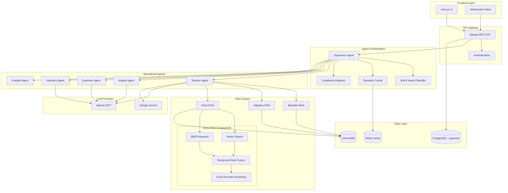

# Hybrid Framework for Autonomous Tutoring with Unified RAG and Conversational LLM

## Abstract

This project presents a comprehensive autonomous tutoring system that leverages a hybrid multi-agent architecture, advanced Retrieval-Augmented Generation (RAG), and conversational Large Language Models (LLMs). The system combines intelligent agent orchestration with three distinct RAG strategies (Baseline, Adaptive, and Omni-RAG) to deliver personalized, context-aware educational experiences. A key differentiator is the **interactive infinite canvas** for visual co-creation with AI, enabling students to draw algorithms and data structures while receiving real-time feedback. The system also features **voice-based interaction** with speech emotion recognition to detect student frustration and adapt responses accordingly. By integrating supervised learning through SetFit classification, semantic caching, and cross-encoder reranking, the framework achieves superior response accuracy and reduced latency. The platform features a modern web-based interface with React-Konva canvas and Monaco code editor, backed by a Django REST API with WebSocket support for real-time communication.

## Key Features

- **Interactive Infinite Canvas**: React-Konva whiteboard for drawing algorithms and data structures with pan/zoom
- **Voice & Emotion Recognition**: CNN-LSTM based speech emotion detection to adapt teaching style
- **Text-to-Speech**: Edge TTS integration for natural voice responses
- **Multi-Agent Architecture**: Supervisor-orchestrated system with specialized agents (Teacher, Analyst, Examiner, Visionary, Empath)
- **Three RAG Strategies**: Baseline, Adaptive (intent-aware), and Omni-RAG (hybrid search with reranking)
- **Intent Classification**: SetFit-based classifier for intelligent query routing
- **Semantic Caching**: Redis-backed cache for response optimization
- **Hybrid Retrieval**: Combined vector similarity and BM25 keyword search with reciprocal rank fusion
- **Cross-Encoder Reranking**: Context-aware relevance scoring for improved accuracy
- **Real-time Communication**: WebSocket support for interactive learning sessions
- **Modern UI/UX**: Responsive Next.js frontend with Monaco code editor integration

## High-Level Architecture



## Project Structure

```
V/
├── backend/                    # Django Backend
│   ├── ai_engine/             # Multi-Agent System
│   │   ├── agents.py          # Agent implementations
│   │   ├── supervisor/        # Supervisor components
│   │   │   ├── classifier.py  # SetFit intent classifier
│   │   │   ├── cache.py       # Semantic cache
│   │   │   ├── complexity.py  # Query complexity analyzer
│   │   │   └── dialogue.py    # Dialogue state tracker
│   │   ├── models/            # ML models
│   │   └── state.py           # Shared state management
│   ├── rag_system/            # RAG Implementation
│   │   ├── hybrid_retriever.py    # Omni-RAG retriever
│   │   ├── __init__.py            # RAG factory
│   │   └── storage/               # Vector store
│   ├── llm_engine/            # LLM Integration
│   │   └── factory.py         # LLM provider factory
│   ├── learning_session/      # Session management
│   ├── users/                 # User authentication
│   └── core/                  # Django core settings
├── frontend/                  # Next.js Frontend
│   ├── app/                   # App router pages
│   ├── components/            # React components
│   ├── hooks/                 # Custom React hooks
│   └── lib/                   # Utility functions
├── brain/                     # Vector database storage
└── Report/                    # Project documentation
    └── docs/                  # Detailed documentation
```

## Technology Stack

### Backend
- **Framework**: Django 5.0 + Django REST Framework + Django Channels (WebSocket)
- **Database**: PostgreSQL with pgvector extension
- **Vector Store**: ChromaDB
- **Cache**: Redis (for semantic caching)
- **ML/AI**: Sentence Transformers, SetFit, Cross-Encoders
- **LLM Providers**: OpenAI GPT-4, Google Gemini
- **Audio/Speech**: librosa (audio features), Wav2Vec2 (emotion), SpeechRecognition (STT), Edge TTS (TTS)

### Frontend
- **Framework**: Next.js 16 (React 19)
- **Styling**: Tailwind CSS
- **Communication**: Axios, WebSocket (react-use-websocket)
- **Interactive Canvas**: React-Konva (infinite whiteboard)
- **Audio**: Web Audio API, MediaRecorder
- **Code Editor**: Monaco Editor
- **Animation**: Framer Motion

### DevOps & Tools
- **Version Control**: Git
- **API Documentation**: Django REST Framework browsable API
- **Environment Management**: python-dotenv

## Getting Started

### Prerequisites
- Python 3.10+
- Node.js 18+
- PostgreSQL 14+ with pgvector extension
- Redis (optional, for caching)

### Backend Setup
```bash
cd backend
pip install -r requirements.txt
python manage.py migrate
python manage.py runserver
```

### Frontend Setup
```bash
cd frontend
npm install
npm run dev
```

### Environment Variables
Create `.env` files in both backend and frontend directories with necessary API keys and configuration.

## Documentation

Detailed documentation is available in the `docs/` directory:

1. [Introduction](docs/01_Introduction.md)
2. [Problem Statement](docs/02_Problem_Statement.md)
3. [System Overview](docs/03_System_Overview.md)
4. [Architecture](docs/04_Architecture.md)
5. [Technology Stack](docs/05_Technology_Stack.md)
6. [Use Cases](docs/06_Use_Cases.md)
7. [Implementation Details](docs/07_Implementation_Details.md)
8. [Results and Analysis](docs/08_Results_and_Analysis.md)
9. [Limitations and Future Work](docs/09_Limitations_and_Future_Work.md)
10. [Conclusion](docs/10_Conclusion.md)

### RAG Strategies
- [Baseline RAG](docs/strategies/Strategy_1_Baseline_RAG.md)
- [Adaptive RAG](docs/strategies/Strategy_2_Adaptive_RAG.md)
- [Omni-RAG](docs/strategies/Strategy_3_Omni_RAG.md)

## Authors

Vaathiyar Team - Final Year Project 2026

## License

This project is developed as part of academic requirements and is subject to institutional guidelines.
