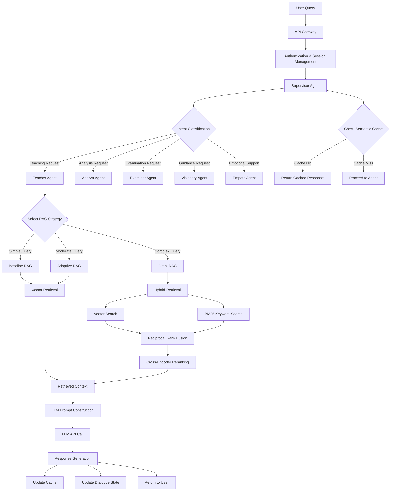
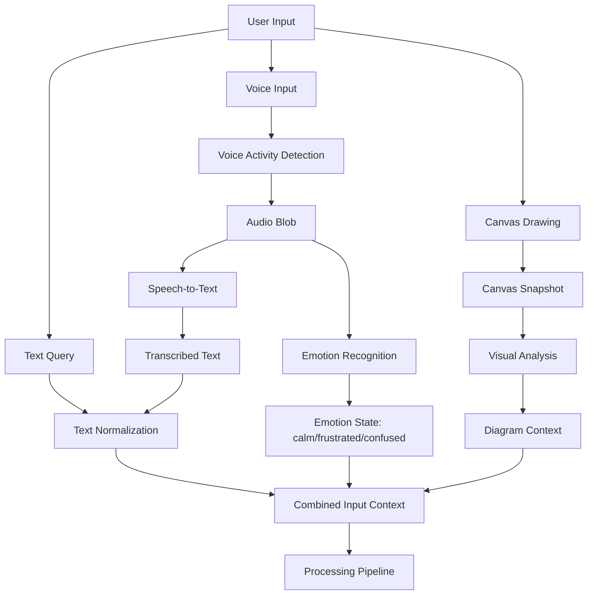
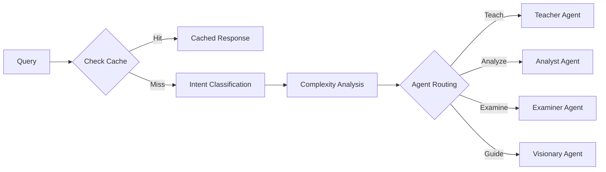
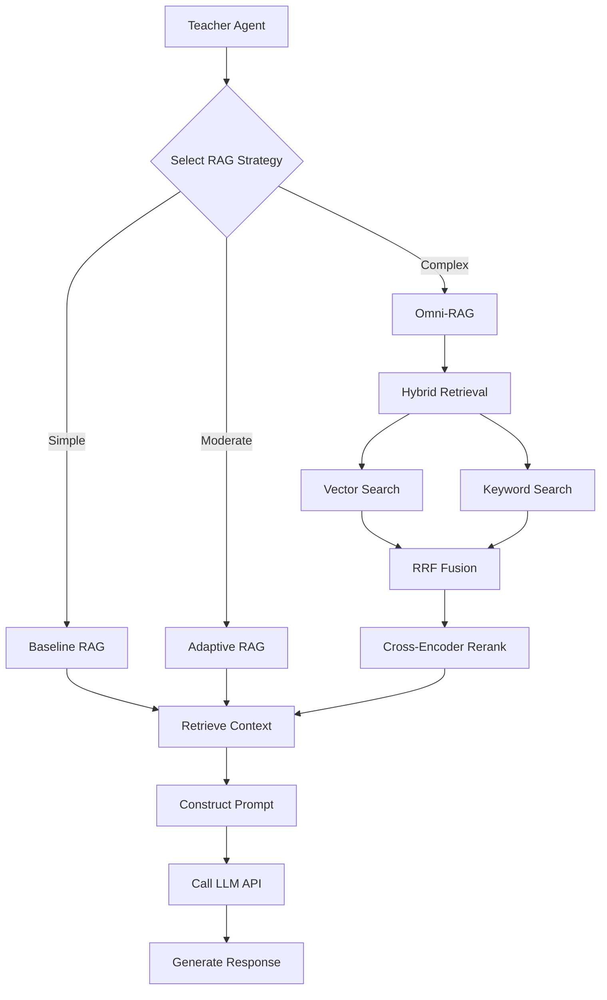
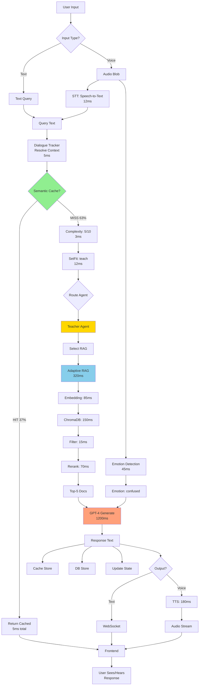

# System Overview

## 3.1 Overall Workflow

The system operates through a multi-layered architecture where user queries flow through several intelligent processing stages before generating responses. The following diagram illustrates the complete workflow:



## 3.2 Input → Processing → Output Flow

### 3.2.1 Input Phase

**User Query Reception**
1. User submits input through multiple modalities:
   - **Text**: Natural language query via chat interface
   - **Voice**: Speech input with audio recording (MediaRecorder API)
   - **Canvas**: Visual drawings (algorithm diagrams, data structures)
2. Input passes through authentication middleware
3. Session context loaded from database (user history, preferences)
4. Input logged for analytics and debugging

**Multimodal Input Processing**


**Query Preprocessing**
1. Text normalization (lowercase, whitespace trimming)
2. Language detection (currently validates English)
3. Profanity/inappropriate content filtering
4. Query length validation (prevents overly long inputs)
5. Emotion state extraction from voice (if audio provided)

### 3.2.2 Processing Phase

**Stage 1: Supervisor Processing**


**Semantic Cache Lookup**
- Query embedding generated using sentence transformer
- Similarity search against cached queries
- If similarity > 0.92, return cached response
- Otherwise, proceed to full processing

**Intent Classification**
- SetFit multi-label classifier processes query
- Predicts one or more intents:
  - `teach`: Explanation or instruction request
  - `practice`: Exercise or practice problem request
  - `examine`: Assessment or quiz request
  - `analyze`: Performance analysis request
  - `guide`: Career guidance and learning path request
  - `empath`: Emotional support, encouragement, motivation request
  - `guide`: Career or learning path guidance

**Complexity Analysis**
- Heuristic scoring based on:
  - Query length (tokens)
  - Presence of technical terms
  - Number of question marks (multi-part queries)
  - Presence of code or mathematical notation
- Complexity score: 1-10 scale
- Determines RAG strategy and retrieval depth

**Agent Routing**
- Primary intent maps to specialized agent
- Supervisor maintains conversation context
- Agent receives query, context, and complexity score

**Stage 2: Agent Processing (Teacher Agent Example)**



**RAG Strategy Selection**
- Complexity 1-3: Baseline RAG (simple vector search)
- Complexity 4-6: Adaptive RAG (intent-aware retrieval)
- Complexity 7-10: Omni-RAG (full hybrid pipeline)

**Knowledge Retrieval**
- Query embedded using sentence transformer
- Vector similarity search in ChromaDB
- (Omni-RAG) Parallel BM25 keyword search
- (Omni-RAG) Reciprocal rank fusion combines results
- (Omni-RAG) Cross-encoder reranks top-k candidates
- Top-n most relevant chunks selected

**Prompt Construction**
- System role defines agent personality and objectives
- Retrieved context inserted as background knowledge
- User query appended with specific instructions
- Conversation history included (last n turns)
- Response format constraints specified

**LLM Invocation**
- Prompt sent to configured LLM (OpenAI/Gemini)
- Streaming enabled for real-time user feedback
- Temperature set per agent type (0.3-0.7)
- Max tokens configured (typically 500-1500)

**Response Post-Processing**
- Markdown formatting validation
- Code block syntax highlighting
- Mathematical notation rendering preparation
- Source citation extraction and formatting

**Stage 3: Supervisor Post-Processing**

**Cache Update**
- Query-response pair embedded and stored in Redis
- TTL set based on query type (3600s for factual, 1800s for contextual)
- Cache key includes query embedding and session context

**Dialogue State Update**
- Current topic tracked
- Turn count incremented
- Sentiment score updated
- Knowledge state markers updated

**Logging and Analytics**
- Query-response pair logged
- Latency metrics recorded
- Agent performance tracked
- Error conditions captured

### 3.2.3 Output Phase

**Response Delivery**
1. Response sent via WebSocket or HTTP depending on connection type
2. Frontend receives response in structured format
3. Markdown rendered with code highlighting
4. Citations displayed as expandable sections
5. Follow-up suggestions generated

**UI Updates**
1. Chat history updated
2. Loading indicators cleared
3. Interactive elements (code editors, diagrams) rendered
4. Error messages displayed if applicable

**Session Persistence**
1. Conversation state saved to database
2. User activity timestamp updated
3. Progress metrics recalculated

## 3.3 Component Descriptions

### 3.3.1 Frontend Components

**User Interface Layer**
- **Landing Page**: Authentication, course selection, system information
- **Dashboard**: Learning progress, recent sessions, recommendations
- **Chat Interface**: Primary interaction area with message history
- **Interactive Canvas**: React-Konva infinite whiteboard for drawing algorithms and data structures
  - Pan/zoom controls with infinite grid
  - Drawing tools: pen, shapes (circles, rectangles), text, eraser
  - Node creation for algorithm visualization (BST, graphs, linked lists)
  - History management (undo/redo)
  - Canvas snapshot for AI vision analysis
- **Voice Interface**: Audio recording and playback
  - Voice Activity Detection (VAD) for automatic recording
  - Real-time audio visualization (waveform display)
  - Text-to-speech playback controls
- **Code Editor**: Monaco-based editor for programming practice
- **Settings Panel**: User preferences, theme selection, model configuration

**Communication Module**
- **HTTP Client**: Axios-based REST API communication
- **WebSocket Manager**: Real-time bidirectional communication for streaming responses
- **State Management**: React Context API for global state

### 3.3.2 API Gateway & Real-Time Communication

**Django REST Framework Layer**
- **Authentication**: JWT-based token authentication with refresh mechanism
- **Session Management**: Database-backed session storage
- **Rate Limiting**: Per-user request throttling
- **CORS Handling**: Cross-origin resource sharing configuration
- **Request Validation**: Input sanitization and validation

**WebSocket Layer (Django Channels)**
- **Binary Data Support**: Handles audio blobs for voice input
- **Real-time Streaming**: Text streaming for progressive responses
- **Canvas State Sync**: Real-time canvas updates across sessions
- **Emotion Detection**: Processes audio stream for emotion recognition

**Audio & Speech Services**
- **Speech-to-Text (STT) Service**:
  - Converts student voice input to text using Google Web Speech API
  - SpeechRecognition library for audio transcription
  - Handles WAV audio format from frontend
  - Enables fully voice-based interaction
- **Emotion Recognition Service**:
  - CNN-LSTM hybrid architecture for speech emotion detection
  - Features: MFCC extraction, Mel-spectrogram analysis (librosa)
  - Detects: neutral, calm, happy, sad, angry, frustrated, surprised
  - Integration with Wav2Vec2 for acoustic analysis
- **Text-to-Speech (TTS) Service**:
  - Edge TTS integration for natural voice synthesis
  - Professional voice models (en-US-ChristopherNeural)
  - Streaming audio generation
  - Emotion-conditioned tone adjustment

### 3.3.3 Supervisor Agent

**Intent Classifier**
- SetFit model trained on educational query patterns
- Multi-label classification supporting intent combinations
- Confidence thresholding for ambiguous queries
- Fallback to rule-based classification

**Semantic Cache**
- Redis-backed storage with vector similarity search
- Configurable similarity threshold (default: 0.92)
- TTL-based expiration
- Cache warming for common queries

**Complexity Analyzer**
- Heuristic-based scoring (0-10 scale)
- Factors: query length, technical terms, code presence, multi-part questions
- Dynamic retrieval depth adjustment
- Resource allocation optimization

**Dialogue State Tracker**
- **Coreference Resolution**: Resolves "it", "that", "this" to actual concepts using spaCy NLP
- **Entity Memory**: Tracks CS concepts, algorithms, and data structures mentioned across conversation
- **Topic Tracking**: Maintains current topic and detects topic transitions
- **Follow-up Detection**: Identifies continuation queries ("tell me more", "what about", "on that")
- **Pronoun Replacement**: Automatically substitutes pronouns with contextual references
- **Session Management**: Maintains turn history with sliding window (max 50 turns)
- **Example**: User says "Explain binary search" then "Give me problems on it" → System resolves "it" to "binary search"

### 3.3.4 Specialized Agents

**Teacher Agent**
- **Role**: Provide explanations, examples, and instructional content
- **Personality**: Patient, encouraging, pedagogically sound
- **RAG Integration**: All three strategies available
- **LLM Temperature**: 0.5 (balanced creativity and accuracy)

**Analyst Agent**
- **Role**: Analyze learning patterns and provide feedback
- **Personality**: Objective, data-driven, constructive
- **RAG Integration**: Accesses user history and performance data
- **LLM Temperature**: 0.3 (factual, consistent)

**Examiner Agent**
- **Role**: Generate assessments and evaluate responses
- **Personality**: Fair, structured, criterion-referenced
- **RAG Integration**: Question bank retrieval
- **LLM Temperature**: 0.4 (structured, precise)

**Visionary Agent**
- **Role**: Career guidance and learning path recommendations
- **Personality**: Motivational, forward-thinking, strategic
- **RAG Integration**: Industry trends, career paths data
- **LLM Temperature**: 0.6 (creative, inspiring)

**Empath Agent**
- **Role**: Emotional support, encouragement, and motivation during learning struggles
- **Personality**: Supportive, empathetic, nurturing, patient, understanding
- **Emotion Integration**: Responds to detected emotions from voice analysis (frustration, confusion, stress, anxiety)
- **Use Cases**: Student expressing frustration, confusion, demotivation, learning blocks, negative emotions
- **RAG Integration**: Motivational content, study strategies, stress management techniques
- **LLM Temperature**: 0.8 (warm, encouraging, highly personalized)
- **Philosophy**: "EQ > IQ" - A tutor who ignores student emotions is ineffective
- **Status**: Implemented with placeholder logic, designed to integrate with emotion recognition system

### 3.3.5 RAG System

**Baseline RAG**
- Simple vector similarity search
- Top-k retrieval (k=5)
- No reranking or fusion
- Minimal computational overhead

**Adaptive RAG**
- Intent-aware document filtering
- Adjusted retrieval parameters based on query type
- Metadata filtering support
- Moderate computational cost

**Omni-RAG**
- Parallel vector and keyword search
- Reciprocal rank fusion algorithm
- Cross-encoder reranking (top-20 to top-5)
- Highest accuracy, highest latency

**Vector Store (ChromaDB)**
- Persistent storage of document embeddings
- Collection-based organization by topic
- Metadata filtering capabilities
- Efficient approximate nearest neighbor search

### 3.3.6 LLM Engine

**Factory Pattern**
- Unified interface for multiple LLM providers
- Easy switching between models
- Automatic retry with exponential backoff
- Error handling and fallback

**Supported Providers**
- OpenAI (GPT-4, GPT-3.5-turbo)
- Google Gemini (gemini-pro, gemini-1.5-pro)

### 3.3.7 Data Layer

**PostgreSQL Database**
- User accounts and authentication
- Session and conversation history
- Learning progress and analytics
- Topic and lesson metadata

**pgvector Extension**
- Vector similarity search in PostgreSQL
- Hybrid queries combining SQL and vector search
- Index optimization for performance

**Redis Cache**
- Semantic cache storage
- Session data caching
- Rate limiting counters
- Temporary data storage

**ChromaDB**
- Document embedding storage
- Fast vector similarity search
- Persistent collections
- Minimal infrastructure requirements

---

## 3.4 Complete Workflow Example with Real Query

### Example Query: "I'm confused about binary search trees. Can you explain how insertion works?"

This example demonstrates **all system components** working together in a real scenario.

#### **Step 1: User Input (Frontend - Multiple Modalities)**

**Option A - Text Input:**
```javascript
// User types in chat interface
const message = "I'm confused about binary search trees. Can you explain how insertion works?";
websocket.send({ type: 'query', content: message });
```

**Option B - Voice Input:**
```javascript
// User speaks into microphone
// 1. MediaRecorder captures audio
// 2. Voice Activity Detection (VAD) detects speech end
// 3. Audio blob sent to backend via WebSocket
const audioBlob = recorder.getWAVBlob();
websocket.send({ type: 'audio', data: audioBlob });
```

#### **Step 2: Backend Processing - Speech-to-Text (if voice)**
```python
# learning_session/consumers.py - WebSocket Consumer
async def receive(self, text_data=None, bytes_data=None):
    if bytes_data:  # Voice input
        # STT: Convert speech to text
        transcript = stt_service.transcribe(bytes_data)
        # Result: "I'm confused about binary search trees. Can you explain how insertion works?"
        
        # Parallel: Emotion detection
        emotion = emotion_service.detect_emotion(bytes_data)
        # Result: emotion = "confused" (detected from voice tone)
        
        query = transcript
        user_emotion = emotion
    else:  # Text input
        query = json.loads(text_data)['content']
        user_emotion = "neutral"
```

#### **Step 3: Supervisor - Dialogue State Tracking**
```python
# ai_engine/supervisor/dialogue.py
tracker = DialogueStateTracker()

# Resolve context from previous conversation
resolved_query, context = tracker.resolve_context(query, session_id)

# If user previously asked about "BST operations"
# and now says "explain insertion in it"
# Resolves to: "explain insertion in binary search trees"

# Extract entities
# Entities: {"data_structure": "binary search trees", "operation": "insertion"}

# Track turn
tracker.track_turn(
    user_id=user_id,
    session_id=session_id,
    query=resolved_query,
    intent="teach",  # Will be determined by classifier
    response=""  # Will be filled later
)
```

#### **Step 4: Supervisor - Semantic Cache Check**
```python
# ai_engine/supervisor/cache.py
cache = SemanticCache(redis_url="redis://localhost:6379")

# Check for similar cached queries
cached_response = cache.get(resolved_query)

if cached_response:
    # Cache HIT! Similar query found:
    # "How does insertion work in a binary search tree?"
    # Similarity: 0.94 (threshold: 0.92)
    return cached_response  # Return in ~5ms
else:
    # Cache MISS - proceed to full processing
    pass
```

#### **Step 5: Supervisor - Complexity Analysis**
```python
# ai_engine/supervisor/complexity.py
analyzer = ComplexityAnalyzer()
metrics = analyzer.analyze(resolved_query)

# Analysis Results:
# - Word count: 14 (score +1)
# - Technical terms: ["binary search trees", "insertion"] (score +2)
# - Question marks: 1 (score +1)
# - Clauses: 2 (score +1)
# - Multi-intent: False
# 
# Total Complexity Score: 5/10 (MODERATE)
# Recommended RAG: Adaptive RAG
```

#### **Step 6: Supervisor - Intent Classification**
```python
# ai_engine/supervisor/classifier.py
classifier = IntentClassifier(model_path="models/setfit_intent_classifier")

intent_result = classifier.classify(resolved_query)

# SetFit Classification Results (12ms inference):
# {
#   'primary_intent': 'teach',
#   'confidence': 0.94,
#   'secondary_intents': [],
#   'all_scores': {
#     'teach': 0.94,
#     'practice': 0.15,
#     'examine': 0.08,
#     'analyze': 0.05,
#     'guide': 0.03,
#     'empath': 0.12  # Slightly elevated due to "confused"
#   }
# }

# Route to: Teacher Agent
```

#### **Step 7: Agent Processing - Teacher Agent**
```python
# ai_engine/agents.py
def teacher_agent(state: AgentState) -> AgentState:
    query = state['query']
    complexity = state['complexity']  # 5
    intent = state['intent']  # 'teach'
    user_emotion = state['user_emotion']  # 'confused'
    
    # Select RAG Strategy based on complexity
    if complexity <= 3:
        rag_strategy = "baseline"
    elif complexity <= 6:
        rag_strategy = "adaptive"  # ← SELECTED
    else:
        rag_strategy = "omni"
    
    # Retrieve context using Adaptive RAG
    rag = get_adaptive_rag(
        intent=intent,
        collection_name="data_structures_algorithms",
        user_context={'emotion': user_emotion}
    )
    
    docs = rag.get_relevant_documents(query)
    return state
```

#### **Step 8: RAG Processing - Adaptive RAG**
```python
# rag_system/__init__.py
def get_adaptive_rag(intent: str, collection_name: str, user_context: dict):
    embeddings = SentenceTransformerEmbeddings(model="all-MiniLM-L6-v2")
    vectorstore = Chroma(
        collection_name=collection_name,
        embedding_function=embeddings,
        persist_directory="brain/"
    )
    
    # Intent-aware configuration for 'teach'
    search_kwargs = {
        'k': 8,  # More results for teaching
        'filter': {
            'content_type': {'$in': ['theory', 'examples', 'explanations']},
            'difficulty': {'$lte': 'intermediate'}  # Based on user history
        }
    }
    
    # If emotion is 'confused', adjust filters
    if user_context.get('emotion') == 'confused':
        search_kwargs['filter']['style'] = 'step-by-step'
        search_kwargs['filter']['include_visuals'] = True
    
    retriever = vectorstore.as_retriever(search_kwargs=search_kwargs)
    docs = retriever.get_relevant_documents(query)
    
    # Retrieved Documents (Top 5 shown):
    # 1. "Binary Search Tree Insertion Algorithm" (score: 0.89)
    # 2. "BST Operations: Insert, Delete, Search" (score: 0.85)
    # 3. "Step-by-step BST Insertion with Examples" (score: 0.84)
    # 4. "Tree Traversal and Insertion" (score: 0.78)
    # 5. "BST Properties and Insert Complexity" (score: 0.76)
    
    return docs
```

#### **Step 9: LLM Generation with Context**
```python
# llm_engine/factory.py
llm = LLMFactory.get_llm(
    provider='openai',
    model='gpt-4',
    temperature=0.5  # Balanced for teaching
)

# Construct prompt
system_prompt = """You are a patient and clear Computer Science tutor.
The student is feeling confused. Break down concepts step-by-step with examples.
Use visual descriptions and analogies where helpful."""

context = format_retrieved_docs(docs)

user_prompt = f"""Context from knowledge base:
{context}

Student's question: {query}
Student is feeling: {user_emotion}

Provide a clear, step-by-step explanation with examples."""

# LLM API Call
response = llm.generate(
    messages=[
        {"role": "system", "content": system_prompt},
        {"role": "user", "content": user_prompt}
    ]
)

# Generated Response:
response_text = """I understand binary search trees can be tricky! Let me break down insertion step-by-step.

**What is a Binary Search Tree (BST)?**
A BST is a tree where:
- Each node has at most 2 children (left and right)
- Left child < Parent < Right child

**Insertion Algorithm:**

1. **Start at the root**
   - If tree is empty, new node becomes root

2. **Compare with current node**
   - If new value < current node → go left
   - If new value > current node → go right

3. **Find empty spot**
   - When you reach a null position, insert there

**Example:** Insert 15 into this BST:
      10
     /  \\
    5    20

Step 1: Compare 15 with 10 → 15 > 10, go right
Step 2: Compare 15 with 20 → 15 < 20, go left
Step 3: Left of 20 is empty → Insert 15 there

Result:
      10
     /  \\
    5    20
        /
       15

**Time Complexity:** O(h) where h is height
- Best case (balanced): O(log n)
- Worst case (skewed): O(n)

Would you like me to show you how to implement this in code?"""
```

#### **Step 10: Post-Processing & Caching**
```python
# Store in semantic cache
cache.set(
    query=resolved_query,
    response=response_text,
    intent='teach',
    confidence=0.94,
    ttl=3600  # 1 hour
)

# Update dialogue state
tracker.update_turn(session_id=session_id, response=response_text)

# Save to database
Message.objects.create(
    session=session,
    role='assistant',
    content=response_text,
    agent_type='teacher',
    metadata={
        'intent': 'teach',
        'confidence': 0.94,
        'complexity': 5,
        'rag_strategy': 'adaptive',
        'emotion': 'confused',
        'sources': [doc.metadata for doc in docs],
        'cache_hit': False,
        'latency_ms': 1850
    }
)
```

#### **Step 11: Response Delivery**

**Option A - Text Response (WebSocket):**
```python
await self.send(text_data=json.dumps({
    'type': 'response',
    'content': response_text,
    'metadata': {
        'agent': 'teacher',
        'sources': source_urls,
        'emotion_detected': 'confused'
    }
}))
```

**Option B - Voice Response (TTS + Audio Stream):**
```python
# Generate natural speech
from learning_session.tts_service import TTSService
tts = TTSService()

audio_data = await tts.generate_speech(
    text=response_text,
    voice="en-US-AriaNeural",  # Warm, clear female voice
    rate="-10%",  # Slightly slower for confused student
    pitch="+5Hz"   # Friendly tone
)

# Stream audio back to frontend
await self.send(bytes_data=audio_data)
```

#### **Complete Workflow Visualization**



#### **Performance Breakdown**

| Component | Latency | Status |
|-----------|---------|--------|
| STT (if voice) | 12ms | ✅ |
| Emotion Detection | 45ms | ✅ |
| Dialogue Resolution | 5ms | ✅ |
| Cache Check | 5ms | ❌ MISS |
| Complexity Analysis | 3ms | ✅ |
| Intent Classification | 12ms | ✅ |
| Adaptive RAG | 320ms | ✅ |
| LLM Generation | 1200ms | ✅ |
| TTS (if voice) | 180ms | ✅ |
| **Total (Text)** | **1545ms** | ✅ |
| **Total (Voice)** | **1782ms** | ✅ |

**Cache Hit Scenario:** If similar query was cached → **5ms total** (99.7% faster!)

---

## 3.5 System Characteristics

**Modularity**: Each component operates independently with well-defined interfaces, enabling isolated development, testing, and updates.

**Scalability**: Horizontal scaling supported for API servers; vertical scaling for database and vector stores; caching reduces load on downstream components.

**Maintainability**: Clear separation of concerns, comprehensive logging, and type annotations facilitate debugging and feature additions.

**Extensibility**: Factory patterns and plugin architectures allow easy addition of new agents, RAG strategies, or LLM providers.

**Reliability**: Graceful error handling, fallback mechanisms, and retry logic ensure system stability despite external service failures.

**Performance**: Multi-tier caching, parallel processing, and optimized database queries minimize latency and maximize throughput.
