# Architecture

## 4.1 Detailed System Architecture

The system architecture follows a microservices-inspired design with clear separation between presentation, business logic, and data layers. The architecture emphasizes modularity, enabling independent scaling and maintenance of components.

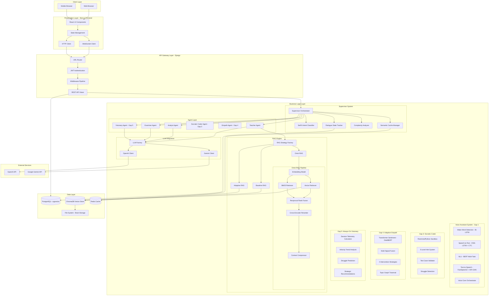

## 4.1.1 Multimodal Interaction Architecture

The system supports three input modalities: text, voice, and visual canvas. The following diagram shows the complete multimodal data flow:

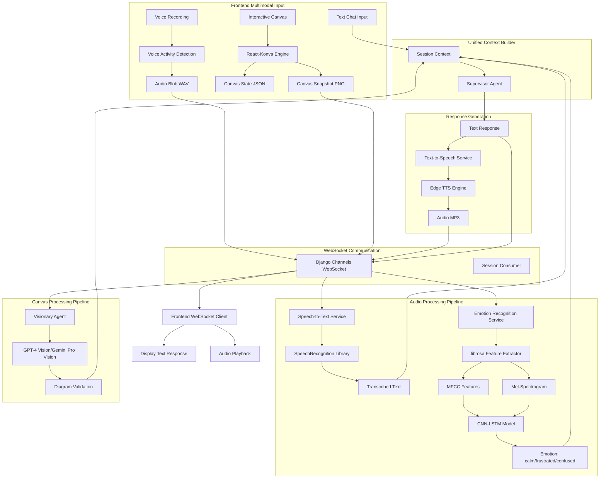

**Key Multimodal Features:**

1. **Complete Voice Interaction Loop**
   - **Speech-to-Text (STT)**: Google Web Speech API converts student speech to text
   - **Emotion Recognition**: CNN-LSTM analyzes tone, pitch, and rhythm in parallel
   - **Text-to-Speech (TTS)**: Edge TTS generates natural voice responses
   - Enables fully hands-free voice-based tutoring sessions

2. **Voice Emotion Recognition**
   - Real-time audio capture via Web Audio API
   - Voice Activity Detection triggers recording automatically
   - CNN-LSTM model analyzes tone, pitch, and rhythm
   - Detects emotional states: neutral, calm, happy, frustrated, confused, angry
   - Emotion state influences AI response tone and scaffolding level

3. **Interactive Canvas**
   - Infinite pan/zoom grid for algorithm visualization
   - Drawing tools: pen, shapes (circles, rectangles), text, eraser
   - Specialized node creation for data structures (BST, graphs, linked lists)
   - History management (undo/redo) with state persistence
   - Real-time canvas snapshot for AI vision analysis

4. **Canvas-AI Co-Creation**
   - Student draws algorithm/diagram on canvas
   - System captures canvas state as JSON + PNG snapshot
   - Visionary agent analyzes drawing correctness
   - AI provides visual feedback and corrections
   - Supports collaborative debugging of visual concepts

## 4.2 Data Flow Diagram

### 4.2.1 User Query Processing Flow

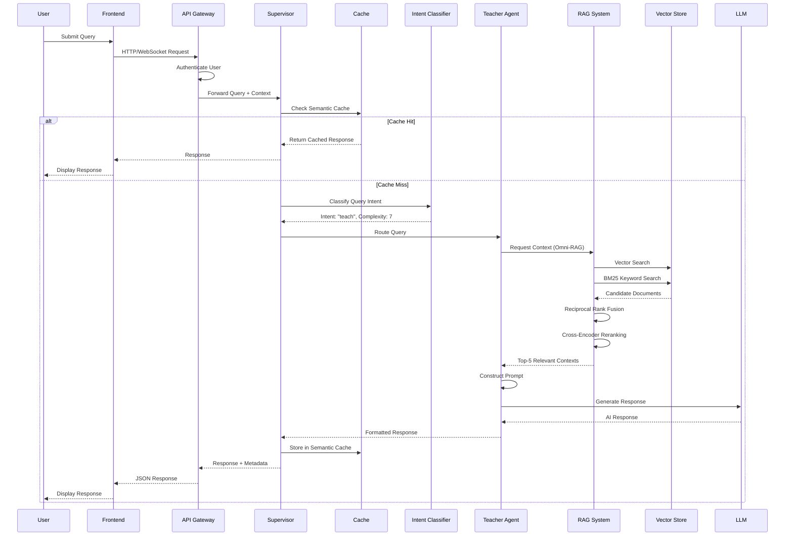

### 4.2.2 Knowledge Ingestion Flow

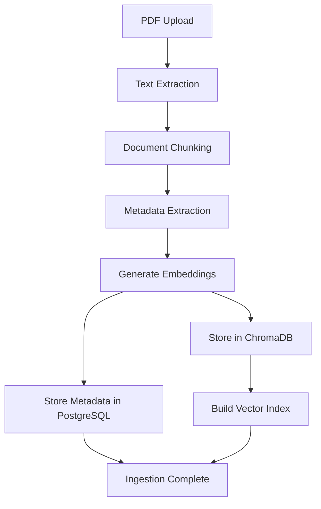

### 4.2.3 Multi-Agent Collaboration Flow

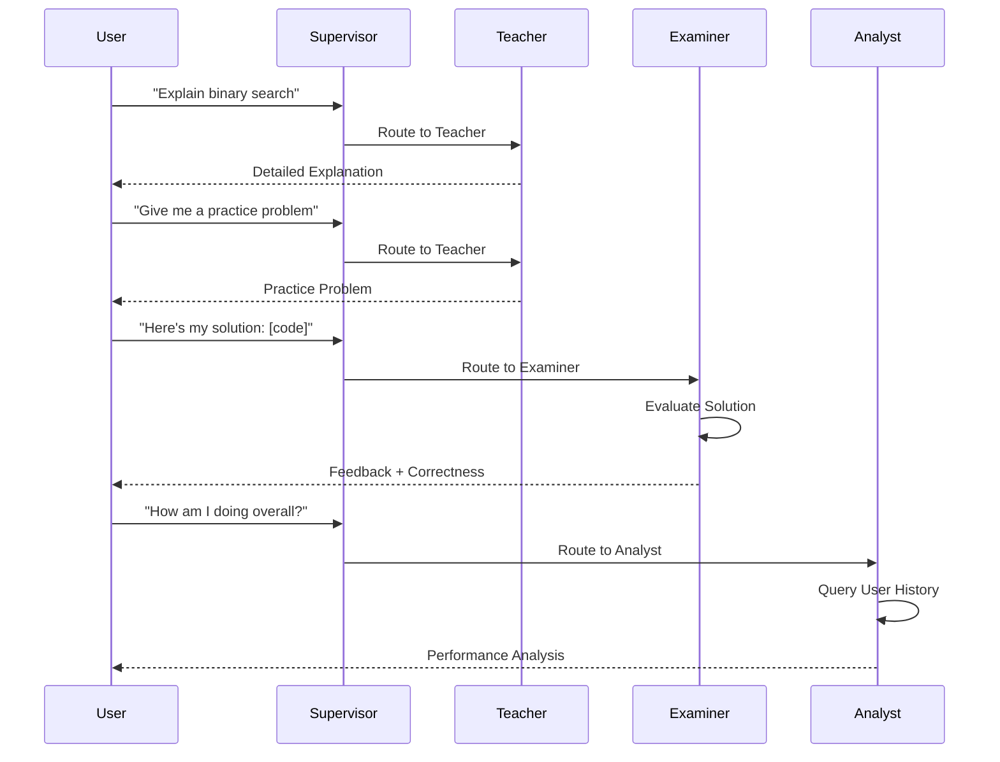

## 4.3 Component Interaction Diagram

### 4.3.1 Supervisor-Agent Interaction

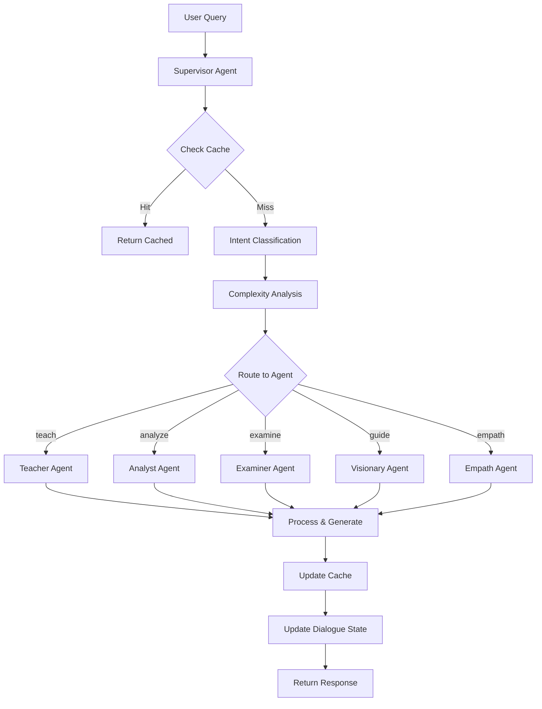

### 4.3.2 RAG Strategy Selection

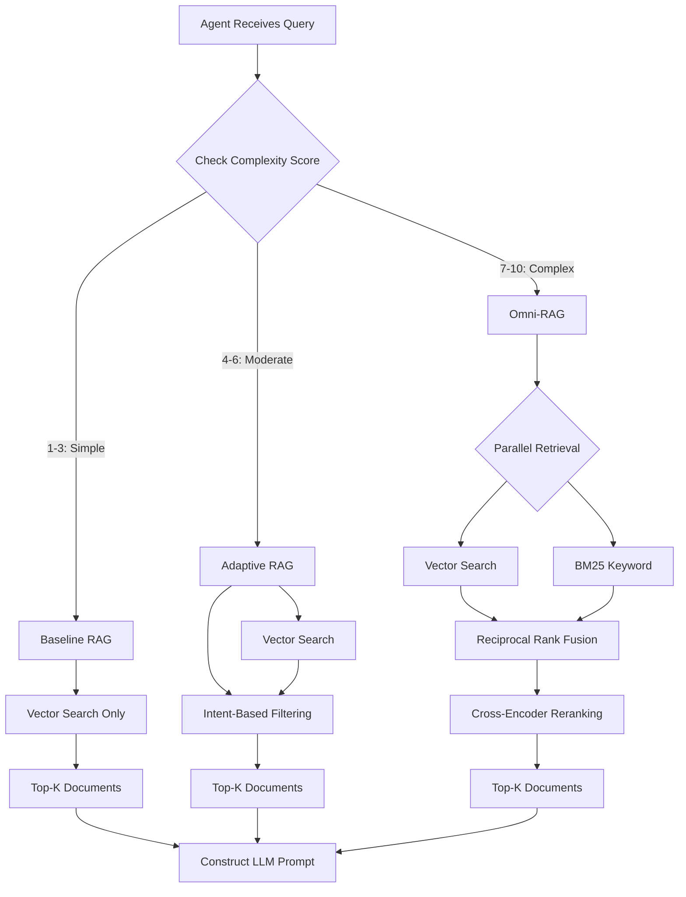

### 4.3.3 Omni-RAG Internal Architecture

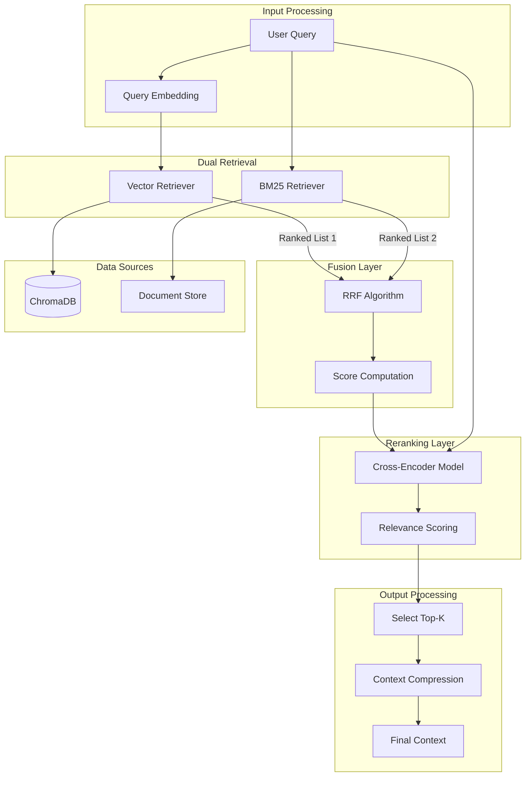

## 4.4 Database Schema

### 4.4.1 Core Tables

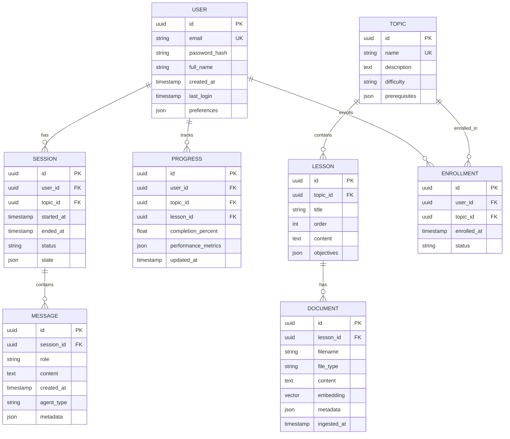

### 4.4.2 Vector Storage Structure

**ChromaDB Collections:**
```
brain/
├── {topic_id_1}/
│   └── chroma.sqlite3          # Vector embeddings for topic 1
├── {topic_id_2}/
│   └── chroma.sqlite3          # Vector embeddings for topic 2
└── ...
```

**Collection Metadata:**
- Document ID (UUID)
- Source filename
- Page number (for PDFs)
- Chunk index
- Topic ID
- Timestamp

## 4.5 Security Architecture

### 4.5.1 Authentication Flow

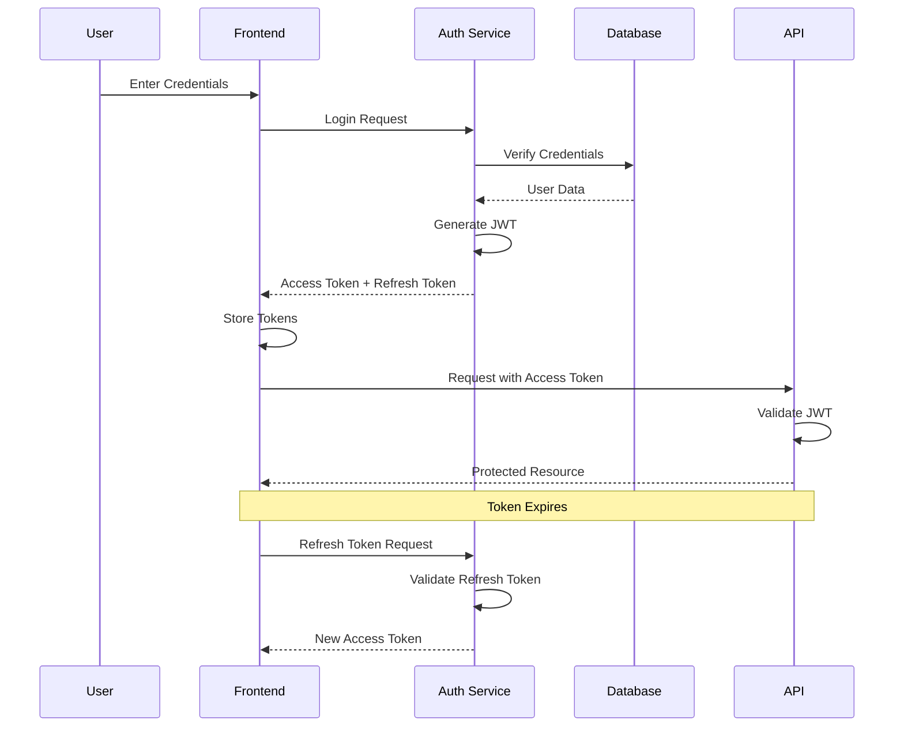

### 4.5.2 Security Layers

**Transport Security:**
- HTTPS/TLS encryption for all communications
- WebSocket Secure (WSS) for real-time connections
- CORS configuration with whitelist

**Application Security:**
- JWT-based stateless authentication
- Password hashing with bcrypt
- SQL injection prevention (parameterized queries)
- XSS protection (input sanitization)
- CSRF protection (Django middleware)

**Data Security:**
- Database encryption at rest
- Sensitive environment variables (API keys)
- Rate limiting per user/IP
- Input validation and sanitization

## 4.6 Scalability Considerations

### 4.6.1 Horizontal Scaling

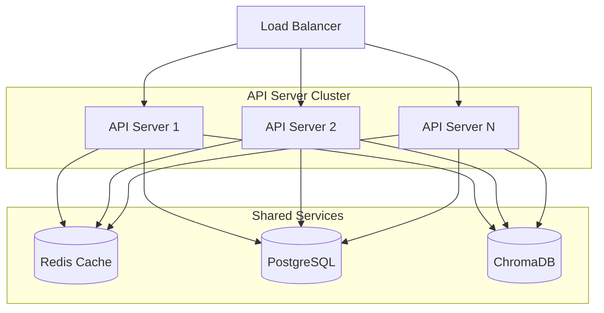

**Scaling Strategies:**
- **API Layer**: Stateless design enables horizontal scaling with load balancer
- **Cache Layer**: Redis cluster for distributed caching
- **Database**: Read replicas for query distribution
- **Vector Store**: Sharding by topic/subject for parallel queries

### 4.6.2 Performance Optimization

**Caching Hierarchy:**
1. **L1**: In-memory cache (per server instance)
2. **L2**: Redis semantic cache (shared)
3. **L3**: Database query cache

**Async Processing:**
- Background tasks for non-critical operations (analytics, logging)
- Celery task queue for heavy computations
- Streaming responses for real-time feedback

**Database Optimization:**
- Indexed columns (user_id, topic_id, session_id)
- Connection pooling
- Query optimization with EXPLAIN ANALYZE
- Materialized views for complex aggregations

## 4.7 Deployment Architecture

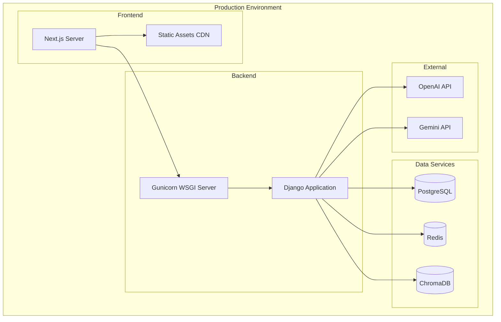

**Deployment Stack:**
- **Web Server**: Nginx (reverse proxy, static files)
- **Application Server**: Gunicorn with async workers
- **Process Manager**: Systemd or Supervisor
- **Container**: Docker (optional for containerization)
- **Orchestration**: Docker Compose or Kubernetes (production)

---

## 4.8 Critical Gap 1: Voice + Canvas Synchronization Architecture

### 4.8.1 Overview

This architecture addresses the challenge of synchronizing voice-based teaching with handwritten canvas animations, creating a notebook-style learning experience where the AI teacher's voice narration is perfectly synchronized with visual content appearing on the canvas.

### 4.8.2 Architecture Components

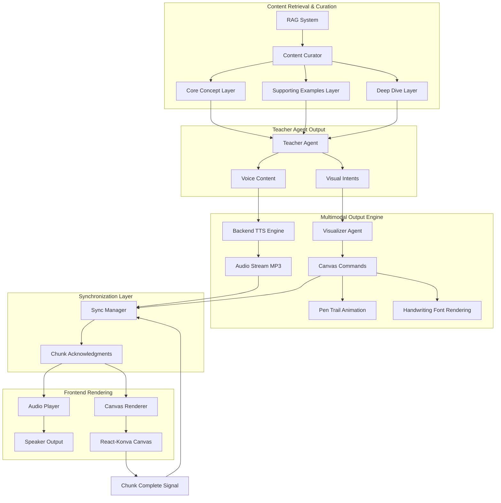

### 4.8.3 Teacher Output Structure (Hybrid Approach)

The Teacher Agent outputs structured multimodal content:

```json
{
  "teaching_chunks": [
    {
      "id": "chunk_1",
      "voice_content": "Let's understand binary search. It's a divide and conquer algorithm.",
      "visual_intents": [
        {
          "action": "write_heading",
          "content": "Binary Search",
          "style": "handwriting",
          "position": {"x": 100, "y": 50}
        },
        {
          "action": "draw_divider",
          "style": "underline"
        }
      ],
      "pacing": "normal",
      "wait_for_completion": true
    },
    {
      "id": "chunk_2",
      "voice_content": "We start with a sorted array. Here's an example.",
      "visual_intents": [
        {
          "action": "write_array",
          "content": "[1, 3, 5, 7, 9, 11, 13]",
          "style": "handwriting",
          "animate": "pen_trail"
        }
      ],
      "pacing": "normal",
      "wait_for_completion": true
    }
  ],
  "depth_level": "core",
  "student_level": "beginner"
}
