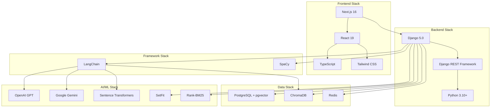

# Technology Stack

## 5.1 Backend Technologies

### 5.1.1 Django 5.0

**Why Chosen:**
- Mature, battle-tested web framework with extensive ecosystem
- Built-in ORM simplifies database operations and migrations
- Excellent security features (CSRF, XSS, SQL injection protection)
- Django REST Framework provides robust API development tools
- Strong community support and comprehensive documentation

**Role in System:**
- Core web application framework
- RESTful API implementation
- Database schema management through migrations
- User authentication and session management
- Middleware pipeline for request/response processing

**Alternatives Considered:**
- **Flask**: More lightweight but requires more manual configuration for production features
- **FastAPI**: Excellent performance but less mature ecosystem for complex applications
- **Node.js/Express**: JavaScript-based but team expertise favored Python

### 5.1.2 Django REST Framework (DRF)

**Why Chosen:**
- Seamless integration with Django
- Built-in serialization and validation
- Browsable API for development and testing
- Authentication and permission classes
- ViewSets and routers reduce boilerplate

**Role in System:**
- API endpoint definitions
- Request/response serialization
- Authentication token management
- API versioning and documentation
- Throttling and rate limiting

**Alternatives Considered:**
- **Django Ninja**: FastAPI-like syntax but less mature
- **GraphQL (Graphene)**: Overengineered for current requirements

### 5.1.2.1 Django Channels

**Why Chosen:**
- Official Django extension for WebSocket support
- ASGI-based for async real-time communication
- Seamless integration with Django authentication
- Channel layers enable cross-process communication
- Supports binary data (audio) and text streaming

**Role in System:**
- WebSocket connection management
- Real-time bidirectional communication
- Binary audio data handling for voice input
- Canvas state synchronization
- Streaming response delivery

**Alternatives Considered:**
- **Socket.IO**: Requires separate server, complicates deployment
- **FastAPI WebSockets**: Would require separate backend service
- **Pure ASGI**: Lower-level, more implementation effort

### 5.1.3 PostgreSQL with pgvector

**Why Chosen:**
- Robust ACID-compliant relational database
- pgvector extension enables vector similarity search directly in SQL
- Excellent performance for hybrid queries (structured + vector data)
- Strong consistency guarantees
- Rich query capabilities and indexing options

**Role in System:**
- Primary data store for users, sessions, messages
- Vector similarity search using pgvector extension
- Complex analytical queries across structured data
- Transaction management for data integrity

**Alternatives Considered:**
- **MySQL**: Limited vector search capabilities
- **MongoDB**: NoSQL benefits not required for structured educational data
- **Separate vector DB (Pinecone, Weaviate)**: Additional operational complexity

### 5.1.4 ChromaDB

**Why Chosen:**
- Lightweight, embeddable vector database
- Excellent Python integration
- Persistent storage with minimal setup
- Collection-based organization aligns with topic structure
- No external server dependencies for small-medium deployments

**Role in System:**
- Document embedding storage
- Fast approximate nearest neighbor search
- Topic-wise collection organization
- Metadata filtering during retrieval

**Alternatives Considered:**
- **FAISS**: Lower-level library requiring more implementation effort
- **Pinecone**: Cloud-hosted, introduces latency and costs
- **Qdrant**: More complex setup for current requirements

### 5.1.5 Redis

**Why Chosen:**
- In-memory data structure store with sub-millisecond latency
- Built-in support for TTL (time-to-live) expiration
- Atomic operations for concurrent access
- Pub/Sub for real-time features
- Persistence options for cache recovery

**Role in System:**
- Semantic cache storage with vector similarity
- Session data caching
- Rate limiting counters
- Temporary data storage for async tasks

**Alternatives Considered:**
- **Memcached**: Lacks advanced data structures and persistence
- **In-memory Python dict**: No persistence, not shared across processes

### 5.1.6 SpeechRecognition (Speech-to-Text)

**Why Chosen:**
- Simple, unified API for multiple STT engines
- Google Web Speech API integration (free tier available)
- Supports multiple audio formats (WAV, FLAC, MP3)
- Synchronous and asynchronous operation
- Built-in audio file handling

**Role in System:**
- Converts student voice input to text
- Enables fully voice-based question asking
- Transcribes audio blobs from frontend
- Provides accessibility for typing-challenged users

**Alternatives Considered:**
- **OpenAI Whisper**: Higher accuracy but requires local model (large download) or API costs
- **Google Cloud Speech-to-Text**: Requires API key setup and billing
- **Azure Speech Services**: Paid service, complex authentication
- **Browser Web Speech API**: Works in frontend but limited accuracy and browser support

### 5.1.7 librosa (Audio Processing)

**Why Chosen:**
- Industry-standard Python library for audio analysis
- Comprehensive feature extraction (MFCC, Mel-spectrogram, chroma)
- Excellent documentation and research community support
- Optimized NumPy-based computation
- Compatible with ML frameworks (PyTorch, TensorFlow)

**Role in System:**
- Audio loading and resampling
- MFCC (Mel-Frequency Cepstral Coefficients) extraction for emotion detection
- Mel-spectrogram generation for CNN input
- Audio feature engineering for emotion recognition pipeline

**Alternatives Considered:**
- **torchaudio**: PyTorch-specific, less feature-rich
- **scipy.signal**: Lower-level, requires more manual implementation
- **pyAudioAnalysis**: Less maintained, limited features

### 5.1.8 Edge TTS (Text-to-Speech)

**Why Chosen:**
- Free, no API key required
- High-quality neural voices from Microsoft Edge
- Async Python API for non-blocking generation
- Multiple language and voice options
- Streaming audio generation

**Role in System:**
- Natural voice synthesis from text responses
- Audio response generation for auditory learners
- Emotion-aware voice selection
- Streaming MP3 audio to frontend

**Alternatives Considered:**
- **Google Text-to-Speech**: Requires API key, costs money
- **Amazon Polly**: Paid service, complex setup
- **gTTS**: Lower quality, limited voice options
- **OpenAI TTS**: Expensive for high volume usage

### 5.1.9 Wav2Vec2 (Speech Emotion Recognition)

**Why Chosen:**
- State-of-the-art self-supervised speech representation
- Pre-trained on large speech corpora
- Fine-tunable for emotion recognition
- HuggingFace Transformers integration
- Strong performance on emotion classification

**Role in System:**
- Acoustic feature extraction from voice input
- Emotion classification (calm, frustrated, confused, happy, angry)
- Adaptation of AI response tone based on detected emotion
- Real-time emotion tracking during learning sessions

**Alternatives Considered:**
- **Custom CNN-LSTM**: Requires training data and model development
- **OpenSMILE**: Traditional handcrafted features, less accurate
- **SpeechBrain**: Similar capabilities but larger model footprint

### 5.1.10 LangChain Community

**Why Chosen:**
- Standardized abstractions for RAG components
- Pre-built retrievers, document loaders, and text splitters
- Easy integration with multiple LLM providers
- Active development and community contributions

**Role in System:**
- Document loading and chunking
- Vector store abstractions
- Retriever implementations
- Prompt template management

**Alternatives Considered:**
- **LlamaIndex**: More focused on data connectors, less flexible for custom RAG
- **Custom implementation**: Reinventing well-tested components

### 5.1.7 Sentence Transformers

**Why Chosen:**
- State-of-the-art embedding models for semantic search
- Pre-trained models optimized for various tasks
- Efficient batch processing
- Supports cross-encoder models for reranking

**Role in System:**
- Query and document embedding generation
- Cross-encoder reranking in Omni-RAG
- Semantic cache similarity computation

**Alternatives Considered:**
- **OpenAI Embeddings API**: Higher latency and costs for frequent operations
- **Universal Sentence Encoder**: TensorFlow dependency, larger model size

### 5.1.8 SetFit (Sentence Transformer Fine-tuning)

**Why Chosen:**
- Few-shot learning capabilities with limited training data
- Efficient fine-tuning of sentence transformers
- Superior performance on small datasets compared to traditional classifiers
- Multi-label classification support

**Role in System:**
- Intent classification from user queries
- Multi-label prediction for complex queries
- Confidence scoring for ambiguous intents

**Alternatives Considered:**
- **BERT-based classifiers**: Require more training data and computational resources
- **Rule-based systems**: Lack flexibility and require extensive manual rules

### 5.1.9 Rank-BM25

**Why Chosen:**
- Proven keyword-based retrieval algorithm
- Complements vector search for lexical matching
- No training required, deterministic results
- Handles exact matches and acronyms well

**Role in System:**
- Keyword retrieval in Omni-RAG
- BM25 scoring for ranking
- Combined with vector search via RRF

**Alternatives Considered:**
- **TF-IDF**: BM25 provides better term frequency saturation
- **Elasticsearch**: Overengineered for current scale

### 5.1.10 SpaCy

**Why Chosen:**
- Industrial-strength NLP library
- Fast tokenization and linguistic analysis
- Pre-trained models for English
- Entity recognition and POS tagging
- Efficient sentence parsing and dependency trees

**Role in System:**
- **Dialogue State Tracker**: Coreference resolution and entity extraction
- Text preprocessing and tokenization
- Named entity extraction from user queries
- CS concept identification (algorithms, data structures)
- Complexity analysis features
- Context compression and query normalization

**Use Cases:**
- Resolve pronouns ("it", "that") to actual concepts mentioned earlier
- Extract technical entities from queries
- Detect follow-up questions and topic continuations
- Parse query structure for complexity scoring

**Alternatives Considered:**
- **NLTK**: Slower, more academic-focused, lacks modern entity recognition
- **Transformers tokenizers**: Overkill for basic NLP tasks, higher latency

## 5.2 Frontend Technologies

### 5.2.1 Next.js 16

**Why Chosen:**
- React-based framework with server-side rendering
- App Router provides modern routing and layouts
- Built-in optimization for images and fonts
- API routes for backend-for-frontend pattern
- Excellent developer experience

**Role in System:**
- Frontend application framework
- Page routing and navigation
- Server-side rendering for SEO
- Static asset optimization
- Development server with hot reload

**Alternatives Considered:**
- **Create React App**: Lacks SSR and advanced optimizations
- **Vite + React**: More manual configuration required
- **Vue.js/Nuxt.js**: Team expertise favored React

### 5.2.2 React 19

**Why Chosen:**
- Industry-standard UI library
- Component-based architecture
- Large ecosystem of libraries and tools
- Strong typing with TypeScript
- Concurrent features for performance

**Role in System:**
- UI component development
- State management with Context API
- Event handling and user interactions
- Virtual DOM for efficient updates

**Alternatives Considered:**
- **Vue 3**: Different paradigm, smaller ecosystem
- **Svelte**: Less mature, smaller community

### 5.2.3 TypeScript

**Why Chosen:**
- Static typing reduces runtime errors
- Enhanced IDE support with autocomplete and refactoring
- Self-documenting code with type annotations
- Catches errors at compile time
- Improves code maintainability

**Role in System:**
- Type-safe component development
- API response type definitions
- Props and state typing
- Utility function type safety

**Alternatives Considered:**
- **JavaScript**: Lacks compile-time type checking
- **Flow**: Less popular, smaller community

### 5.2.4 Tailwind CSS

**Why Chosen:**
- Utility-first approach for rapid development
- Consistent design system
- Smaller bundle size than traditional CSS frameworks
- JIT compiler for optimal performance
- Excellent responsive design utilities

**Role in System:**
- Component styling
- Responsive layout design
- Dark mode support
- Custom theme configuration

**Alternatives Considered:**
- **Bootstrap**: Less flexible, larger bundle
- **Material-UI**: Opinionated design, heavier components
- **CSS Modules**: More manual work for consistency

### 5.2.5 Axios

**Why Chosen:**
- Promise-based HTTP client
- Interceptors for request/response transformation
- Automatic JSON parsing
- Request cancellation support
- Better error handling than fetch API

**Role in System:**
- REST API communication
- Request/response interceptors for auth tokens
- Error handling and retry logic
- Request cancellation

**Alternatives Considered:**
- **Fetch API**: Lacks interceptors and advanced features
- **SWR/React Query**: Adds unnecessary complexity for current needs

### 5.2.6 react-use-websocket

**Why Chosen:**
- React hooks-based WebSocket management
- Automatic reconnection
- Message queuing during disconnection
- TypeScript support
- Minimal setup required

**Role in System:**
- Real-time bidirectional communication
- Streaming AI responses
- Live updates and notifications
- Connection state management

**Alternatives Considered:**
- **Socket.io**: Heavier library, unnecessary fallbacks
- **Native WebSocket API**: Requires manual reconnection logic

### 5.2.7 React-Konva

**Why Chosen:**
- React wrapper for Konva.js canvas library
- High-performance rendering for complex graphics
- Event handling for shapes and interactions
- Supports layers, groups, and transformations
- Pan/zoom functionality with smooth animations
- Export canvas to image (PNG/JPEG)

**Role in System:**
- Interactive infinite canvas implementation
- Algorithm and data structure visualization
- Drawing tools (pen, shapes, text, nodes)
- Real-time canvas manipulation
- Canvas state management and history (undo/redo)
- Snapshot generation for AI vision analysis

**Alternatives Considered:**
- **Fabric.js**: Less React-friendly, more imperative API
- **Excalidraw**: Full application, not a library component
- **tldraw**: Heavier, includes unnecessary collaboration features
- **Paper.js**: Vector graphics focused, overkill for requirements
- **Plain HTML5 Canvas**: Manual state management, event handling complexity

### 5.2.8 Web Audio API & MediaRecorder

**Why Chosen:**
- Native browser API, no external dependencies
- Real-time audio capture and processing
- Audio context for visualization and analysis
- MediaRecorder for recording audio streams
- Wide browser support (Chrome, Firefox, Edge)
- Low latency for real-time interaction

**Role in System:**
- Voice input capture from microphone
- Voice Activity Detection (VAD) implementation
- Real-time audio visualization (waveform display)
- Audio blob generation (WAV format) for backend processing
- Audio playback for TTS responses

**Alternatives Considered:**
- **Recorder.js**: Outdated, no longer maintained
- **Recorderx**: Limited browser support
- **MediaStream Recording API only**: Lacks audio analysis features
- **External libraries**: Native API provides sufficient functionality

### 5.2.9 Monaco Editor

**Why Chosen:**
- Powers VS Code, industry-leading code editor
- Syntax highlighting for multiple languages
- IntelliSense and autocomplete
- Diff editor for solution comparison
- Excellent performance

**Role in System:**
- Interactive code editor for programming practice
- Syntax highlighting
- Code validation
- Solution submission interface

**Alternatives Considered:**
- **CodeMirror**: Less feature-rich
- **Ace Editor**: Older, less maintained

### 5.2.8 Framer Motion

**Why Chosen:**
- Production-ready animation library
- Declarative API with React components
- Gesture support
- Layout animations
- Excellent performance

**Role in System:**
- Page transitions
- Component animations
- Loading indicators
- Interactive UI feedback

**Alternatives Considered:**
- **React Spring**: More complex API
- **CSS animations**: Less flexible, harder to orchestrate

## 5.3 AI/ML Technologies

### 5.3.1 OpenAI GPT-4 / GPT-3.5-turbo

**Why Chosen:**
- State-of-the-art language understanding and generation
- Excellent instruction-following capabilities
- Large context window (128K for GPT-4 Turbo)
- Reliable API with good uptime
- Continuous improvements and updates

**Role in System:**
- Primary LLM for response generation
- Teacher agent instructional content
- Analyst agent insights
- Examiner agent evaluation

**Alternatives Considered:**
- **GPT-3**: Lower quality responses
- **Claude (Anthropic)**: Similar capabilities but different pricing
- **Open-source models (LLaMA, Mistral)**: Require local hosting

### 5.3.2 Google Gemini

**Why Chosen:**
- Competitive alternative to OpenAI
- Multimodal capabilities
- Generous free tier for development
- Good performance-to-cost ratio

**Role in System:**
- Fallback LLM provider
- Cost optimization through provider switching
- A/B testing for response quality
- Specific use cases requiring multimodal input

**Alternatives Considered:**
- **PaLM 2**: Replaced by Gemini
- **Bard**: Consumer-facing, not API-first

### 5.3.3 all-MiniLM-L6-v2 (Sentence Transformer)

**Why Chosen:**
- Fast inference speed
- Good balance of quality and performance
- Small model size (80MB)
- Optimized for semantic similarity

**Role in System:**
- Query and document embedding
- Semantic cache similarity computation
- Vector search in ChromaDB

**Alternatives Considered:**
- **all-mpnet-base-v2**: Larger, slower, marginally better quality
- **OpenAI Ada**: API dependency, higher latency

### 5.3.4 ms-marco-MiniLM-L-6-v2 (Cross-Encoder)

**Why Chosen:**
- Specifically trained for passage ranking
- Excellent reranking performance
- Reasonable inference time
- Works well with limited candidates (top-20)

**Role in System:**
- Cross-encoder reranking in Omni-RAG
- Relevance scoring
- Final context selection

**Alternatives Considered:**
- **BERT-based cross-encoders**: Slower inference
- **DPR (Dense Passage Retrieval)**: Requires separate training

## 5.4 DevOps & Infrastructure

### 5.4.1 Git

**Why Chosen:**
- Industry-standard version control
- Distributed architecture
- Excellent branching and merging
- Large ecosystem of tools and platforms

**Role in System:**
- Source code version control
- Collaboration and code review
- Branch-based development workflow

**Alternatives Considered:**
- None (Git is de facto standard)

### 5.4.2 Python dotenv

**Why Chosen:**
- Simple environment variable management
- Separates configuration from code
- Different configurations per environment
- Security best practice

**Role in System:**
- API key management
- Database credentials
- Environment-specific settings

**Alternatives Considered:**
- **Environment variables**: Less organized
- **Config files**: Risk of committing secrets

### 5.4.3 Gunicorn

**Why Chosen:**
- Production-grade WSGI server
- Multiple worker processes for concurrency
- Graceful worker restart
- Unix socket support

**Role in System:**
- Serve Django application in production
- Process management
- Load distribution across workers

**Alternatives Considered:**
- **uWSGI**: More complex configuration
- **Django development server**: Not production-ready

## 5.5 Technology Stack Summary

| Layer | Technology | Version | Purpose |
|-------|-----------|---------|---------|
| **Frontend Framework** | Next.js | 16.0.10 | React-based web framework |
| **UI Library** | React | 19.2.1 | Component-based UI |
| **Language** | TypeScript | 5.x | Type-safe development |
| **Styling** | Tailwind CSS | 4.x | Utility-first styling |
| **HTTP Client** | Axios | 1.13.2 | API communication |
| **WebSocket** | react-use-websocket | 4.13.0 | Real-time communication |
| **Code Editor** | Monaco Editor | 4.7.0 | Interactive code editing |
| **Animation** | Framer Motion | 12.23.26 | UI animations |
| **Backend Framework** | Django | 5.0+ | Web application framework |
| **API Framework** | DRF | Latest | RESTful API development |
| **Primary Database** | PostgreSQL | 14+ | Structured data storage |
| **Vector Extension** | pgvector | Latest | Vector similarity in SQL |
| **Vector Store** | ChromaDB | Latest | Document embeddings |
| **Cache** | Redis | 7+ | Semantic caching |
| **LLM Provider 1** | OpenAI | GPT-4 | Primary LLM |
| **LLM Provider 2** | Google Gemini | Pro | Alternative LLM |
| **Embeddings** | Sentence Transformers | Latest | Semantic embeddings |
| **Intent Classifier** | SetFit | Latest | Query classification |
| **Keyword Search** | Rank-BM25 | Latest | BM25 retrieval |
| **NLP** | SpaCy | 3.x | Text processing |
| **RAG Framework** | LangChain Community | Latest | RAG components |

## 5.6 Technology Integration

## 5.7 Technology Decision Rationale

### 5.7.1 Full-Stack JavaScript vs. Python Backend

**Decision**: Python backend with TypeScript frontend

**Rationale**:
- Python ecosystem dominates AI/ML libraries
- LangChain, Sentence Transformers primarily Python-based
- Better integration with scientific computing libraries
- Team expertise in Python for AI development
- TypeScript frontend provides modern development experience

### 5.7.2 Monolithic vs. Microservices

**Decision**: Monolithic Django application with modular design

**Rationale**:
- Simpler deployment and debugging for academic project
- Lower operational complexity
- Easier transaction management
- Can evolve to microservices if scaling demands
- Modular code structure provides flexibility

### 5.7.3 Client-Side vs. Server-Side Rendering

**Decision**: Next.js with hybrid rendering

**Rationale**:
- SSR improves initial load time
- Better SEO for public pages
- Client-side navigation for SPA experience
- Flexibility to choose per page

### 5.7.4 REST vs. GraphQL

**Decision**: REST API with Django REST Framework

**Rationale**:
- Simpler to implement and debug
- Better caching strategies
- Sufficient flexibility for current requirements
- Extensive DRF tooling and documentation
- No over-fetching issues with controlled endpoints

### 5.7.5 SQL vs. NoSQL

**Decision**: PostgreSQL for structured data, ChromaDB for vectors

**Rationale**:
- Educational data is inherently structured (users, sessions, progress)
- ACID properties important for user accounts and progress tracking
- pgvector enables hybrid queries
- ChromaDB specialized for vector search
- Best of both worlds approach
