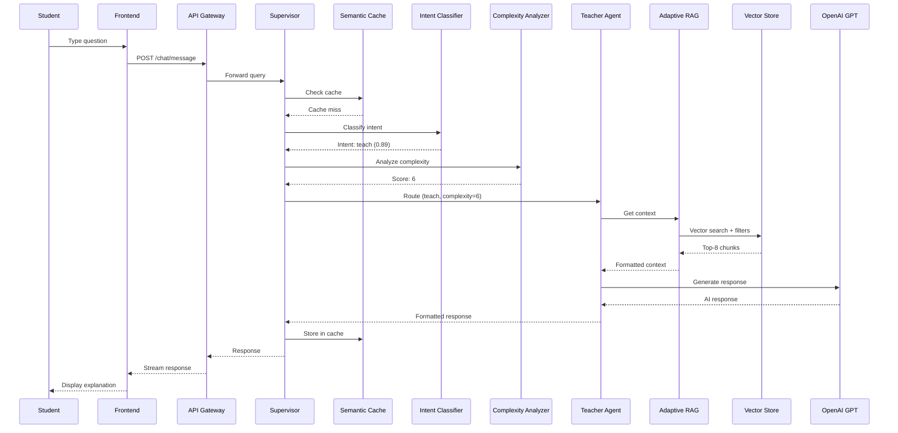
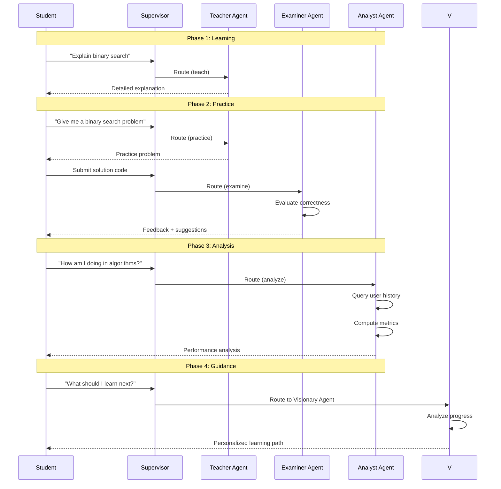

# Use Cases

## 6.1 Actors

### 6.1.1 Primary Actors

**Student/Learner**
- **Description**: End user seeking educational content and tutoring assistance
- **Goals**: Learn new concepts, practice skills, receive assessments, track progress
- **Characteristics**: Varying knowledge levels, diverse learning styles, different subject interests
- **Interaction Mode**: Web browser interface, synchronous query-response sessions

**Instructor/Content Administrator**
- **Description**: Educational professional managing knowledge base and monitoring system
- **Goals**: Upload course materials, curate content, review system performance, adjust difficulty levels
- **Characteristics**: Domain expertise, pedagogical knowledge, system administration skills
- **Interaction Mode**: Administrative interface, content management functions

### 6.1.2 Secondary Actors

**System Administrator**
- **Description**: Technical personnel maintaining infrastructure and monitoring system health
- **Goals**: Ensure uptime, optimize performance, manage resources, troubleshoot issues
- **Characteristics**: Technical expertise, DevOps skills, system architecture knowledge
- **Interaction Mode**: Server access, monitoring dashboards, log analysis

**LLM API Provider**
- **Description**: External service providing large language model capabilities
- **Goals**: Process API requests, return responses, maintain service availability
- **Examples**: OpenAI, Google Gemini
- **Interaction Mode**: REST API, programmatic access

## 6.2 Use Case Table

| Use Case ID | Use Case Name | Primary Actor | Complexity | Priority |
|-------------|--------------|---------------|------------|----------|
| UC-01 | User Registration and Authentication | Student | Low | High |
| UC-02 | Browse Available Topics | Student | Low | High |
| UC-03 | Start Learning Session | Student | Medium | High |
| UC-04 | Ask Question (Teaching Intent) | Student | High | Critical |
| UC-05 | Request Practice Problem | Student | High | Critical |
| UC-06 | Submit Solution for Evaluation | Student | High | Critical |
| UC-07 | Request Performance Analysis | Student | Medium | Medium |
| UC-08 | Seek Career Guidance | Student | Medium | Low |
| UC-09 | Upload Educational Content | Instructor | Medium | High |
| UC-10 | Monitor System Performance | Admin | Low | Medium |
| UC-11 | Adjust RAG Strategy Configuration | Admin | High | Low |
| UC-12 | View Learning Progress Dashboard | Student | Low | Medium |

## 6.3 Detailed Use Case Descriptions

### UC-01: User Registration and Authentication

**Goal**: Enable users to create accounts and securely access the system

**Preconditions**: User has valid email address and internet connection

**Main Flow**:
1. User navigates to registration page
2. User provides email, password, and full name
3. System validates input format and uniqueness
4. System hashes password using bcrypt
5. System creates user account in database
6. System sends confirmation email (optional)
7. User logs in with credentials
8. System generates JWT access and refresh tokens
9. System returns tokens to user
10. User accesses protected resources with token

**Alternate Flows**:
- **AF-01**: Email already registered → System displays error, suggests login
- **AF-02**: Weak password → System rejects, provides password requirements
- **AF-03**: Login with incorrect credentials → System displays error, allows retry

**Postconditions**: User has valid account and can access system features

---

### UC-04: Ask Question (Teaching Intent)

**Goal**: Student receives comprehensive explanation for a concept or topic

**Preconditions**:
- User is authenticated
- User has selected a topic/subject
- System has relevant content in knowledge base

**Main Flow**:
1. Student types question in chat interface (e.g., "Explain dynamic programming")
2. Frontend sends query to API Gateway via WebSocket/HTTP
3. API Gateway authenticates request and forwards to Supervisor Agent
4. Supervisor performs semantic cache lookup
5. **[Cache Miss]** Supervisor invokes Intent Classifier
6. Intent Classifier predicts intent: `teach`, confidence: 0.89
7. Supervisor invokes Complexity Analyzer
8. Complexity Analyzer assigns score: 6 (moderate-high complexity)
9. Supervisor routes query to Teacher Agent with intent and complexity
10. Teacher Agent selects Adaptive RAG strategy (complexity 6)
11. Adaptive RAG retrieves context:
    - Applies metadata filters: `content_type=["theory", "examples"]`
    - Performs vector search, retrieves top-8 chunks
    - Formats context with progressive complexity
12. Teacher Agent constructs prompt with system role and retrieved context
13. Teacher Agent calls LLM API (OpenAI GPT-4)
14. LLM generates comprehensive explanation with examples
15. Teacher Agent formats response with markdown and citations
16. Supervisor updates semantic cache with query-response pair
17. Supervisor updates dialogue state (topic, turn count, sentiment)
18. API Gateway streams response to Frontend
19. Frontend renders markdown with code highlighting and citations

**Alternate Flows**:
- **AF-01**: Cache hit at step 4 → Skip steps 5-16, return cached response immediately
- **AF-02**: Low complexity (score 1-3) → Teacher uses Baseline RAG instead
- **AF-03**: High complexity (score 7-10) → Teacher uses Omni-RAG with full hybrid pipeline
- **AF-04**: No relevant context found → Teacher uses LLM general knowledge with disclaimer
- **AF-05**: LLM API error → System retries with exponential backoff, switches to Gemini if OpenAI fails

**Postconditions**:
- Student receives accurate, pedagogically sound explanation
- Conversation history updated in database
- Cache populated for future similar queries
- Analytics recorded for system improvement

**Sequence Diagram**:


---

### UC-05: Request Practice Problem

**Goal**: Student receives a practice problem matching their skill level

**Preconditions**:
- User is authenticated
- Topic has practice problems in knowledge base
- User skill level is recorded

**Main Flow**:
1. Student requests practice problem (e.g., "Give me a sorting algorithm problem")
2. Query routed through API Gateway to Supervisor
3. Supervisor checks cache (likely miss for practice requests)
4. Intent Classifier predicts: `practice`, confidence: 0.92
5. Complexity Analyzer assigns score: 4
6. Supervisor routes to Teacher Agent
7. Teacher Agent selects Adaptive RAG
8. Adaptive RAG applies metadata filters:
   ```python
   {
       "content_type": ["exercises", "problems"],
       "difficulty": user_level,  # e.g., 2 for intermediate
       "topic": "sorting_algorithms"
   }
   ```
9. Adaptive RAG retrieves 5 practice problems
10. Teacher Agent post-processes:
    - Extracts problem statements
    - Removes solution code
    - Keeps hints and constraints
11. Teacher Agent constructs prompt with practice-oriented instructions
12. LLM formats problem with clear structure:
    - Problem description
    - Input/output examples
    - Constraints
    - Hints (optional)
13. Response returned to Frontend
14. Frontend renders problem with code editor (Monaco)
15. Student attempts solution in editor

**Alternate Flows**:
- **AF-01**: User specifies difficulty → Override user_level with requested difficulty
- **AF-02**: No problems at requested difficulty → System retrieves nearest difficulty problems, notifies user
- **AF-03**: User requests specific problem type (e.g., "merge sort problem") → Add `problem_type` filter

**Postconditions**:
- Student has practice problem suitable for their level
- Code editor initialized for solution attempt
- Problem ID tracked for later evaluation

---

### UC-06: Submit Solution for Evaluation

**Goal**: Student receives feedback on their problem solution

**Preconditions**:
- Student has attempted a practice problem
- Solution code is syntactically valid (or system provides syntax errors)

**Main Flow**:
1. Student writes solution in Monaco editor
2. Student clicks "Submit Solution" button
3. Frontend sends solution code + problem ID to API
4. API Gateway forwards to Supervisor
5. Intent Classifier predicts: `examine`, confidence: 0.94
6. Supervisor routes to Examiner Agent
7. Examiner Agent retrieves problem details and expected solution
8. Examiner Agent constructs evaluation prompt:
   - Problem statement
   - Student solution
   - Evaluation criteria: correctness, efficiency, style
9. Examiner Agent calls LLM for evaluation
10. LLM analyzes solution, provides:
    - Correctness assessment
    - Time/space complexity analysis
    - Code quality feedback
    - Suggestions for improvement
    - Test case results (if applicable)
11. Examiner Agent formats feedback
12. API Gateway returns response
13. Frontend displays feedback with:
    - Pass/fail status
    - Detailed commentary
    - Highlighted code sections (if improvements needed)
14. System updates user progress metrics

**Alternate Flows**:
- **AF-01**: Syntax errors → Frontend shows errors before submission, allows correction
- **AF-02**: Partial correctness → Examiner identifies which test cases pass/fail
- **AF-03**: Security concerns detected → System flags and requests instructor review

**Postconditions**:
- Student receives constructive feedback
- User progress updated (problems attempted, success rate)
- Solution stored for history tracking

---

### UC-07: Request Performance Analysis

**Goal**: Student receives analysis of their learning progress and performance

**Preconditions**:
- User has completed multiple learning sessions
- System has sufficient interaction history

**Main Flow**:
1. Student requests analysis (e.g., "How am I doing in algorithms?")
2. Intent Classifier predicts: `analyze`, confidence: 0.88
3. Supervisor routes to Analyst Agent
4. Analyst Agent queries database for user activity:
   - Sessions completed
   - Topics covered
   - Problems attempted and solved
   - Time spent per topic
   - Difficulty progression
5. Analyst Agent computes metrics:
   - Completion rate: 75%
   - Average problem difficulty: 2.5/5
   - Strengths: Dynamic programming, graphs
   - Weaknesses: Greedy algorithms, complexity analysis
   - Engagement trend: Increasing
6. Analyst Agent uses Adaptive RAG to retrieve:
   - Content type: `analytics`, `benchmarks`
   - Comparison data for user's level
7. Analyst Agent constructs data-driven prompt
8. LLM generates analysis report:
   - Summary of progress
   - Strength areas
   - Improvement opportunities
   - Recommended next topics
   - Motivational feedback
9. Response formatted with charts/tables (data for Frontend visualization)
10. Frontend displays interactive dashboard:
    - Progress charts
    - Skill radar chart
    - Topic heatmap
    - Recommendations list

**Alternate Flows**:
- **AF-01**: Insufficient data → System notifies user, suggests completing more activities
- **AF-02**: User requests specific metric → Analyst focuses on requested aspect

**Postconditions**:
- Student has clear understanding of progress
- Recommended learning path generated
- User motivated to continue learning

---

### UC-09: Upload Educational Content

**Goal**: Instructor adds new educational materials to the knowledge base

**Preconditions**:
- User has instructor/admin privileges
- Content is in supported format (PDF)

**Main Flow**:
1. Instructor navigates to content management page
2. Instructor selects topic/subject for content
3. Instructor uploads PDF file
4. System validates file:
   - File type: PDF
   - File size: < 50 MB
   - Not previously uploaded
5. System extracts text from PDF using PyPDF
6. System performs intelligent chunking:
   - Split by sections/headings
   - Target chunk size: 500-1000 tokens
   - Overlap: 50 tokens between chunks
7. System extracts metadata for each chunk:
   - Page number
   - Section title
   - Content type (theory/example/exercise) - heuristic or manual
   - Difficulty level - estimated or manual
8. System generates embeddings using Sentence Transformer
9. System stores in ChromaDB:
   - Collection: `{topic_id}`
   - Documents: Chunk content
   - Embeddings: 384-dim vectors
   - Metadata: Extracted metadata
10. System updates PostgreSQL:
    - Document record with filename, upload timestamp
    - Lesson/topic associations
11. System rebuilds BM25 index for topic (async)
12. System displays success message with ingestion summary
13. Instructor can preview indexed content and edit metadata

**Alternate Flows**:
- **AF-01**: Unsupported file format → System rejects, suggests PDF conversion
- **AF-02**: Duplicate content detected → System warns, allows override or skip
- **AF-03**: Text extraction fails → System logs error, notifies administrator

**Postconditions**:
- Content available for retrieval in RAG system
- Vector and keyword indices updated
- Content searchable by students

---

## 6.4 Multi-Agent Collaboration Use Case

### UC-Mixed: Complete Learning Journey

**Scenario**: Student progresses from learning to practice to analysis

**Flow**:


**Benefits**:
- Seamless transitions between learning modalities
- Context preserved across agent interactions
- Holistic learning experience
- Personalized progression

---

## 6.5 Use Case Priority Matrix

| Use Case | Frequency | Business Value | Technical Complexity | Priority |
|----------|-----------|----------------|---------------------|----------|
| UC-04 (Ask Question) | Very High | Critical | High | P0 |
| UC-05 (Practice Problem) | High | Critical | High | P0 |
| UC-06 (Submit Solution) | High | Critical | High | P0 |
| UC-01 (Registration) | Low | High | Low | P1 |
| UC-02 (Browse Topics) | High | High | Low | P1 |
| UC-03 (Start Session) | High | High | Medium | P1 |
| UC-09 (Upload Content) | Medium | High | Medium | P1 |
| UC-07 (Performance Analysis) | Medium | Medium | Medium | P2 |
| UC-12 (Progress Dashboard) | High | Medium | Low | P2 |
| UC-08 (Career Guidance) | Low | Low | Medium | P3 |
| UC-10 (Monitor System) | Low | Medium | Low | P3 |
| UC-11 (Configure RAG) | Very Low | Low | High | P4 |

---

## 6.6 Non-Functional Use Cases

### UC-NF-01: System Performance Under Load

**Goal**: System maintains acceptable response times under concurrent user load

**Scenario**:
- 50 concurrent users
- Mixed query types (teaching, practice, examination)
- Sustained for 1 hour

**Expected Behavior**:
- 90th percentile latency < 3 seconds
- No request failures due to resource exhaustion
- Cache hit rate > 30% after warm-up
- Database connection pool not exhausted

---

### UC-NF-02: Graceful Degradation

**Goal**: System continues functioning when external dependencies fail

**Scenario**: OpenAI API experiences outage

**Expected Behavior**:
1. System detects API error (timeout, 5xx status)
2. System logs error and increments failure counter
3. System automatically switches to Google Gemini
4. Response generated using fallback LLM
5. User experience minimally impacted (slight latency increase)
6. System monitors OpenAI recovery, switches back when available

---

## 6.7 Use Case Coverage Summary

The system addresses core educational tutoring requirements through:

**Learning Support**:
- Conceptual explanations (UC-04)
- Example-based teaching
- Multi-modal content delivery

**Skill Development**:
- Practice problems (UC-05)
- Code evaluation (UC-06)
- Iterative improvement feedback

**Assessment**:
- Quiz generation
- Solution evaluation
- Progress tracking

**Personalization**:
- Difficulty adaptation
- Performance analysis (UC-07)
- Learning path recommendations (UC-08)

**Content Management**:
- Knowledge base ingestion (UC-09)
- Metadata curation
- Content versioning

The use case design ensures comprehensive coverage of stakeholder needs while maintaining focus on core educational value delivery.
