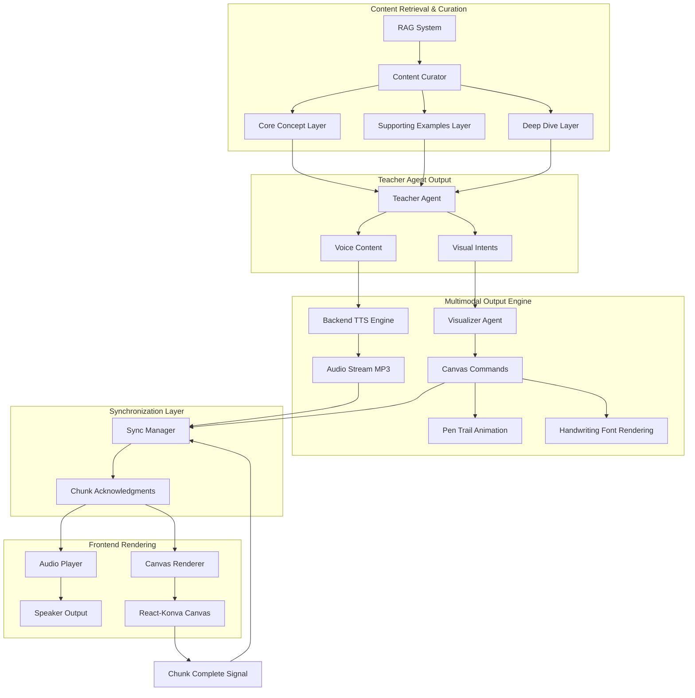
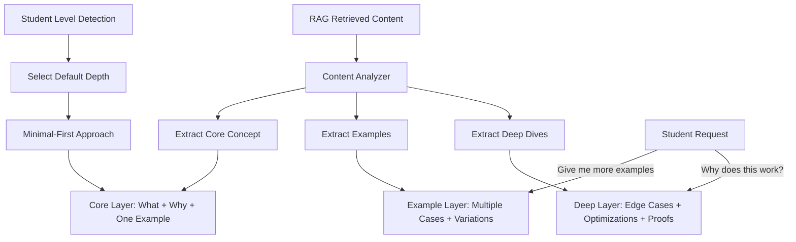
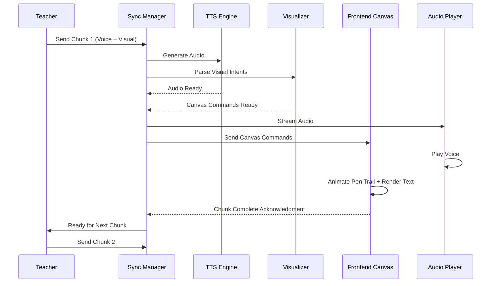

# Critical Gap 1: Voice + Canvas Synchronization Architecture

**Status**: ✅ **Architecture Finalized (January 26, 2026)**

---

## Overview

This architecture addresses the challenge of synchronizing voice-based teaching with handwritten canvas animations, creating a notebook-style learning experience where the AI teacher's voice narration is perfectly synchronized with visual content appearing on the canvas.

---

## Architecture Components



---

## 1. Teacher Output Structure (Hybrid Approach)

### Decision: Teacher outputs visual intents, Visualizer implements

The Teacher Agent outputs structured multimodal content:

```json
{
  "teaching_chunks": [
    {
      "id": "chunk_1",
      "voice_content": "Let's understand binary search. It's a divide and conquer algorithm.",
      "visual_intents": [
        {
          "action": "write_heading",
          "content": "Binary Search",
          "style": "handwriting",
          "position": {"x": 100, "y": 50}
        },
        {
          "action": "draw_divider",
          "style": "underline"
        }
      ],
      "pacing": "normal",
      "wait_for_completion": true
    },
    {
      "id": "chunk_2",
      "voice_content": "We start with a sorted array. Here's an example.",
      "visual_intents": [
        {
          "action": "write_array",
          "content": "[1, 3, 5, 7, 9, 11, 13]",
          "style": "handwriting",
          "animate": "pen_trail"
        }
      ],
      "pacing": "normal",
      "wait_for_completion": true
    }
  ],
  "depth_level": "core",
  "student_level": "beginner"
}
```

---

## 2. Content Curation Layer

### Problem Statement
RAG retrieves extensive content (multiple pages), but effective teaching requires focused 2-3 minute segments with appropriate balance between verbal explanation and visual demonstration.

### Solution: Progressive Disclosure with Lightweight Preprocessing



### Content Curation Strategy

**1. Progressive Disclosure at Runtime**
- NOT a heavy ETL pipeline
- Dynamic depth adjustment based on student interactions
- Natural expansion when student requests more information

**2. Three-Layer Content Structure**

| Layer | Content | Purpose |
|-------|---------|---------|
| **Core Concept** (Baseline) | • What it is<br>• Why it matters<br>• One simple example | Minimal-first approach to prevent cognitive overload |
| **Supporting Examples** (Intermediate) | • Multiple use cases<br>• Variations and patterns<br>• Common scenarios | Expand understanding through practice |
| **Deep Dives** (Advanced) | • Edge cases<br>• Optimization techniques<br>• Formal proofs<br>• Real-world applications | Advanced exploration on demand |

**3. Verbal vs Visual Distribution**

```python
# Content Curator determines split
content_split = {
    "dictate": [
        "Conceptual explanations",
        "Why it works",
        "When to use it",
        "Narration of visual content"
    ],
    "visualize": [
        "Equations and formulas",
        "Data structure diagrams",
        "Step-by-step algorithm flow",
        "Code snippets",
        "Example inputs/outputs"
    ]
}
```

---

## 3. Student Level Detection (Hybrid Implicit→Explicit)

### Inference Signals
- Vocabulary sophistication
- Question types: "what" (beginner) vs "why" (intermediate) vs "optimize" (advanced)
- Interruption speed and frequency
- Depth of follow-up questions
- Requests for examples vs formulas

### Fallback Explicit Query

```json
{
  "confidence_threshold": 0.7,
  "clarification_prompt": "Should I explain this assuming beginner or intermediate level?",
  "trigger_when": "confidence < 0.7 OR conflicting signals"
}
```

### Continuous Adjustment
- Level inference updates throughout session
- No static classification
- Adapts to changing student needs

---

## 4. Synchronization Method (Chunk-Based with Acknowledgments)

### Workflow



### Synchronization Rules
- Teacher waits for canvas completion before proceeding to next chunk
- Backend maintains sync state (current_chunk_id, completion_status)
- No audio-visual drift: tight coupling between narration and canvas rendering
- Pacing levels (slow/normal/fast) adjust both speech rate AND animation speed

---

## 5. Canvas Animation Style (Hybrid Pen Trail + Handwriting Font)

### Animation Technique

**1. Pen Cursor Animation**
- Animated pen/pencil cursor traces the writing path
- Follows the trajectory of text/equation rendering
- Creates "notebook writing" aesthetic

**2. Handwriting Font Rendering**
- Text appears in handwriting font (e.g., "Caveat", "Indie Flower", "Permanent Marker")
- NOT typing style (monospace character-by-character)
- Smooth stroke-based rendering

**3. Visual Primitives**
- **Text**: Headings, explanations, labels
- **Equations**: Mathematical notation in handwriting style
- **Diagrams**: Arrows, boxes, tree nodes, graph edges
- **Highlights**: Underlines, circles, emphasis marks
- **Arrays/Lists**: Data structure visualizations

### Implementation Example

```typescript
// Frontend Canvas Command Handler
interface CanvasCommand {
  action: 'write_text' | 'write_equation' | 'draw_diagram' | 'highlight';
  content: string;
  style: 'handwriting' | 'emphasis';
  animate: 'pen_trail' | 'fade_in';
  position: {x: number, y: number};
  duration: number; // milliseconds
}

const renderWithPenTrail = (command: CanvasCommand) => {
  // 1. Show animated pen cursor following path
  animatePenCursor(command.position, command.duration);
  
  // 2. Render text in handwriting font with stroke animation
  renderHandwritingText(command.content, command.position);
  
  // 3. Emit completion event
  emitChunkComplete(command.id);
};
```

---

## 6. Canvas Pagination (Scrollable Notebook + Section Breaks)

### Design
- **Scrollable History**: Full teaching session preserved
- **Soft Section Separators**: Visual breaks between concepts
- **"New Page" Markers**: Inserted after major topic shifts
- **Viewport Management**: Auto-scroll to active teaching region

### Benefits
- Mirrors real notebook experience
- Allows revisiting earlier steps
- Supports long explanations naturally
- Reduces learner anxiety (nothing is "lost")

### Example Structure

```
┌─────────────────────────────────┐
│ [Session: Binary Search]        │ ← Header
├─────────────────────────────────┤
│ Binary Search                   │ ← Heading
│ ━━━━━━━━━━━                    │ ← Divider
│ Divide & conquer algorithm...   │
│ [1, 3, 5, 7, 9, 11, 13]        │
│ Target: 7                       │
│ ┌──────┬──────┬──────┐         │
│ │ Step │ Left │ Right│         │
│ └──────┴──────┴──────┘         │
├─ ─ ─ ─ ─ ─ ─ ─ ─ ─ ─ ─ ─ ─ ─ ─┤ ← Soft Section Break
│ Time Complexity                 │
│ Best Case: O(1)                │
│ Worst Case: O(log n)           │
├═════════════════════════════════┤ ← New Page (Topic Shift)
│ [New Topic: Binary Search Tree]│
└─────────────────────────────────┘
```

---

## 7. Speed Control (Simple Pacing Levels)

### Three Modes

| Mode | Speech Rate | Animation Duration |
|------|-------------|-------------------|
| **Slow** | 0.85x | +30% (1.3x multiplier) |
| **Normal** | 1.0x | Baseline (1.0x) |
| **Fast** | 1.3x | -30% (0.7x multiplier) |

### Configuration

```json
{
  "pacing_config": {
    "slow": {
      "tts_rate": 0.85,
      "animation_multiplier": 1.3
    },
    "normal": {
      "tts_rate": 1.0,
      "animation_multiplier": 1.0
    },
    "fast": {
      "tts_rate": 1.3,
      "animation_multiplier": 0.7
    }
  }
}
```

### Student Control
- Voice command: "Slow down" / "Speed up"
- UI slider: Real-time pacing adjustment
- Auto-adjustment based on confusion signals (emotion detection)

---

## 8. Audio Generation (Backend TTS)

### Architecture Choice: Server-side TTS generation

**Benefits**:
- **Quality Control**: Consistent voice quality across browsers
- **Caching**: Pre-generate audio for common explanations
- **Customization**: Fine-tune voice parameters (pitch, rate, emotion)
- **Fallback**: Multiple TTS providers (Edge TTS, Google Cloud TTS)

**Streaming Pipeline**:
```
Teacher Agent → TTS Service → Audio Chunks → WebSocket → Frontend Player
```

---

## 9. Implementation Phases

### Phase 1: Content Curation Layer ✅ Architecture Finalized
- Implement Content Curator class
- Three-layer extraction logic (Core/Examples/Deep)
- Student level inference module
- Verbal vs Visual distribution algorithm

### Phase 2: Multimodal Output Engine (Next)
- Teacher Agent output restructuring
- Visual intent generation
- Visualizer Agent implementation
- Canvas command protocol

### Phase 3: Synchronization Engine
- Chunk-based sync manager
- Acknowledgment protocol
- State management (current chunk, completion tracking)
- WebSocket event handlers

### Phase 4: Frontend Canvas Renderer
- Pen trail animation system
- Handwriting font integration
- Visual primitives library
- Scrollable notebook UI

### Phase 5: Testing & Refinement
- End-to-end multimodal testing
- Sync timing optimization
- Student level inference accuracy
- Canvas animation smoothness

---

## 10. Key Decisions Summary

**Status**: ✅ **All Decisions Locked**

| # | Component | Decision |
|---|-----------|----------|
| 1 | **Output Structure** | Hybrid approach: Teacher outputs intents → Visualizer implements |
| 2 | **Synchronization** | Chunk-based with acknowledgments |
| 3 | **Audio Generation** | Backend TTS for quality control |
| 4 | **Speed Control** | Simple pacing levels (slow/normal/fast) |
| 5 | **Visual Primitives** | Standard set in notebook aesthetic |
| 6 | **Animation Style** | Hybrid pen trail + handwriting font |
| 7 | **Content Strategy** | Progressive disclosure with light preprocessing |
| 8 | **Student Level** | Hybrid implicit→explicit detection |
| 9 | **Canvas Pagination** | Scrollable notebook with section breaks |
| 10 | **Content Depth** | Minimal-first with expandable layers |

---

## Next Steps

✅ Gap 1 Architecture Complete → Ready for Implementation

🔜 **Gap 2**: Real-Time Interruption Handling
