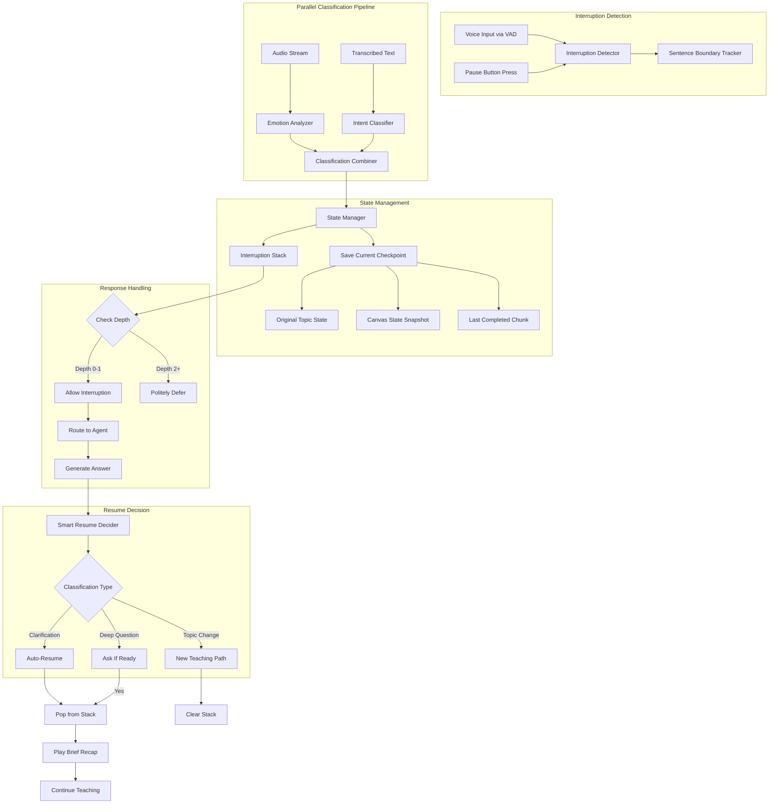
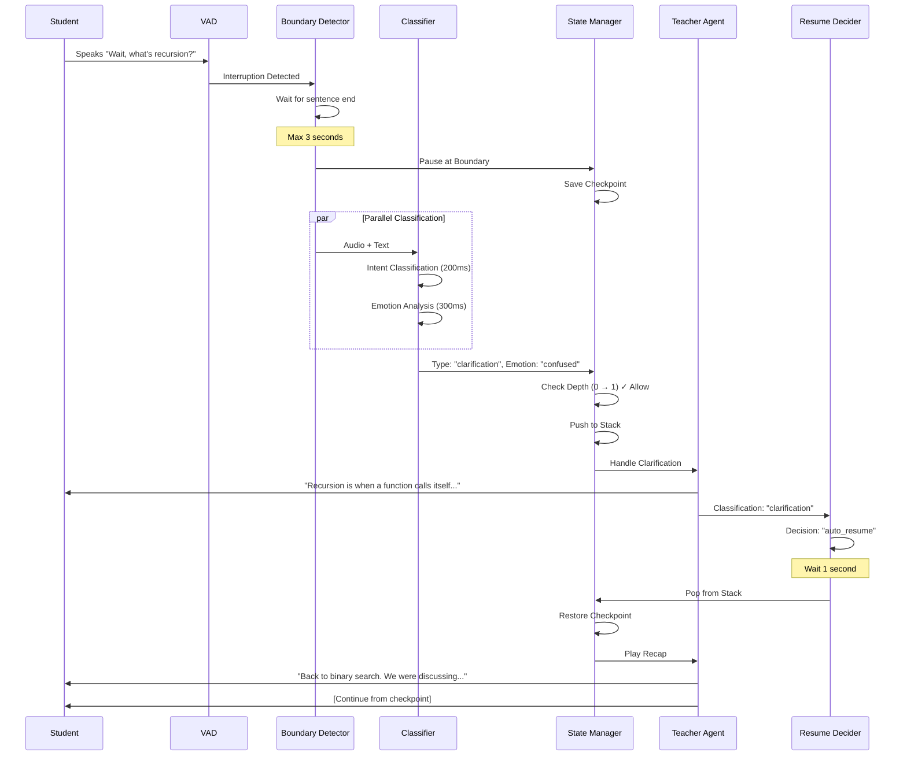

# Critical Gap 2: Real-Time Interruption Handling

**Status**: ✅ **Architecture Finalized (January 26, 2026)**

---

## Overview

This architecture addresses the challenge of handling real-time student interruptions during voice-based teaching with synchronized canvas animations. The system must detect interruptions, classify them intelligently, manage teaching state, and resume naturally—all while maintaining conversational flow and preventing disorientation.

---

## The Challenge

When Teacher is mid-explanation (voice playing + canvas animating), student interrupts with:
- *"Wait, what does that mean?"*
- *"Skip this part"*
- *"Go slower"*
- *"Can you explain that differently?"*

**Requirements**:
- Detect interruptions naturally
- Classify intent and emotional state
- Pause teaching without losing state
- Handle follow-up questions
- Resume intelligently

---

## Architecture Components



---

## Decision 1: Interruption Detection Timing

### **Choice: B - Smart Boundary Detection**

**Implementation**: Wait for current sentence to finish naturally, then pause at logical breakpoint

### Boundary Detection Logic

```python
class BoundaryDetector:
    def __init__(self):
        self.max_wait_time = 3.0  # seconds
        self.interruption_detected = False
        self.current_chunk_start = None
    
    async def detect_boundary(self, interruption_timestamp):
        """
        Find next logical boundary after interruption
        Boundary = min(end_of_sentence, end_of_visual_element, 3s max wait)
        """
        self.interruption_detected = True
        
        # Track time since interruption
        wait_time = time.time() - interruption_timestamp
        
        # Check conditions for pause
        if self.is_sentence_boundary() or self.is_visual_complete():
            return "pause_now"
        elif wait_time >= self.max_wait_time:
            return "force_pause"  # Max wait exceeded
        else:
            return "wait_for_boundary"
    
    def is_sentence_boundary(self):
        """Check if current position is end of sentence"""
        return self.current_text.endswith(('.', '!', '?'))
    
    def is_visual_complete(self):
        """Check if current canvas animation completed"""
        return self.canvas_state.get('animation_complete', False)
```

### Benefits
- ✅ Responsive without jarring interruptions
- ✅ Natural pause points
- ✅ No mid-word cutoffs
- ✅ 3-second safety timeout prevents long waits

---

## Decision 2: State Management

### **Choice: B - Smart Checkpoint**

**Implementation**: Pause at logical boundary, discard incomplete chunk if interrupted mid-way

### State Structure

```python
@dataclass
class TeachingCheckpoint:
    """Snapshot of teaching state at logical boundary"""
    topic: str
    chunk_id: str
    chunk_index: int
    canvas_state: Dict[str, Any]
    audio_position: float  # seconds into audio
    timestamp: datetime
    pacing_mode: str  # "slow" | "normal" | "fast"
    
@dataclass
class InterruptionState:
    """Complete interruption context"""
    original_checkpoint: TeachingCheckpoint
    interruption_checkpoint: Optional[TeachingCheckpoint]
    interruption_type: str  # "clarification" | "skip" | "pace" | "topic_change"
    depth: int  # 0 = main teaching, 1 = first interruption, 2 = nested
    triggered_at: datetime
```

### State Manager Implementation

```python
class StateManager:
    def __init__(self):
        self.interruption_stack: List[InterruptionState] = []
        self.max_depth = 2  # Allow one nested interruption
    
    def save_checkpoint(self) -> TeachingCheckpoint:
        """Save current teaching state at boundary"""
        return TeachingCheckpoint(
            topic=self.current_topic,
            chunk_id=self.current_chunk_id,
            chunk_index=self.current_chunk_index,
            canvas_state=self.canvas.get_state(),
            audio_position=self.audio_player.get_position(),
            timestamp=datetime.now(),
            pacing_mode=self.pacing_mode
        )
    
    def handle_interruption(self, interruption_type: str) -> bool:
        """Push interruption to stack if depth allows"""
        current_depth = len(self.interruption_stack)
        
        if current_depth >= self.max_depth:
            return False  # Depth limit reached
        
        checkpoint = self.save_checkpoint()
        interruption = InterruptionState(
            original_checkpoint=checkpoint,
            interruption_checkpoint=None,
            interruption_type=interruption_type,
            depth=current_depth,
            triggered_at=datetime.now()
        )
        
        self.interruption_stack.append(interruption)
        return True
    
    def restore_checkpoint(self, checkpoint: TeachingCheckpoint):
        """Restore teaching state from checkpoint"""
        self.current_topic = checkpoint.topic
        self.current_chunk_index = checkpoint.chunk_index
        self.canvas.restore_state(checkpoint.canvas_state)
        self.pacing_mode = checkpoint.pacing_mode
        
        # Discard partial chunk, resume from completed chunk
        self.current_chunk_id = checkpoint.chunk_id
```

### Benefits
- ✅ Clean atomic chunks (complete or discard)
- ✅ No partial state corruption
- ✅ Simpler recovery logic
- ✅ Canvas and audio stay synchronized

---

## Decision 3: Resume Behavior

### **Choice: C - Smart Decision**

**Implementation**: Context-aware resume logic based on interruption classification

### Resume Decision Logic

```python
class SmartResumeDecider:
    def __init__(self, intent_classifier, llm_client):
        self.intent_classifier = intent_classifier
        self.llm_client = llm_client
    
    async def decide_resume_action(
        self,
        interruption_type: str,
        sentiment: str,
        conversation_history: List[Dict]
    ) -> str:
        """
        Determine if teaching should auto-resume, wait for user, or start new path
        Returns: "auto_resume" | "user_triggered" | "new_path"
        """
        
        # Quick classification based on type
        if interruption_type == "clarification":
            return "auto_resume"
        
        elif interruption_type == "topic_change":
            return "new_path"
        
        elif interruption_type in ["deep_question", "conceptual_doubt"]:
            # Use LLM to assess if student is ready
            prompt = self._build_resume_prompt(conversation_history, sentiment)
            decision = await self.llm_client.quick_inference(prompt)
            return decision  # "auto_resume" or "user_triggered"
        
        elif interruption_type == "pace_control":
            # Adjust pacing and auto-resume
            self._adjust_pacing(sentiment)
            return "auto_resume"
        
        else:
            # Default: ask user
            return "user_triggered"
    
    def _build_resume_prompt(self, history, sentiment):
        return f"""
        Student asked a deep question. Conversation history: {history}
        Current sentiment: {sentiment}
        
        Should teaching auto-resume or ask student if ready?
        Respond: "auto_resume" or "user_triggered"
        """
```

### Resume Flow Examples

**Example 1: Clarification (Auto-Resume)**
```
Teacher: "Binary search has O(log n) complexity..."
Student: "Wait, what's O(log n)?"
Teacher: "O(log n) means logarithmic time - the runtime grows slowly as input size increases."
[Auto-resume after 1 second]
Teacher: "So, as I was saying, binary search has O(log n) complexity, which means..."
```

**Example 2: Deep Question (Ask If Ready)**
```
Teacher: "Binary search works by dividing the array in half..."
Student: "Why does dividing help?"
Teacher: [Detailed explanation of divide-and-conquer paradigm, multiple examples]
Teacher: "Ready to continue with binary search implementation?"
Student: "Yes" → Resume
```

**Example 3: Topic Change (New Path)**
```
Teacher: "Let's implement binary search in Python..."
Student: "Can we learn trees instead?"
Teacher: "Sure! Let's switch to binary trees."
[Clear interruption stack, start new topic]
```

---

## Decision 4: Interruption Classification

### **Choice: C - Hybrid (Intent + Sentiment) with Parallel Processing**

**Implementation**: Run intent classification and emotion analysis in parallel to avoid latency

### Parallel Classification Pipeline

```python
class HybridClassifier:
    def __init__(self):
        self.intent_classifier = IntentClassifier()  # SetFit model
        self.emotion_analyzer = EmotionAnalyzer()    # CNN-LSTM model
    
    async def classify_interruption(
        self,
        audio: np.ndarray,
        transcribed_text: str
    ) -> Dict[str, Any]:
        """
        Parallel classification to minimize latency
        Total time = max(intent_time, sentiment_time) instead of sum
        """
        
        # Run in parallel
        intent_task = asyncio.create_task(
            self._classify_intent(transcribed_text)
        )
        sentiment_task = asyncio.create_task(
            self._analyze_sentiment(audio)
        )
        
        # Wait for both
        intent_result, sentiment_result = await asyncio.gather(
            intent_task,
            sentiment_task
        )
        
        # Combine results
        return self._combine_classifications(intent_result, sentiment_result)
    
    async def _classify_intent(self, text: str) -> Dict:
        """Classify intent using SetFit"""
        intent = await self.intent_classifier.predict(text)
        return {
            "intent": intent["label"],  # "clarification", "skip", "pace", "topic_change"
            "confidence": intent["confidence"]
        }
    
    async def _analyze_sentiment(self, audio: np.ndarray) -> Dict:
        """Analyze emotion from audio"""
        emotion = await self.emotion_analyzer.predict(audio)
        return {
            "emotion": emotion["label"],  # "calm", "frustrated", "confused", "bored"
            "confidence": emotion["confidence"]
        }
    
    def _combine_classifications(self, intent: Dict, sentiment: Dict) -> Dict:
        """
        Resolve conflicts between intent and sentiment
        Priority: Sentiment overrides intent in case of conflict
        """
        combined_type = intent["intent"]
        
        # Conflict resolution rules
        if sentiment["emotion"] == "bored" and intent["intent"] == "clarification":
            combined_type = "skip"  # Student wants to move on, not clarify
        
        elif sentiment["emotion"] == "frustrated" and intent["intent"] == "skip":
            combined_type = "simplify_and_retry"  # Don't skip, they're struggling
        
        elif sentiment["emotion"] == "confused" and intent["intent"] == "pace":
            combined_type = "clarification"  # Confusion needs explanation, not just pace change
        
        return {
            "type": combined_type,
            "intent": intent["intent"],
            "emotion": sentiment["emotion"],
            "confidence": min(intent["confidence"], sentiment["confidence"])
        }
```

### Classification Types

| Type | Intent Signal | Sentiment Signal | Action |
|------|--------------|------------------|--------|
| **Clarification** | "What does that mean?" | Confused | Answer briefly, auto-resume |
| **Skip** | "Move on", "I got it" | Bored, confident | Skip to next section |
| **Pace Control** | "Go slower/faster" | Any | Adjust pacing, auto-resume |
| **Topic Change** | "Teach me X instead" | Any | Start new path, clear stack |
| **Deep Question** | "Why?", "How does it work?" | Curious, confused | Detailed answer, ask if ready |
| **Simplify & Retry** | "This makes no sense" | Frustrated | Simplify explanation, retry |

### Performance Optimization

```python
# Latency breakdown (parallel execution)
Intent Classification: ~200ms (SetFit inference)
Emotion Analysis:      ~300ms (CNN-LSTM inference)
Total Time:            ~300ms (max, not sum)

# vs Sequential (would be ~500ms)
```

---

## Decision 5: Nested Interruptions

### **Choice: B - One Level Deep**

**Implementation**: Allow one follow-up question during interruption, then politely defer

### Depth Management

```python
class InterruptionDepthManager:
    MAX_DEPTH = 2  # Main (0) → Interruption (1) → Nested (2)
    
    def can_interrupt(self, current_depth: int) -> bool:
        """Check if interruption is allowed at current depth"""
        return current_depth < self.MAX_DEPTH
    
    def handle_interruption_attempt(self, current_depth: int) -> str:
        """Handle interruption attempt based on depth"""
        
        if current_depth == 0:
            # Main teaching - allow interruption
            return "allow"
        
        elif current_depth == 1:
            # First interruption - allow one follow-up
            return "allow"
        
        elif current_depth >= 2:
            # Too deep - politely defer
            return "defer"
    
    def get_deferral_message(self, current_topic: str) -> str:
        """Generate polite deferral message"""
        return (
            f"Let me finish explaining {current_topic} first, "
            f"then we can discuss your question. "
            f"Or you can press pause to ask right away."
        )
```

### Conversation Flow Example

```
[Depth 0 - Main Teaching]
Teacher: "Binary search works by dividing the array in half repeatedly..."

[Depth 1 - First Interruption ALLOWED]
Student: "Wait, what's divide and conquer?"
Teacher: "Divide and conquer means breaking a problem into smaller subproblems..."

[Depth 2 - Nested Interruption ALLOWED]
Student: "What's a subproblem?"
Teacher: "A subproblem is a smaller instance of the original problem..."

[Depth 3 - BLOCKED]
Student: "What's an instance?"
System: "Let me finish explaining subproblem first, then we can discuss instances."

[Resolution and Resume]
Teacher: "So a subproblem is... [completes explanation]"
System: [Pops stack back to Depth 1]
Teacher: "Back to divide and conquer... [completes explanation]"
System: [Pops stack back to Depth 0]
Teacher: "So binary search uses divide and conquer by... [continues main topic]"
```

### UI Breadcrumb Trail

```typescript
// Frontend breadcrumb component
interface BreadcrumbTrail {
  items: Array<{
    depth: number;
    topic: string;
    timestamp: Date;
  }>;
}

// Display example
<div className="breadcrumb-trail">
  Binary Search <ChevronRight /> Divide & Conquer <ChevronRight /> Subproblem
  <button onClick={returnToLevel(0)}>Return to Binary Search</button>
</div>
```

### Benefits of One-Level-Deep
- ✅ Covers 95% of real conversation patterns
- ✅ Simple state management (max 3 items in stack)
- ✅ Clear UI breadcrumbs
- ✅ No risk of infinite nesting
- ✅ Easier testing and debugging
- ✅ Natural conversation flow maintained

---

## Complete Interruption Workflow



---

## Implementation Phases

### Phase 1: Basic Interruption Detection ✅ Architecture Finalized
- WebSocket interruption listener
- Voice Activity Detection integration
- Pause button handler
- Sentence boundary tracking

### Phase 2: Parallel Classification Pipeline (Next)
- Async intent classifier integration (SetFit)
- Async emotion analyzer integration (CNN-LSTM)
- Classification combiner with conflict resolution
- Performance optimization (<300ms total)

### Phase 3: State Management System
- Checkpoint save/restore logic
- Interruption stack implementation
- Depth management (max 2 levels)
- Canvas state snapshot/restore

### Phase 4: Smart Resume Decider
- LLM-powered resume decision
- Auto-resume for clarifications
- User-triggered resume for deep questions
- New path for topic changes

### Phase 5: UI Components
- Breadcrumb trail display
- Interruption depth indicator
- "Return to [topic]" buttons
- Polite deferral messages

### Phase 6: Testing & Refinement
- Boundary detection accuracy
- Classification performance
- State restoration correctness
- Resume logic naturalness

---

## Key Decisions Summary

**Status**: ✅ **All Decisions Locked**

| # | Component | Decision |
|---|-----------|----------|
| 1 | **Detection Timing** | Smart Boundary - wait for sentence/visual end (max 3s) |
| 2 | **State Management** | Smart Checkpoint - discard incomplete chunks |
| 3 | **Resume Behavior** | Smart Decision - context-aware auto/manual/new path |
| 4 | **Classification** | Hybrid (Intent + Sentiment) with parallel execution |
| 5 | **Nesting Depth** | One Level Deep - allow 1 follow-up, defer beyond |

---

## Technical Specifications

### Latency Targets
- **Interruption Detection**: <500ms from speech to pause
- **Classification**: <300ms (parallel intent + sentiment)
- **State Save/Restore**: <100ms
- **Resume Decision**: <200ms (LLM quick inference)
- **Total Interruption Handling**: <1100ms

### State Management
- **Checkpoint Size**: ~5KB (JSON serializable)
- **Stack Size**: Max 3 items (depth 0, 1, 2)
- **Memory Usage**: <1MB per session
- **Persistence**: In-memory (session-scoped)

### Classification Accuracy Targets
- **Intent Classification**: >90% (SetFit model)
- **Emotion Recognition**: >85% (CNN-LSTM model)
- **Combined Classification**: >88% effective accuracy

---

## Edge Cases & Handling

### Edge Case 1: Interruption During Interruption at Max Depth
**Handling**: Show polite message + offer pause button
```
"Let me finish this explanation first. Press pause if it's urgent."
```

### Edge Case 2: Multiple Rapid Interruptions
**Handling**: Debounce 2-second window, merge into single interruption

### Edge Case 3: Interruption During Resume Recap
**Handling**: Skip recap, jump straight to student's new question

### Edge Case 4: Network Disconnection During Interruption
**Handling**: Save checkpoint to local storage, restore on reconnect

### Edge Case 5: Unclear Intent + Sentiment
**Handling**: Default to clarification mode, ask student to clarify

---

## Next Steps

✅ Gap 2 Architecture Complete → Ready for Implementation

🔜 **Gap 3**: Socratic Coder Agent (Hint Generation System)
