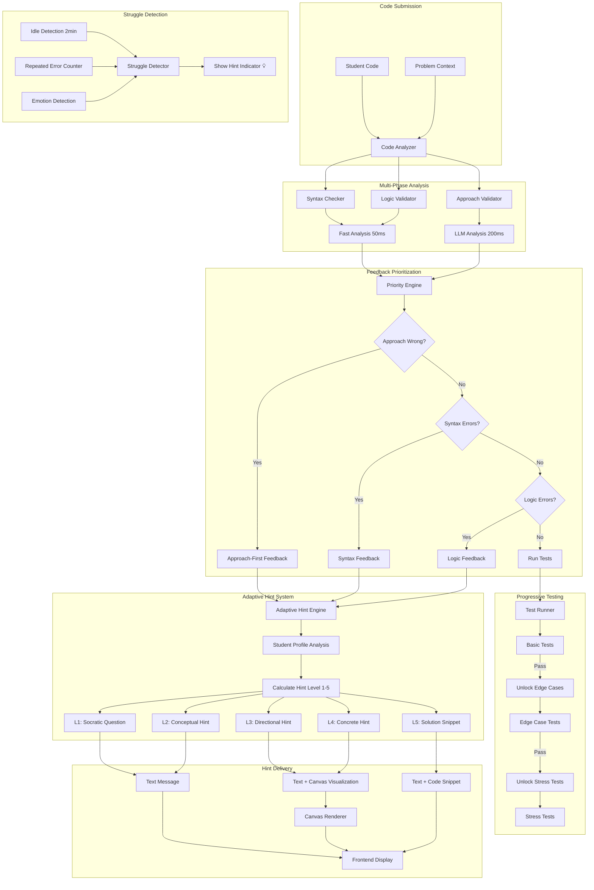
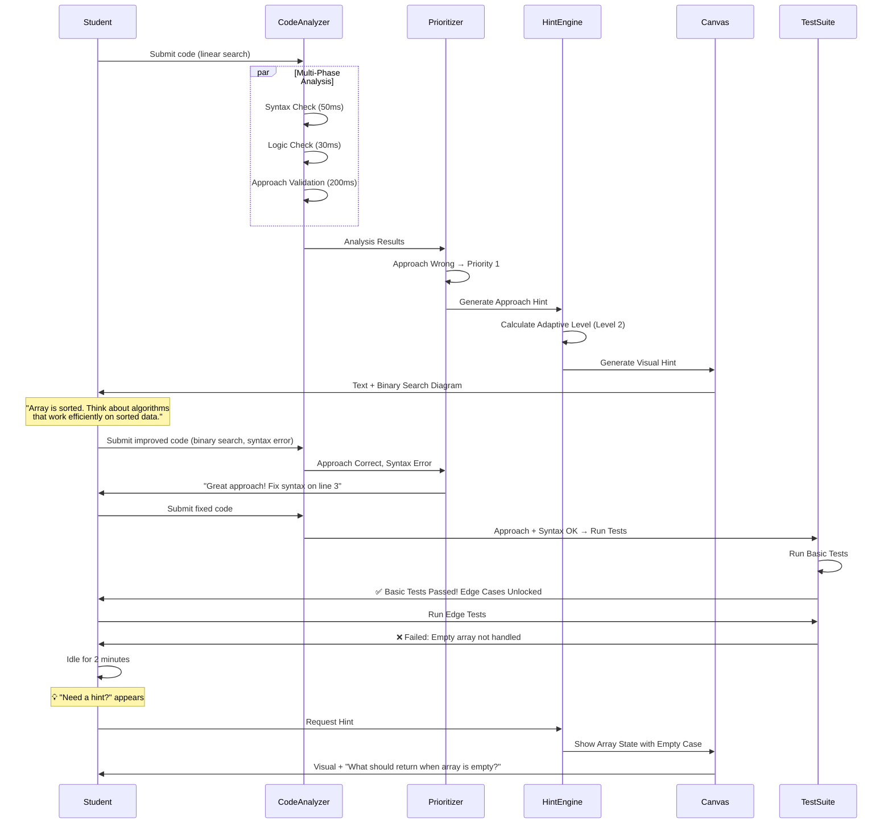

# Critical Gap 3: Socratic Coder Agent

**Status**: ✅ **Architecture Finalized (January 26, 2026)**

---

## Overview

This architecture addresses the challenge of providing intelligent, adaptive coding guidance that helps students learn algorithmic thinking and implementation skills through Socratic questioning rather than direct answers. The Coder Agent must analyze code for both syntactic and conceptual issues, provide progressive hints, and use visual aids to enhance understanding.

---

## The Challenge

Students writing code for algorithms and data structures need guidance that:
- Helps them think through problems independently
- Provides scaffolded support based on their skill level
- Validates both implementation and algorithmic approach
- Uses visual aids for complex concepts (recursion, pointers, etc.)
- Gamifies learning through progressive challenges

**Requirements**:
- Analyze code for syntax, logic, and algorithmic correctness
- Provide adaptive hints that escalate based on student skill and struggle
- Detect when students are stuck and offer help proactively
- Visualize hints on canvas for complex concepts
- Reveal test cases progressively as students improve

---

## Architecture Components



---

## Decision 1: Hint Progression Strategy

### **Choice: C - Adaptive Escalation (Intelligence-Based)**

**Implementation**: System analyzes error patterns and student history to intelligently determine hint levels

### Adaptive Hint Engine

```python
from dataclasses import dataclass
from typing import Dict, List, Optional
import time

@dataclass
class StudentProfile:
    """Student learning profile from Analyst Agent"""
    user_id: str
    skill_level: str  # 'beginner' | 'intermediate' | 'advanced'
    problems_solved: Dict[str, int]  # category -> count
    avg_solve_time: Dict[str, float]  # category -> seconds
    hint_effectiveness: Dict[int, float]  # hint_level -> success_rate
    current_streak: int
    total_attempts: int
    
@dataclass
class ProblemAttempt:
    """Current problem attempt state"""
    problem_id: str
    problem_category: str  # 'recursion', 'sorting', 'trees', etc.
    complexity: int  # 1-10
    start_time: float
    attempts: int
    errors: List[Dict[str, Any]]
    hint_level: int
    
class AdaptiveHintEngine:
    """Intelligent hint progression based on student profile and behavior"""
    
    def __init__(self, analyst_agent, llm_client):
        self.analyst = analyst_agent
        self.llm = llm_client
        
    async def calculate_initial_hint_level(
        self,
        student: StudentProfile,
        attempt: ProblemAttempt
    ) -> int:
        """
        Determine starting hint level (1-5) based on:
        - Student's past performance on similar problems
        - Time spent on current problem
        - Number of attempts
        - Problem complexity
        """
        
        # Factor 1: Historical performance on similar problems
        category_success_rate = self._get_category_success_rate(
            student, attempt.problem_category
        )
        
        # Factor 2: Time spent vs average
        time_spent = time.time() - attempt.start_time
        avg_time = student.avg_solve_time.get(attempt.problem_category, 600)
        time_ratio = time_spent / avg_time if avg_time > 0 else 1.0
        
        # Factor 3: Number of attempts
        attempt_factor = min(attempt.attempts / 3, 1.0)  # Cap at 3 attempts
        
        # Factor 4: Problem complexity vs student skill
        complexity_gap = self._calculate_complexity_gap(student, attempt)
        
        # Calculate initial level
        if student.skill_level == 'advanced' and category_success_rate > 0.8:
            # Strong student - start with Socratic questions
            base_level = 1
        elif student.skill_level == 'intermediate' or category_success_rate > 0.5:
            # Intermediate - start with conceptual hints
            base_level = 2
        else:
            # Beginner or struggling - start with directional hints
            base_level = 3
        
        # Adjust based on current struggle
        if time_ratio > 2.0 or attempt.attempts >= 3:
            # Student is really stuck - jump up
            base_level = min(base_level + 1, 4)
        
        if complexity_gap > 2:
            # Problem is much harder than student level
            base_level = min(base_level + 1, 4)
        
        return base_level
    
    async def escalate_hint_level(
        self,
        current_level: int,
        student: StudentProfile,
        attempt: ProblemAttempt
    ) -> int:
        """
        Escalate hint level based on continued struggle
        May skip levels for advanced students
        """
        
        # Check if we should skip levels
        if self._should_skip_level(student, current_level):
            return min(current_level + 2, 5)
        
        # Normal escalation
        return min(current_level + 1, 5)
    
    def _get_category_success_rate(
        self,
        student: StudentProfile,
        category: str
    ) -> float:
        """Calculate success rate for problem category"""
        solved = student.problems_solved.get(category, 0)
        total = max(solved + 1, 1)  # Avoid division by zero
        return solved / total
    
    def _calculate_complexity_gap(
        self,
        student: StudentProfile,
        attempt: ProblemAttempt
    ) -> int:
        """Calculate gap between problem complexity and student level"""
        skill_to_complexity = {
            'beginner': 3,
            'intermediate': 6,
            'advanced': 9
        }
        student_complexity = skill_to_complexity.get(student.skill_level, 5)
        return attempt.complexity - student_complexity
    
    def _should_skip_level(
        self,
        student: StudentProfile,
        current_level: int
    ) -> bool:
        """Determine if we should skip hint levels for advanced students"""
        if student.skill_level == 'advanced' and current_level <= 2:
            # Advanced student stuck early - skip Socratic/conceptual, go straight to directional
            return True
        
        if student.current_streak > 5 and current_level == 1:
            # Student on hot streak - skip Socratic, go to conceptual
            return True
        
        return False
    
    async def generate_hint(
        self,
        level: int,
        error_type: str,
        code: str,
        problem: Dict[str, Any]
    ) -> Dict[str, Any]:
        """Generate hint at specified level"""
        
        if level == 1:
            # Socratic Question
            return await self._generate_socratic_question(error_type, problem)
        
        elif level == 2:
            # Conceptual Hint
            return await self._generate_conceptual_hint(error_type, problem)
        
        elif level == 3:
            # Directional Hint
            return await self._generate_directional_hint(error_type, code, problem)
        
        elif level == 4:
            # Concrete Hint
            return await self._generate_concrete_hint(error_type, code, problem)
        
        elif level == 5:
            # Solution Snippet
            return await self._generate_solution_snippet(error_type, code, problem)
    
    async def _generate_socratic_question(
        self,
        error_type: str,
        problem: Dict[str, Any]
    ) -> Dict[str, Any]:
        """Level 1: Ask thought-provoking question"""
        
        prompt = f"""
        Student is solving: {problem['description']}
        Error type: {error_type}
        
        Generate a Socratic question that guides their thinking without giving away the answer.
        Question should make them reflect on the core concept.
        """
        
        response = await self.llm.generate(prompt)
        
        return {
            'level': 1,
            'type': 'socratic_question',
            'text': response['question'],
            'visual': None
        }
    
    async def _generate_conceptual_hint(
        self,
        error_type: str,
        problem: Dict[str, Any]
    ) -> Dict[str, Any]:
        """Level 2: Provide conceptual guidance"""
        
        prompt = f"""
        Student is solving: {problem['description']}
        Expected algorithm: {problem['expected_algorithm']}
        Error type: {error_type}
        
        Provide a conceptual hint about the algorithm without specific code.
        """
        
        response = await self.llm.generate(prompt)
        
        return {
            'level': 2,
            'type': 'conceptual',
            'text': response['hint'],
            'visual': None
        }
    
    async def _generate_directional_hint(
        self,
        error_type: str,
        code: str,
        problem: Dict[str, Any]
    ) -> Dict[str, Any]:
        """Level 3: Point to specific area needing attention"""
        
        prompt = f"""
        Student code: {code}
        Problem: {problem['description']}
        Error type: {error_type}
        
        Provide a directional hint pointing to the specific part of their approach that needs work.
        Include a simple visual representation if helpful (array state, tree structure, etc.)
        """
        
        response = await self.llm.generate(prompt)
        
        return {
            'level': 3,
            'type': 'directional',
            'text': response['hint'],
            'visual': response.get('visual_hint')  # Optional canvas visualization
        }
    
    async def _generate_concrete_hint(
        self,
        error_type: str,
        code: str,
        problem: Dict[str, Any]
    ) -> Dict[str, Any]:
        """Level 4: Provide concrete guidance with pseudocode"""
        
        prompt = f"""
        Student code: {code}
        Problem: {problem['description']}
        Error type: {error_type}
        
        Provide concrete guidance with pseudocode or specific code patterns.
        Include visual explanation on canvas.
        """
        
        response = await self.llm.generate(prompt)
        
        return {
            'level': 4,
            'type': 'concrete',
            'text': response['hint'],
            'pseudocode': response.get('pseudocode'),
            'visual': response['visual_hint']
        }
    
    async def _generate_solution_snippet(
        self,
        error_type: str,
        code: str,
        problem: Dict[str, Any]
    ) -> Dict[str, Any]:
        """Level 5: Show solution snippet for stuck students"""
        
        prompt = f"""
        Student code: {code}
        Problem: {problem['description']}
        Error type: {error_type}
        
        Student is very stuck. Provide a small solution snippet that fixes the immediate issue.
        Explain why this works.
        """
        
        response = await self.llm.generate(prompt)
        
        return {
            'level': 5,
            'type': 'solution',
            'text': response['explanation'],
            'code_snippet': response['code'],
            'visual': response.get('visual_hint')
        }
```

### Hint Level Examples

**Problem**: Implement binary search

| Level | Hint Example |
|-------|--------------|
| **Level 1 (Socratic)** | "What should happen to the search space after each comparison?" |
| **Level 2 (Conceptual)** | "Binary search works by repeatedly dividing the search space in half. Consider what 'in half' means mathematically." |
| **Level 3 (Directional)** | "Your loop condition should check if `left <= right`. Focus on updating the `mid` pointer correctly." |
| **Level 4 (Concrete)** | "Add: `mid = (left + right) // 2`. When target is greater, update `left = mid + 1`." |
| **Level 5 (Solution)** | "Here's the comparison logic: `if arr[mid] == target: return mid`" |

---

## Decision 2: Hint Triggering

### **Choice: C - Hybrid (Detect + Gentle Offer)**

**Implementation**: System detects struggle signals but shows subtle indicator, letting student control when to reveal hints

### Struggle Detection System

```python
class StruggleDetector:
    """Detect when students are struggling and offer help proactively"""
    
    IDLE_THRESHOLD = 120  # 2 minutes
    ERROR_REPEAT_THRESHOLD = 3
    
    def __init__(self, emotion_detector):
        self.emotion_detector = emotion_detector
        self.last_code_change = time.time()
        self.error_history = []
        self.hint_offered = False
    
    def on_code_change(self, code: str):
        """Track code changes to detect idle time"""
        self.last_code_change = time.time()
        self.hint_offered = False  # Reset hint offer on new activity
    
    def on_error(self, error: Dict[str, Any]):
        """Track errors to detect repeated mistakes"""
        self.error_history.append({
            'error': error,
            'timestamp': time.time()
        })
        
        # Keep only recent errors (last 5 minutes)
        cutoff = time.time() - 300
        self.error_history = [
            e for e in self.error_history 
            if e['timestamp'] > cutoff
        ]
    
    async def should_offer_hint(
        self,
        student_input: Optional[str] = None,
        audio: Optional[np.ndarray] = None
    ) -> bool:
        """
        Determine if system should offer a hint
        Returns True if any struggle signal detected
        """
        
        # Signal 1: Code hasn't changed in 2+ minutes
        idle_time = time.time() - self.last_code_change
        if idle_time >= self.IDLE_THRESHOLD:
            return True
        
        # Signal 2: Same error repeated 3+ times
        if self._has_repeated_errors():
            return True
        
        # Signal 3: Student explicitly says they're stuck
        if student_input and self._indicates_stuck(student_input):
            return True
        
        # Signal 4: Emotion detection shows frustration
        if audio is not None:
            emotion = await self.emotion_detector.analyze(audio)
            if emotion['label'] in ['frustrated', 'confused']:
                return True
        
        return False
    
    def _has_repeated_errors(self) -> bool:
        """Check if same error repeated multiple times"""
        if len(self.error_history) < self.ERROR_REPEAT_THRESHOLD:
            return False
        
        # Group by error type
        from collections import Counter
        error_types = [e['error']['type'] for e in self.error_history]
        most_common = Counter(error_types).most_common(1)[0]
        
        return most_common[1] >= self.ERROR_REPEAT_THRESHOLD
    
    def _indicates_stuck(self, student_input: str) -> bool:
        """Check if student input indicates being stuck"""
        stuck_phrases = [
            'stuck', 'help', "don't understand", "don't get it",
            'confused', "can't figure", 'struggling', 'lost'
        ]
        
        input_lower = student_input.lower()
        return any(phrase in input_lower for phrase in stuck_phrases)
```

### UI/UX Implementation

```typescript
// React component for hint indicator
import { useState, useEffect } from 'react';
import { LightBulbIcon } from '@/components/icons';

interface HintIndicatorProps {
  shouldShow: boolean;
  onRequestHint: () => void;
}

export const HintIndicator: React.FC<HintIndicatorProps> = ({
  shouldShow,
  onRequestHint
}) => {
  const [isVisible, setIsVisible] = useState(false);
  
  useEffect(() => {
    if (shouldShow && !isVisible) {
      // Fade in with subtle animation
      setTimeout(() => setIsVisible(true), 500);
    }
  }, [shouldShow]);
  
  if (!isVisible) return null;
  
  return (
    <div 
      className="hint-indicator"
      onClick={onRequestHint}
      role="button"
      aria-label="Request hint"
    >
      <LightBulbIcon className="pulse-animation" />
      <span className="hint-text">Need a hint?</span>
      
      <style jsx>{`
        .hint-indicator {
          position: fixed;
          bottom: 20px;
          right: 20px;
          padding: 12px 20px;
          background: linear-gradient(135deg, #667eea 0%, #764ba2 100%);
          border-radius: 24px;
          color: white;
          display: flex;
          align-items: center;
          gap: 8px;
          cursor: pointer;
          box-shadow: 0 4px 12px rgba(0,0,0,0.15);
          transition: all 0.3s ease;
          animation: fadeIn 0.5s ease;
        }
        
        .hint-indicator:hover {
          transform: translateY(-2px);
          box-shadow: 0 6px 16px rgba(0,0,0,0.2);
        }
        
        .pulse-animation {
          animation: pulse 2s infinite;
        }
        
        @keyframes pulse {
          0%, 100% { opacity: 1; }
          50% { opacity: 0.6; }
        }
        
        @keyframes fadeIn {
          from { opacity: 0; transform: translateY(10px); }
          to { opacity: 1; transform: translateY(0); }
        }
      `}</style>
    </div>
  );
};
```

### Voice Integration

```python
# Voice-triggered hint requests
class VoiceHintHandler:
    def __init__(self, hint_engine):
        self.hint_engine = hint_engine
        self.hint_request_phrases = [
            'give me a hint',
            'i need a hint',
            'hint please',
            'help me',
            'i\'m stuck',
            'what should i do'
        ]
    
    def is_hint_request(self, transcribed_text: str) -> bool:
        """Check if student is requesting a hint via voice"""
        text_lower = transcribed_text.lower()
        return any(phrase in text_lower for phrase in self.hint_request_phrases)
    
    async def handle_voice_input(self, text: str, audio: np.ndarray):
        """Handle voice input for hint requests"""
        
        if self.is_hint_request(text):
            # Direct hint request
            return await self.hint_engine.provide_next_hint()
        
        # Check for struggle signals in emotion
        emotion = await self.emotion_detector.analyze(audio)
        if emotion['label'] in ['frustrated', 'confused']:
            # Show hint indicator
            return {'action': 'show_hint_indicator'}
        
        return None
```

---

## Decision 3: Code Analysis Depth

### **Choice: A + B - Syntax/Logic + Algorithmic Approach**

**Implementation**: Two-phase analysis - fast error checking + deep approach validation

### Code Analysis Pipeline

```python
class CodeAnalyzer:
    """
    Comprehensive code analysis
    Phase 1: Syntax + Logic (Fast, <100ms)
    Phase 2: Algorithmic Approach (Deep, ~200ms)
    """
    
    def __init__(self, llm_client):
        self.llm = llm_client
        self.syntax_checker = SyntaxChecker()
        self.logic_validator = LogicValidator()
    
    async def analyze_code(
        self,
        code: str,
        problem: Dict[str, Any],
        language: str = 'python'
    ) -> Dict[str, Any]:
        """
        Perform comprehensive code analysis
        """
        
        # Phase 1: Fast checks (syntax + logic)
        syntax_result = self.syntax_checker.check(code, language)
        logic_result = self.logic_validator.validate(code, language)
        
        # Phase 2: Deep approach validation (parallel with Phase 1 completion)
        approach_result = await self.validate_approach(code, problem)
        
        return {
            'syntax_errors': syntax_result['errors'],
            'logic_errors': logic_result['errors'],
            'approach_analysis': approach_result,
            'total_time_ms': syntax_result['time'] + logic_result['time'] + approach_result['time']
        }
    
    async def validate_approach(
        self,
        code: str,
        problem: Dict[str, Any]
    ) -> Dict[str, Any]:
        """
        LLM-powered algorithmic approach validation
        Checks if student is using the right algorithm
        """
        
        start_time = time.time()
        
        prompt = f"""
        Problem Description: {problem['description']}
        Expected Algorithm: {problem['expected_algorithm']}
        Expected Complexity: {problem['expected_complexity']}
        
        Student Code:
        ```python
        {code}
        ```
        
        Analyze:
        1. Is the student using the correct algorithmic approach?
        2. What algorithm are they attempting? (e.g., "bubble sort", "binary search")
        3. Is their approach conceptually correct, even if implementation has issues?
        4. What complexity is their approach (time and space)?
        5. If approach is wrong, what conceptual hint would help redirect them?
        
        Respond in JSON:
        {{
            "approach_correct": bool,
            "detected_algorithm": str,
            "conceptually_sound": bool,
            "time_complexity": str,
            "space_complexity": str,
            "conceptual_hint": str (if approach_correct is false)
        }}
        """
        
        response = await self.llm.generate(prompt, response_format='json')
        
        elapsed_ms = (time.time() - start_time) * 1000
        
        return {
            **response,
            'time': elapsed_ms
        }


class SyntaxChecker:
    """Fast syntax error detection"""
    
    def check(self, code: str, language: str) -> Dict[str, Any]:
        """Check for syntax errors"""
        start_time = time.time()
        errors = []
        
        if language == 'python':
            try:
                compile(code, '<string>', 'exec')
            except SyntaxError as e:
                errors.append({
                    'type': 'syntax',
                    'line': e.lineno,
                    'message': str(e),
                    'hint': self._generate_syntax_hint(e)
                })
        
        elapsed_ms = (time.time() - start_time) * 1000
        
        return {
            'errors': errors,
            'time': elapsed_ms
        }
    
    def _generate_syntax_hint(self, error: SyntaxError) -> str:
        """Generate helpful hint for syntax error"""
        error_msg = str(error).lower()
        
        if 'eof' in error_msg:
            return "Check if you're missing a closing parenthesis, bracket, or quote"
        elif 'indent' in error_msg:
            return "Check your indentation - Python requires consistent spacing"
        elif 'invalid syntax' in error_msg:
            return "Look for missing colons (:) after if/for/while/def statements"
        else:
            return "Check the syntax near this line"


class LogicValidator:
    """Detect common logic errors"""
    
    def validate(self, code: str, language: str) -> Dict[str, Any]:
        """Check for logic errors"""
        start_time = time.time()
        errors = []
        
        # Check for common issues
        errors.extend(self._check_infinite_loops(code))
        errors.extend(self._check_off_by_one(code))
        errors.extend(self._check_uninitialized_vars(code))
        
        elapsed_ms = (time.time() - start_time) * 1000
        
        return {
            'errors': errors,
            'time': elapsed_ms
        }
    
    def _check_infinite_loops(self, code: str) -> List[Dict]:
        """Detect potential infinite loops"""
        errors = []
        
        # Pattern: while loop without break or variable update
        import re
        while_pattern = r'while\s+(.+?):'
        matches = re.finditer(while_pattern, code)
        
        for match in matches:
            condition = match.group(1)
            # Simple heuristic: if condition var not updated in loop body
            # (More sophisticated analysis would use AST)
            errors.append({
                'type': 'logic',
                'subtype': 'potential_infinite_loop',
                'line': code[:match.start()].count('\n') + 1,
                'message': 'Potential infinite loop detected',
                'hint': f'Make sure the condition "{condition}" eventually becomes False'
            })
        
        return errors
    
    def _check_off_by_one(self, code: str) -> List[Dict]:
        """Detect off-by-one errors in loops"""
        # Simplified check - production would use AST analysis
        return []
    
    def _check_uninitialized_vars(self, code: str) -> List[Dict]:
        """Detect variables used before initialization"""
        # Simplified check - production would use AST analysis
        return []
```

### Analysis Time Budget

| Phase | Target Time | Components |
|-------|-------------|------------|
| **Syntax Check** | 30-50ms | Compile check, parser |
| **Logic Validation** | 20-50ms | Pattern matching, AST analysis |
| **Approach Validation** | 150-250ms | LLM inference |
| **Total** | 200-350ms | Complete analysis |

---

## Decision 4: Error vs Approach Focus

### **Choice: B - Approach First**

**Implementation**: Prioritize conceptual understanding over syntax fixes

### Feedback Prioritization Engine

```python
class FeedbackPrioritizer:
    """
    Prioritize feedback based on issue severity
    Approach issues take precedence over syntax
    """
    
    def prioritize_feedback(
        self,
        analysis_result: Dict[str, Any]
    ) -> Dict[str, Any]:
        """
        Determine which feedback to show first
        Priority: Approach > Syntax > Logic > Success
        """
        
        approach = analysis_result['approach_analysis']
        syntax_errors = analysis_result['syntax_errors']
        logic_errors = analysis_result['logic_errors']
        
        # Priority 1: Approach is fundamentally wrong
        if not approach['approach_correct']:
            return {
                'priority': 'approach',
                'severity': 'high',
                'message': self._generate_approach_message(approach, syntax_errors),
                'hint_type': 'conceptual',
                'defer_syntax': len(syntax_errors) > 0,
                'defer_logic': len(logic_errors) > 0
            }
        
        # Priority 2: Approach OK, but syntax errors prevent execution
        if syntax_errors:
            return {
                'priority': 'syntax',
                'severity': 'medium',
                'message': "You're on the right track! Let's fix these syntax errors:",
                'errors': syntax_errors,
                'hint_type': 'syntax_fix'
            }
        
        # Priority 3: Syntax OK, approach OK, but logic issues
        if logic_errors:
            return {
                'priority': 'logic',
                'severity': 'medium',
                'message': "Almost there! Let's look at your logic:",
                'errors': logic_errors,
                'hint_type': 'logic_fix'
            }
        
        # Priority 4: Everything looks good - run tests
        return {
            'priority': 'success',
            'severity': 'low',
            'message': "Great work! Let's test your solution.",
            'action': 'run_tests'
        }
    
    def _generate_approach_message(
        self,
        approach: Dict[str, Any],
        syntax_errors: List[Dict]
    ) -> str:
        """
        Generate message when approach is wrong
        Acknowledge syntax errors but defer fixing them
        """
        
        detected_alg = approach['detected_algorithm']
        conceptual_hint = approach['conceptual_hint']
        
        message = (
            f"I see you're attempting {detected_alg}. "
        )
        
        if syntax_errors:
            message += (
                f"Your code has {len(syntax_errors)} syntax error(s), "
                "but let's first discuss your approach. "
            )
        
        message += conceptual_hint
        
        return message
```

### Example Scenario

**Problem**: Find element in sorted array (expects binary search)

**Student Code**: (Uses linear search with syntax error)
```python
def find(arr, target)  # Missing colon
    for i in range(len(arr)):
        if arr[i] == target:
            return i
    return -1
```

**Feedback (Approach-First)**:
```
System: "I see you're using a linear search approach. Your code also has a 
         syntax error on line 1, but let's first discuss your algorithm.
         
         Think about this: The array is already sorted. Do we need to check 
         every element? What algorithm works efficiently on sorted arrays?
         
         [Hint Level 2 - Conceptual]"
```

**Contrast with Error-First** (What we DON'T do):
```
System: "Syntax Error on line 1: Missing colon after function definition"
         
Student fixes syntax, submits again

System: "Your code runs but uses linear search O(n). The problem expects 
         binary search O(log n)."
         
[Student wasted time implementing wrong algorithm correctly]
```

---

## Decision 5: Hint Delivery Method

### **Choice: B - Text + Canvas Visualization**

**Implementation**: Combine text hints with visual canvas illustrations for complex concepts

### Visual Hint Generator

```python
@dataclass
class VisualHint:
    """Visual hint to be rendered on canvas"""
    text: str
    visual_type: str  # 'recursion_tree' | 'array_state' | 'pointer' | 'graph'
    canvas_commands: List[Dict[str, Any]]
    voice_narration: Optional[str] = None
    
class VisualHintGenerator:
    """Generate visual hints for canvas rendering"""
    
    def __init__(self, llm_client):
        self.llm = llm_client
    
    async def generate_visual_hint(
        self,
        hint_text: str,
        code: str,
        problem: Dict[str, Any],
        error_type: str
    ) -> VisualHint:
        """
        Generate visual representation to accompany text hint
        """
        
        # Determine if visualization would help
        needs_visual = self._needs_visualization(error_type, problem)
        
        if not needs_visual:
            return VisualHint(
                text=hint_text,
                visual_type='none',
                canvas_commands=[]
            )
        
        # Generate appropriate visualization
        if 'recursion' in problem['categories']:
            return await self._generate_recursion_tree(hint_text, code, problem)
        
        elif 'array' in problem['categories'] or 'sorting' in problem['categories']:
            return await self._generate_array_state(hint_text, code, problem)
        
        elif 'two pointer' in problem['description'].lower():
            return await self._generate_pointer_visual(hint_text, code, problem)
        
        elif 'tree' in problem['categories'] or 'graph' in problem['categories']:
            return await self._generate_graph_visual(hint_text, code, problem)
        
        else:
            return VisualHint(
                text=hint_text,
                visual_type='none',
                canvas_commands=[]
            )
    
    def _needs_visualization(self, error_type: str, problem: Dict) -> bool:
        """Determine if visual hint would be helpful"""
        visual_categories = [
            'recursion', 'tree', 'graph', 'array', 'sorting',
            'two pointer', 'sliding window'
        ]
        
        problem_categories = problem.get('categories', [])
        description = problem.get('description', '').lower()
        
        return any(
            cat in problem_categories or cat in description
            for cat in visual_categories
        )
    
    async def _generate_recursion_tree(
        self,
        hint_text: str,
        code: str,
        problem: Dict
    ) -> VisualHint:
        """Generate recursion tree visualization"""
        
        # Example: Fibonacci recursion tree
        canvas_commands = [
            {
                'action': 'write_heading',
                'content': 'Recursion Tree',
                'style': 'handwriting',
                'position': {'x': 100, 'y': 50}
            },
            {
                'action': 'draw_tree',
                'content': {
                    'root': 'fib(4)',
                    'children': [
                        {
                            'value': 'fib(3)',
                            'children': [
                                {'value': 'fib(2)'},
                                {'value': 'fib(1)'}
                            ]
                        },
                        {
                            'value': 'fib(2)',
                            'children': [
                                {'value': 'fib(1)'},
                                {'value': 'fib(0)'}
                            ]
                        }
                    ]
                },
                'style': 'handwriting',
                'animate': 'pen_trail'
            },
            {
                'action': 'highlight',
                'content': 'Base cases: fib(0), fib(1)',
                'position': {'x': 100, 'y': 400},
                'style': 'emphasis'
            }
        ]
        
        voice_narration = (
            "Notice how the recursion branches out. "
            "Each call splits into two smaller subproblems. "
            "The base cases are at the bottom where recursion stops."
        )
        
        return VisualHint(
            text=hint_text,
            visual_type='recursion_tree',
            canvas_commands=canvas_commands,
            voice_narration=voice_narration
        )
    
    async def _generate_array_state(
        self,
        hint_text: str,
        code: str,
        problem: Dict
    ) -> VisualHint:
        """Generate array state progression visualization"""
        
        # Example: Sorting visualization
        canvas_commands = [
            {
                'action': 'write_heading',
                'content': 'Array State Progression',
                'style': 'handwriting',
                'position': {'x': 100, 'y': 50}
            },
            {
                'action': 'draw_array_sequence',
                'content': [
                    {'array': [5, 2, 8, 1, 9], 'highlight': 0, 'label': 'Initial'},
                    {'array': [2, 5, 8, 1, 9], 'highlight': 1, 'label': 'After swap'},
                    {'array': [2, 5, 8, 1, 9], 'highlight': 2, 'label': 'No swap needed'},
                ],
                'style': 'handwriting',
                'animate': 'sequential'
            }
        ]
        
        voice_narration = (
            "Watch how the array changes at each step. "
            "The highlighted element is being compared."
        )
        
        return VisualHint(
            text=hint_text,
            visual_type='array_state',
            canvas_commands=canvas_commands,
            voice_narration=voice_narration
        )
    
    async def _generate_pointer_visual(
        self,
        hint_text: str,
        code: str,
        problem: Dict
    ) -> VisualHint:
        """Generate two-pointer visualization"""
        
        canvas_commands = [
            {
                'action': 'write_heading',
                'content': 'Two Pointer Approach',
                'style': 'handwriting',
                'position': {'x': 100, 'y': 50}
            },
            {
                'action': 'draw_array_with_pointers',
                'content': {
                    'array': [1, 2, 3, 4, 5],
                    'pointers': [
                        {'name': 'left', 'index': 0, 'color': 'blue'},
                        {'name': 'right', 'index': 4, 'color': 'red'}
                    ]
                },
                'style': 'handwriting',
                'animate': 'pointer_movement'
            },
            {
                'action': 'write_text',
                'content': 'left moves →, right moves ←',
                'position': {'x': 100, 'y': 300},
                'style': 'handwriting'
            }
        ]
        
        voice_narration = (
            "The left pointer starts at the beginning. "
            "The right pointer starts at the end. "
            "They move towards each other."
        )
        
        return VisualHint(
            text=hint_text,
            visual_type='pointer',
            canvas_commands=canvas_commands,
            voice_narration=voice_narration
        )
    
    async def _generate_graph_visual(
        self,
        hint_text: str,
        code: str,
        problem: Dict
    ) -> VisualHint:
        """Generate graph/tree structure visualization"""
        
        # Implementation similar to recursion tree
        # but for graph nodes and edges
        pass
```

### Frontend Canvas Integration

```typescript
// React component for rendering visual hints
interface CanvasCommand {
  action: string;
  content: any;
  style?: string;
  position?: {x: number, y: number};
  animate?: string;
}

export const VisualHintRenderer: React.FC<{commands: CanvasCommand[]}> = ({
  commands
}) => {
  const canvasRef = useRef<HTMLCanvasElement>(null);
  
  useEffect(() => {
    if (commands.length > 0) {
      renderHintSequence(canvasRef.current, commands);
    }
  }, [commands]);
  
  const renderHintSequence = async (
    canvas: HTMLCanvasElement,
    commands: CanvasCommand[]
  ) => {
    for (const command of commands) {
      await renderCommand(canvas, command);
      
      // Wait between commands for readability
      if (command.animate !== 'none') {
        await delay(500);
      }
    }
  };
  
  const renderCommand = async (
    canvas: HTMLCanvasElement,
    command: CanvasCommand
  ) => {
    switch (command.action) {
      case 'draw_tree':
        await drawRecursionTree(canvas, command.content);
        break;
      
      case 'draw_array_sequence':
        await drawArraySequence(canvas, command.content);
        break;
      
      case 'draw_array_with_pointers':
        await drawArrayWithPointers(canvas, command.content);
        break;
      
      // ... other command types
    }
  };
  
  return (
    <div className="visual-hint-canvas">
      <canvas ref={canvasRef} width={800} height={600} />
    </div>
  );
};
```

---

## Bonus Decision: Test Case Strategy

### **Choice: B - Progressive Test Case Reveal**

**Implementation**: Gamified test case system that reveals edge cases as students progress

### Progressive Test Suite

```python
@dataclass
class TestCase:
    """Individual test case"""
    id: str
    input: Any
    expected_output: Any
    category: str  # 'basic' | 'edge' | 'stress'
    description: str
    hidden: bool = True
    
@dataclass
class TestResult:
    """Test execution result"""
    test_id: str
    passed: bool
    actual_output: Any
    expected_output: Any
    execution_time_ms: float
    error: Optional[str] = None

class ProgressiveTestSuite:
    """
    Progressive test case reveal system
    Students unlock harder test cases by passing easier ones
    """
    
    def __init__(self, problem: Dict[str, Any]):
        self.problem = problem
        self.test_cases = self._organize_test_cases()
        self.current_level = 'basic'
        self.unlocked_levels = ['basic']
    
    def _organize_test_cases(self) -> Dict[str, List[TestCase]]:
        """Organize test cases into difficulty levels"""
        
        basic_tests = [
            TestCase(
                id='basic_1',
                input=[1, 2, 3, 4, 5],
                expected_output=3,
                category='basic',
                description='Normal case: target in middle',
                hidden=False  # Always visible
            ),
            TestCase(
                id='basic_2',
                input=[1, 3, 5, 7, 9],
                expected_output=5,
                category='basic',
                description='Normal case: target exists',
                hidden=False
            )
        ]
        
        edge_tests = [
            TestCase(
                id='edge_1',
                input=[],
                expected_output=None,
                category='edge',
                description='Empty array',
                hidden=True  # Unlock after basic pass
            ),
            TestCase(
                id='edge_2',
                input=[1],
                expected_output=1,
                category='edge',
                description='Single element',
                hidden=True
            ),
            TestCase(
                id='edge_3',
                input=[1, 2],
                expected_output=None,  # Target not in array
                category='edge',
                description='Target not found',
                hidden=True
            )
        ]
        
        stress_tests = [
            TestCase(
                id='stress_1',
                input=list(range(100000)),
                expected_output=99999,
                category='stress',
                description='Large array: 100K elements',
                hidden=True  # Unlock after edge pass
            ),
            TestCase(
                id='stress_2',
                input=list(range(1000000)),
                expected_output=0,
                category='stress',
                description='Very large array: 1M elements',
                hidden=True
            )
        ]
        
        return {
            'basic': basic_tests,
            'edge': edge_tests,
            'stress': stress_tests
        }
    
    async def run_tests(
        self,
        student_code: str,
        level: Optional[str] = None
    ) -> Dict[str, Any]:
        """
        Run test cases at specified level (or current level)
        """
        
        level = level or self.current_level
        
        if level not in self.unlocked_levels:
            return {
                'error': f'Level {level} not unlocked yet',
                'current_level': self.current_level
            }
        
        test_cases = self.test_cases[level]
        results = []
        
        for test in test_cases:
            result = await self._execute_test(student_code, test)
            results.append(result)
        
        # Check if all tests passed
        all_passed = all(r.passed for r in results)
        
        if all_passed:
            next_level = self._get_next_level(level)
            
            if next_level:
                self._unlock_level(next_level)
                
                return {
                    'status': 'level_complete',
                    'level': level,
                    'results': results,
                    'message': f'🎉 {level.title()} tests passed! {next_level.title()} tests unlocked.',
                    'unlocked_level': next_level
                }
        
        return {
            'status': 'incomplete',
            'level': level,
            'results': results,
            'passed': sum(1 for r in results if r.passed),
            'total': len(results)
        }
    
    async def _execute_test(
        self,
        student_code: str,
        test: TestCase
    ) -> TestResult:
        """Execute a single test case"""
        
        start_time = time.time()
        
        try:
            # Create safe execution environment
            exec_globals = {}
            exec(student_code, exec_globals)
            
            # Get student function (assume it's the first defined function)
            func_name = self._extract_function_name(student_code)
            student_func = exec_globals[func_name]
            
            # Run test
            actual_output = student_func(test.input)
            
            # Check result
            passed = actual_output == test.expected_output
            
            elapsed_ms = (time.time() - start_time) * 1000
            
            return TestResult(
                test_id=test.id,
                passed=passed,
                actual_output=actual_output,
                expected_output=test.expected_output,
                execution_time_ms=elapsed_ms
            )
        
        except Exception as e:
            elapsed_ms = (time.time() - start_time) * 1000
            
            return TestResult(
                test_id=test.id,
                passed=False,
                actual_output=None,
                expected_output=test.expected_output,
                execution_time_ms=elapsed_ms,
                error=str(e)
            )
    
    def _get_next_level(self, current: str) -> Optional[str]:
        """Get next difficulty level"""
        levels = ['basic', 'edge', 'stress']
        
        try:
            current_idx = levels.index(current)
            if current_idx < len(levels) - 1:
                return levels[current_idx + 1]
        except ValueError:
            pass
        
        return None
    
    def _unlock_level(self, level: str):
        """Unlock next difficulty level"""
        if level not in self.unlocked_levels:
            self.unlocked_levels.append(level)
            self.current_level = level
            
            # Unhide test cases at this level
            for test in self.test_cases[level]:
                test.hidden = False
    
    def get_visible_tests(self) -> List[TestCase]:
        """Get all currently visible test cases"""
        visible = []
        
        for level in self.unlocked_levels:
            visible.extend([
                t for t in self.test_cases[level]
                if not t.hidden
            ])
        
        return visible
```

### UI Gamification

```typescript
// Test case panel with progressive reveal
export const ProgressiveTestPanel: React.FC<{
  testSuite: ProgressiveTestSuite;
  results: TestResult[];
}> = ({ testSuite, results }) => {
  
  const getLevelStatus = (level: string) => {
    if (!testSuite.unlocked_levels.includes(level)) {
      return 'locked';
    }
    
    const levelResults = results.filter(r => r.test_id.startsWith(level));
    if (levelResults.every(r => r.passed)) {
      return 'passed';
    }
    
    return 'active';
  };
  
  return (
    <div className="test-panel">
      <h3>🧪 Test Cases</h3>
      
      {/* Basic Tests */}
      <TestLevelSection
        title="Basic Tests"
        status={getLevelStatus('basic')}
        tests={testSuite.test_cases.basic}
        results={results}
      />
      
      {/* Edge Cases */}
      <TestLevelSection
        title="Edge Cases"
        status={getLevelStatus('edge')}
        tests={testSuite.test_cases.edge}
        results={results}
        locked={!testSuite.unlocked_levels.includes('edge')}
      />
      
      {/* Stress Tests */}
      <TestLevelSection
        title="Stress Tests"
        status={getLevelStatus('stress')}
        tests={testSuite.test_cases.stress}
        results={results}
        locked={!testSuite.unlocked_levels.includes('stress')}
      />
      
      <style jsx>{`
        .test-panel {
          padding: 20px;
          background: #f8f9fa;
          border-radius: 8px;
        }
      `}</style>
    </div>
  );
};

const TestLevelSection: React.FC<{
  title: string;
  status: 'locked' | 'active' | 'passed';
  tests: TestCase[];
  results: TestResult[];
  locked?: boolean;
}> = ({ title, status, tests, results, locked }) => {
  
  if (locked) {
    return (
      <div className="test-level locked">
        <div className="level-header">
          <span className="lock-icon">🔒</span>
          <h4>{title}</h4>
          <span className="unlock-hint">Pass previous tests to unlock</span>
        </div>
      </div>
    );
  }
  
  return (
    <div className={`test-level ${status}`}>
      <div className="level-header">
        <span className="status-icon">
          {status === 'passed' ? '✅' : '🔓'}
        </span>
        <h4>{title}</h4>
      </div>
      
      <div className="test-list">
        {tests.map(test => {
          const result = results.find(r => r.test_id === test.id);
          
          return (
            <TestCaseItem
              key={test.id}
              test={test}
              result={result}
            />
          );
        })}
      </div>
    </div>
  );
};
```

---

## Complete Workflow Example

**Scenario**: Student implementing binary search, makes conceptual error



---

## Implementation Phases

### Phase 1: Basic Code Analysis ✅ Architecture Finalized
- Syntax checker implementation
- Logic validator with common patterns
- LLM-powered approach validation
- Feedback prioritization engine

### Phase 2: Adaptive Hint System (Next)
- Student profiling integration (Analyst Agent)
- Adaptive hint level calculator
- Hint escalation logic
- 5-level hint generator

### Phase 3: Struggle Detection
- Idle timer implementation
- Error counter tracking
- Emotion detection integration (Gap 2)
- Hint offer UI component

### Phase 4: Visual Hint System
- Canvas command generator
- Recursion tree visualizer
- Array state animator
- Pointer movement renderer
- Graph/tree structure drawer

### Phase 5: Progressive Test Suite
- Test case organizer (basic/edge/stress)
- Unlock system
- Test execution sandbox
- Gamified UI components

### Phase 6: Integration & Polish
- Gap 1 integration (voice narration for hints)
- Gap 2 integration (interruption during coding)
- End-to-end testing
- Performance optimization

---

## Key Decisions Summary

**Status**: ✅ **All Decisions Locked**

| # | Component | Decision |
|---|-----------|----------|
| 1 | **Hint Progression** | Adaptive Escalation - intelligence-based (1-5 levels) |
| 2 | **Hint Triggering** | Hybrid - detect struggle + gentle offer indicator |
| 3 | **Analysis Depth** | Syntax/Logic + Algorithmic Approach (no code quality) |
| 4 | **Priority Focus** | Approach First - conceptual over syntax |
| 5 | **Delivery Method** | Text + Canvas Visualization |
| **Bonus** | **Test Cases** | Progressive Reveal - unlock harder tests by passing easier ones |

---

## Technical Specifications

### Performance Targets
- **Code Analysis**: <350ms total
  - Syntax check: 30-50ms
  - Logic validation: 20-50ms
  - Approach validation: 150-250ms
- **Hint Generation**: <500ms (including LLM)
- **Visual Hint Rendering**: <200ms
- **Test Execution**: <100ms per test (excludes student code execution time)

### Hint Level Distribution Goals
- **Advanced Students**: 60% Level 1-2, 30% Level 3, 10% Level 4-5
- **Intermediate Students**: 40% Level 2-3, 40% Level 4, 20% Level 5
- **Beginner Students**: 20% Level 2-3, 50% Level 4, 30% Level 5

### Success Metrics
- **Hint Effectiveness**: >70% of students solve problem after receiving hints
- **Level Skipping Accuracy**: <15% students request lower level after skip
- **Visual Hint Impact**: >60% students report visual aids helped understanding
- **Test Suite Engagement**: >80% students attempt edge cases after unlock

---

## Integration with Other Gaps

### Gap 1 (Voice + Canvas) Integration
- Voice narration of visual hints
- Canvas animations for algorithm visualization
- Synchronized audio explanation with visual progression

### Gap 2 (Interruption) Integration
- Student can interrupt hint delivery to ask clarification
- Emotion detection triggers hint offers
- Smart resume after coding interruption

### Gap 4 (Empath Agent) Integration
- Emotion state influences hint level selection
- Frustration detection triggers more concrete hints
- Confidence detection allows hint level skipping

### Gap 5 (Visionary Agent) Integration
- Canvas state analysis for code visualization validation
- Real-time feedback on student's diagram-based solutions
- Visual hint generation based on student's drawing attempts

---

## Edge Cases & Handling

### Edge Case 1: Student Requests Lower Hint Level
**Handling**: Allow manual hint level adjustment
```python
if student_requests_lower_level:
    hint_engine.set_max_level(student_preference)
    # "I'll keep hints more conceptual"
```

### Edge Case 2: Hint at Level 5 Still Doesn't Help
**Handling**: Offer pair programming mode with Teacher Agent
```python
if hint_level == 5 and still_stuck:
    return "Would you like me to walk through the solution together?"
```

### Edge Case 3: Student Solves Without Hints
**Handling**: Update student profile, increase difficulty
```python
if solved_without_hints:
    student_profile.skill_level = upgrade_if_appropriate(student_profile)
    # "Great job! Let's try a harder problem."
```

### Edge Case 4: Visual Hint Rendering Fails
**Handling**: Fallback to text-only hint
```python
try:
    render_visual_hint(hint)
except RenderError:
    show_text_hint_only(hint.text)
    log_error("Visual hint rendering failed")
```

### Edge Case 5: Approach Detection Wrong
**Handling**: Allow student to correct system
```python
if student_says_approach_is_correct:
    # "Let me re-analyze your code..."
    reanalyze_with_student_context()
```

---

## Next Steps

✅ Gap 3 Architecture Complete → Ready for Implementation

🔜 **Gap 4**: Adaptive Empath Agent (Emotion-Driven Teaching Strategies)
