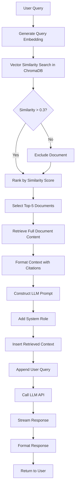

# Strategy 1: Baseline RAG

## 1.1 Strategy Overview

Baseline RAG (Retrieval-Augmented Generation) represents the foundational retrieval strategy that combines vector similarity search with Large Language Models. This strategy implements a straightforward pipeline: embed the user query, search for similar documents in the vector database, retrieve the top-k most similar chunks, and pass them as context to the LLM for response generation.

The baseline approach serves as the performance benchmark for more advanced strategies and handles simple, straightforward queries efficiently without unnecessary computational overhead.

## 1.2 Why This Strategy is Needed

### 1.2.1 Foundation for Comparison
Baseline RAG establishes performance metrics against which advanced strategies (Adaptive RAG and Omni-RAG) can be measured. It provides:
- Baseline precision and recall metrics
- Reference latency measurements
- Cost benchmarks (API calls, compute resources)

### 1.2.2 Efficient Simple Query Handling
Not all queries require complex retrieval mechanisms. Simple factual questions benefit from straightforward vector similarity search:
- "What is binary search?"
- "Define recursion"
- "Explain the OSI model"

For these queries, advanced techniques add latency without improving accuracy.

### 1.2.3 System Stability
Baseline RAG has minimal dependencies and failure points:
- Single retrieval pathway reduces complexity
- No fusion algorithms or reranking models
- Predictable performance characteristics
- Easier to debug and maintain

### 1.2.4 Resource Efficiency
For low-complexity queries identified by the Complexity Analyzer:
- Minimal CPU usage (single embedding operation)
- No cross-encoder inference overhead
- Reduced vector database queries
- Lower memory footprint

## 1.3 Algorithm / Logic Explanation

### 1.3.1 Step-by-Step Process

**Step 1: Query Embedding**
```
Input: User query (text string)
Process: 
  - Tokenize query using sentence transformer tokenizer
  - Generate dense vector embedding (384 dimensions for all-MiniLM-L6-v2)
  - Normalize embedding vector
Output: Query embedding vector
```

**Step 2: Vector Similarity Search**
```
Input: Query embedding, collection name (topic ID)
Process:
  - Access ChromaDB collection for specified topic
  - Compute cosine similarity between query embedding and document embeddings
  - Rank documents by similarity score (descending)
  - Apply similarity threshold (default: 0.3)
Output: Ranked list of document IDs and similarity scores
```

**Step 3: Document Retrieval**
```
Input: Top-k document IDs (k=5)
Process:
  - Retrieve full document content for each ID
  - Extract metadata (source, page number, chunk index)
  - Order by similarity score
Output: List of (document_content, metadata, score) tuples
```

**Step 4: Context Construction**
```
Input: Retrieved documents
Process:
  - Concatenate document contents with delimiters
  - Format as numbered references
  - Include source citations
  - Truncate if exceeding token limit (typically 2000 tokens)
Output: Formatted context string
```

**Step 5: Prompt Construction**
```
Input: Context string, user query, agent personality
Process:
  - Insert system role (agent instructions)
  - Add retrieved context as "background knowledge"
  - Append user query
  - Include response formatting instructions
Output: Complete LLM prompt
```

**Step 6: LLM Generation**
```
Input: Complete prompt
Process:
  - Send to LLM API (OpenAI/Gemini)
  - Stream response tokens
  - Parse and format output
Output: Final response to user
```

### 1.3.2 Mathematical Formulation

**Cosine Similarity:**
$$
\text{similarity}(q, d) = \frac{q \cdot d}{||q|| \times ||d||} = \frac{\sum_{i=1}^{n} q_i \times d_i}{\sqrt{\sum_{i=1}^{n} q_i^2} \times \sqrt{\sum_{i=1}^{n} d_i^2}}
$$

Where:
- $q$ = query embedding vector
- $d$ = document embedding vector
- $n$ = embedding dimensions (384)

**Top-K Selection:**
$$
\text{TopK}(Q, D, k) = \{d_i | d_i \in D, \text{rank}(d_i) \leq k\}
$$

Where ranking is based on $\text{similarity}(Q, d_i)$ in descending order.

## 1.4 Flow Diagram



## 1.5 Use Cases

### Use Case 1: Simple Factual Query
**Scenario**: User asks "What is a linked list?"

**Processing**:
1. Query embedded: `[0.23, -0.45, 0.67, ...]` (384-dim vector)
2. ChromaDB searches "Data Structures" collection
3. Top 5 chunks retrieved:
   - Chunk 1: Linked list definition (similarity: 0.89)
   - Chunk 2: Linked list types (similarity: 0.82)
   - Chunk 3: Linked list operations (similarity: 0.79)
   - Chunk 4: Arrays vs linked lists (similarity: 0.71)
   - Chunk 5: Memory representation (similarity: 0.68)
4. Context constructed with all 5 chunks
5. LLM generates comprehensive explanation with examples

**Outcome**: Accurate, well-structured response with source references

### Use Case 2: Conceptual Explanation
**Scenario**: User asks "Explain polymorphism in OOP"

**Processing**:
1. Vector search returns relevant OOP concept chunks
2. Retrieved context includes:
   - Polymorphism definition
   - Types (compile-time, runtime)
   - Examples in Java/Python
   - Benefits and use cases
3. LLM synthesizes coherent explanation from fragments

**Outcome**: Clear conceptual explanation with code examples

### Use Case 3: Definition Lookup
**Scenario**: User asks "Define Big O notation"

**Processing**:
1. High similarity match with algorithm analysis content
2. Single highly relevant chunk sufficient
3. Quick response with minimal LLM elaboration needed

**Outcome**: Fast, accurate definition with complexity examples

## 1.6 Advantages

### 1.6.1 Simplicity
- **Minimal Components**: Only requires embedding model and vector store
- **Easy to Understand**: Straightforward pipeline aids debugging
- **Low Maintenance**: Fewer dependencies mean fewer failure points

### 1.6.2 Speed
- **Fast Retrieval**: Single vector search operation
- **Low Latency**: ~200-500ms for typical queries
- **Predictable Performance**: Consistent response times

### 1.6.3 Resource Efficiency
- **Low CPU Usage**: One embedding operation
- **Minimal Memory**: No additional models loaded
- **Cost Effective**: Fewer computations reduce cloud costs

### 1.6.4 Stability
- **Reliable**: Well-tested vector similarity algorithms
- **Deterministic**: Same query produces same results (with fixed embeddings)
- **Robust**: Handles various query types adequately

### 1.6.5 Good Baseline Performance
- **Semantic Understanding**: Embeddings capture meaning beyond keywords
- **Context Awareness**: Retrieves semantically related content
- **Multi-Topic**: Works across diverse subject areas

## 1.7 Limitations

### 1.7.1 Keyword Mismatch Problem
**Issue**: Vector embeddings may miss exact keyword matches
**Example**: 
- Query: "What is HTTP?"
- Problem: May retrieve generic networking content instead of HTTP-specific information
- Reason: Acronyms and specific terms may embed poorly

**Impact**: Reduced precision for acronym-heavy or technical queries

### 1.7.2 No Reranking
**Issue**: Initial ranking based solely on embedding similarity
**Example**:
- Document A: High embedding similarity but contextually irrelevant
- Document B: Lower similarity but highly relevant to specific query aspect
- Result: Document A ranked higher despite being less useful

**Impact**: Suboptimal document ordering, potentially confusing LLM

### 1.7.3 Single Strategy Inflexibility
**Issue**: Same approach for all query types
**Example**:
- Simple query: "Define merge sort" (over-retrieves context)
- Complex query: "Compare merge sort vs quicksort for different data distributions" (under-retrieves)

**Impact**: Either wasteful retrieval or insufficient context

### 1.7.4 Semantic Similarity Limitations
**Issue**: Embeddings capture semantic similarity, not relevance
**Example**:
- Query: "How to debug segmentation faults?"
- Retrieved: General debugging content or memory management theory
- Missing: Specific debugging tools and practical techniques

**Impact**: Generically related content instead of actionable answers

### 1.7.5 No Context Compression
**Issue**: All retrieved chunks passed to LLM without filtering
**Example**:
- Retrieved 5 chunks, 2 are redundant, 1 is tangential
- LLM context window "wasted" on less relevant information
- Potentially confuses LLM with contradictory information

**Impact**: Reduced response quality, increased API costs

### 1.7.6 Poor Performance on Multi-Intent Queries
**Issue**: Single embedding doesn't capture multiple query aspects
**Example**: "Explain binary search and give me a practice problem"
**Problem**: Embedding averages both intents, retrieves generic content
**Impact**: Incomplete responses missing one or both aspects

### 1.7.7 Cold Start for Niche Topics
**Issue**: Limited training data for specialized subjects
**Example**: Niche algorithms or recent technologies poorly represented
**Impact**: Low-quality retrievals, LLM falls back to general knowledge (prone to hallucination)

## 1.8 Performance Characteristics

| Metric | Value | Notes |
|--------|-------|-------|
| Average Latency | 400-600ms | Query embedding + vector search + LLM |
| Retrieval Precision@5 | ~65-70% | Depends on corpus quality |
| Retrieval Recall@5 | ~40-50% | Limited by top-k constraint |
| Embedding Time | 50-100ms | Sentence Transformer inference |
| Vector Search Time | 50-150ms | ChromaDB ANN search |
| LLM Generation Time | 300-400ms | OpenAI GPT-3.5-turbo |
| Resource Usage | Low | Single model, minimal memory |

## 1.9 Configuration Parameters

```python
BASELINE_RAG_CONFIG = {
    "embedding_model": "all-MiniLM-L6-v2",
    "top_k": 5,
    "similarity_threshold": 0.3,
    "max_context_tokens": 2000,
    "collection_name": "{topic_id}",
    "search_type": "similarity",
    "distance_metric": "cosine"
}
```

## 1.10 When to Use Baseline RAG

**Recommended For**:
- Simple factual queries (definitions, concepts)
- Well-indexed topics with good corpus coverage
- Low-latency requirements
- Resource-constrained environments
- Queries with complexity score 1-3

**Not Recommended For**:
- Multi-part complex queries
- Acronym-heavy technical queries
- Queries requiring exact keyword matches
- Topics with sparse or low-quality corpus
- Queries requiring deep reasoning across multiple sources

## 1.11 Comparison with Advanced Strategies

| Aspect | Baseline RAG | Adaptive RAG | Omni-RAG |
|--------|-------------|--------------|----------|
| Retrieval Method | Vector only | Vector + Intent | Vector + BM25 + Rerank |
| Latency | Fast (~500ms) | Medium (~800ms) | Slow (~1200ms) |
| Accuracy | Good (70%) | Better (78%) | Best (85%) |
| Complexity | Low | Medium | High |
| Resource Usage | Low | Medium | High |
| Failure Modes | Keyword misses | Intent misclassification | Reranking errors |

## 1.12 Code Reference

Implementation located in:
- `backend/rag_system/__init__.py` - RAG factory function
- `backend/rag_system/hybrid_retriever.py` - Vector search logic
- `backend/ai_engine/agents.py` - Agent integration

**Key Function**: `get_baseline_rag(collection_name: str, top_k: int = 5)`

## 1.13 Conclusion

Baseline RAG provides a solid foundation for retrieval-augmented generation, offering a good balance of simplicity, speed, and accuracy for straightforward educational queries. While it lacks the sophistication of hybrid search and reranking mechanisms, its low latency and resource efficiency make it ideal for simple queries and serve as a performance baseline for more advanced strategies. The strategy's limitations motivate the development of Adaptive RAG and Omni-RAG, which address keyword matching, reranking, and multi-intent query challenges.
