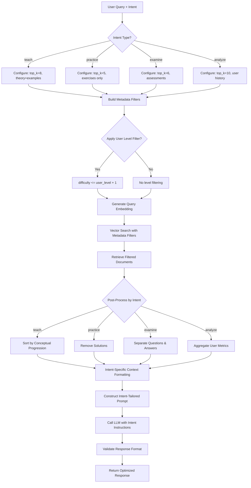

# Strategy 2: Adaptive RAG

## 2.1 Strategy Overview

Adaptive RAG extends Baseline RAG by introducing intent-aware retrieval mechanisms that adjust retrieval parameters and filtering strategies based on the classified intent of the user's query. Instead of applying a one-size-fits-all approach, Adaptive RAG recognizes that different types of queries—informational, procedural, assessment-related, or analytical—require different retrieval strategies.

The system uses the SetFit intent classifier output to dynamically configure retrieval depth, metadata filters, and context formatting, optimizing for each query type's specific requirements. This strategy represents a middle ground between the simplicity of Baseline RAG and the computational intensity of Omni-RAG.

## 2.2 Why This Strategy is Needed

### 2.2.1 Intent-Specific Optimization
Different query types have distinct characteristics and retrieval needs:

**Teaching Intent ("Explain binary search")**
- Requires comprehensive conceptual coverage
- Benefits from ordered, progressive explanations
- Needs examples and visual aids
- Higher top-k value (7-10 chunks)

**Practice Intent ("Give me a sorting problem")**
- Requires specific problem instances
- Benefits from metadata filtering (difficulty level)
- Needs clear problem statements without solutions
- Lower top-k value (3-5 chunks)

**Examination Intent ("Quiz me on databases")**
- Requires diverse question coverage
- Benefits from topic-based filtering
- Needs proper question-answer separation
- Medium top-k value (5-7 chunks)

**Analysis Intent ("How am I performing in algorithms?")**
- Requires user-specific data retrieval
- Benefits from temporal filtering
- Needs performance metrics aggregation
- Custom retrieval from user history

### 2.2.2 Bridging Performance Gap
Baseline RAG's uniform approach leaves performance gaps for specific query types, while Omni-RAG's full pipeline is overkill for moderate-complexity queries. Adaptive RAG fills this gap by:
- Providing better accuracy than Baseline without Omni-RAG's latency
- Handling moderate complexity queries (score 4-6)
- Offering configurable trade-offs between speed and accuracy

### 2.2.3 Metadata Utilization
Educational content contains rich metadata (difficulty level, prerequisites, topic tags, content type) that Baseline RAG ignores. Adaptive RAG leverages this metadata to:
- Filter documents by difficulty matching user level
- Prioritize specific content types (theory vs. practice)
- Apply prerequisite-based filtering
- Enable temporal filtering for current curriculum

### 2.2.4 Response Quality Improvement
Intent-aware context construction improves LLM response quality:
- Structured prompts tailored to query type
- Appropriate context volume per intent
- Format hints for desired output structure
- Reduced hallucination through targeted retrieval

## 2.3 Algorithm / Logic Explanation

### 2.3.1 High-Level Pipeline

```
Input: User Query, Intent Classification Result, User Context
↓
Intent Analysis → Determine retrieval strategy parameters
↓
Metadata Filter Construction → Build filters based on intent and user level
↓
Adaptive Vector Search → Search with intent-specific parameters
↓
Result Post-Processing → Format based on intent requirements
↓
Context Construction → Intent-aware prompt engineering
↓
LLM Generation → Generate response with tailored instructions
↓
Output: Intent-Optimized Response
```

### 2.3.2 Intent Classification Integration

**SetFit Classifier Output**:
```python
{
    "primary_intent": "teach",
    "secondary_intents": ["practice"],
    "confidence": 0.87,
    "complexity_hints": ["multi-part", "requires_examples"]
}
```

**Intent-to-Strategy Mapping**:
```python
INTENT_STRATEGIES = {
    "teach": {
        "top_k": 8,
        "metadata_filters": {"content_type": ["theory", "examples"]},
        "context_format": "comprehensive",
        "prompt_style": "pedagogical"
    },
    "practice": {
        "top_k": 5,
        "metadata_filters": {"content_type": ["exercises", "problems"]},
        "context_format": "problem_focused",
        "prompt_style": "practice_oriented"
    },
    "examine": {
        "top_k": 6,
        "metadata_filters": {"content_type": ["assessments", "questions"]},
        "context_format": "structured_qa",
        "prompt_style": "evaluative"
    },
    "analyze": {
        "top_k": 10,
        "metadata_filters": {"user_specific": True},
        "context_format": "analytical",
        "prompt_style": "data_driven"
    }
}
```

### 2.3.3 Adaptive Retrieval Process

**Step 1: Intent-Based Parameter Selection**
```
Input: Intent classification result
Process:
  - Map intent to retrieval configuration
  - Adjust top_k based on intent type
  - Select appropriate metadata filters
  - Determine context formatting style
Output: Retrieval configuration object
```

**Step 2: Metadata Filter Construction**
```
Input: Intent, user level, topic
Process:
  - Build metadata query filters
  - Example for "teach" intent:
    {
      "content_type": {"$in": ["theory", "examples"]},
      "difficulty": {"$lte": user_level + 1},
      "topic": current_topic
    }
Output: Metadata filter dictionary
```

**Step 3: Enhanced Vector Search**
```
Input: Query embedding, metadata filters, top_k
Process:
  - Perform vector similarity search in ChromaDB
  - Apply metadata filters during search (not post-filtering)
  - Retrieve top_k results matching both embedding and metadata
Output: Filtered, ranked document list
```

**Step 4: Intent-Specific Post-Processing**
```
Input: Retrieved documents, intent
Process:
  - For "teach": Sort by conceptual progression
  - For "practice": Filter out solutions, keep problem statements
  - For "examine": Ensure question-answer separation
  - For "analyze": Aggregate metrics, compute statistics
Output: Processed document set
```

**Step 5: Context Construction**
```
Input: Processed documents, intent
Process:
  - Format based on intent requirements
  - "teach": Numbered sections with progressive complexity
  - "practice": Problem statement followed by hints
  - "examine": Questions without revealing answers
  - "analyze": Tabular or chart-ready data format
Output: Formatted context string
```

**Step 6: Prompt Engineering**
```
Input: Formatted context, intent
Process:
  - Select intent-specific system prompt
  - Insert context with appropriate framing
  - Add intent-specific instructions
  - Include response format guidelines
Output: Complete, intent-optimized prompt
```

### 2.3.4 Mathematical Formulation

**Intent-Weighted Similarity**:
$$
\text{score}(q, d) = \alpha \cdot \text{similarity}(q, d) + \beta \cdot \text{intent\_match}(i, d)
$$

Where:
- $\alpha, \beta$ = weighting parameters (typically 0.7, 0.3)
- $\text{similarity}(q, d)$ = cosine similarity between query and document
- $\text{intent\_match}(i, d)$ = binary indicator if document matches intent metadata

**Adaptive Top-K Selection**:
$$
k_{\text{adaptive}} = k_{\text{base}} + f(\text{intent}, \text{complexity})
$$

Where:
- $k_{\text{base}}$ = default retrieval count (5)
- $f(\text{intent}, \text{complexity})$ = adjustment function based on query characteristics

## 2.4 Flow Diagram



## 2.5 Use Cases

### Use Case 1: Teaching Intent with Difficulty Adaptation
**Scenario**: Intermediate user asks "Explain dynamic programming"

**Processing**:
1. Intent: `teach`, Confidence: 0.91
2. User level: `intermediate` (level 2)
3. Retrieval config:
   ```python
   top_k = 8
   filters = {
       "content_type": ["theory", "examples"],
       "difficulty": {"$lte": 3},  # intermediate + 1
       "topic": "algorithms"
   }
   ```
4. Retrieved content:
   - DP definition (difficulty: 2)
   - Memoization concept (difficulty: 2)
   - Simple DP example - Fibonacci (difficulty: 1)
   - Classic DP - Knapsack (difficulty: 3)
   - DP optimization techniques (difficulty: 3)
5. Context formatted with progressive complexity
6. LLM generates explanation starting from basics to advanced

**Outcome**: User receives appropriately leveled explanation, not overwhelmed with advanced content

### Use Case 2: Practice Intent with Problem Filtering
**Scenario**: User requests "Give me a medium difficulty sorting problem"

**Processing**:
1. Intent: `practice`, Confidence: 0.88
2. Retrieval config:
   ```python
   top_k = 5
   filters = {
       "content_type": ["exercises"],
       "difficulty": 2,  # medium
       "topic": "sorting",
       "has_solution": True  # but will filter out in post-processing
   }
   ```
3. Retrieved problems:
   - Problem A: Merge k sorted arrays
   - Problem B: Custom comparator sort
   - Problem C: Counting inversions
4. Post-processing:
   - Extract problem statements only
   - Remove solution code
   - Keep problem constraints and hints
5. LLM presents problem with clear instructions

**Outcome**: User receives practice problem without spoilers, can attempt independently

### Use Case 3: Multi-Intent Query
**Scenario**: User asks "Explain quicksort and give me a practice problem"

**Processing**:
1. Primary intent: `teach`, Secondary: `practice`
2. Hybrid retrieval config:
   ```python
   top_k = 10  # increased for dual intent
   filters = {
       "content_type": ["theory", "examples", "exercises"],
       "topic": "quicksort"
   }
   ```
3. Retrieved content:
   - Quicksort explanation (5 chunks)
   - Quicksort practice problems (5 chunks)
4. Context structured in two sections:
   - Section 1: Theory and examples
   - Section 2: Practice problems
5. LLM instructed to provide explanation followed by problem

**Outcome**: Comprehensive response addressing both aspects

### Use Case 4: Examination Intent with Answer Separation
**Scenario**: User requests "Quiz me on SQL joins"

**Processing**:
1. Intent: `examine`, Confidence: 0.85
2. Retrieval config:
   ```python
   top_k = 6
   filters = {
       "content_type": ["assessments", "questions"],
       "topic": "sql_joins"
   }
   ```
3. Post-processing:
   - Extract questions
   - Store answers separately (not passed to initial prompt)
   - Include question difficulty labels
4. LLM generates quiz with 3-5 questions
5. Answers held for subsequent evaluation

**Outcome**: Clean quiz presentation without answer leakage

## 2.6 Advantages

### 2.6.1 Intent-Specific Optimization
- **Tailored Retrieval**: Parameters adjusted per query type
- **Better Precision**: Metadata filtering reduces irrelevant results
- **Improved Recall**: Adaptive top-k ensures sufficient coverage

### 2.6.2 Metadata Exploitation
- **Content Type Filtering**: Retrieves theory vs. practice as needed
- **Difficulty Matching**: Aligns content with user level
- **Topic Scoping**: Focuses on relevant subject areas
- **Temporal Filtering**: Current vs. historical content

### 2.6.3 Performance Balance
- **Moderate Latency**: ~800ms (between Baseline and Omni-RAG)
- **Better Accuracy**: ~78% vs. 70% for Baseline
- **Resource Efficient**: No additional models beyond intent classifier
- **Scalable**: Metadata filtering reduces document processing

### 2.6.4 Flexibility
- **Configurable Strategies**: Easy to add new intent types
- **Parameter Tuning**: Adjustable weights and thresholds
- **Extensible Filters**: Custom metadata filters per domain
- **A/B Testing**: Compare intent strategies empirically

### 2.6.5 User Experience
- **Relevant Results**: Intent-aware retrieval matches expectations
- **Appropriate Depth**: Right amount of information per query type
- **Consistent Quality**: Less variance in response relevance
- **Personalization**: User-level adaptation improves accessibility

## 2.7 Limitations

### 2.7.1 Intent Classification Dependency
**Issue**: Strategy effectiveness relies on accurate intent classification

**Failure Scenarios**:
- **Misclassification**: "Explain binary search" classified as `examine` → retrieves quiz questions instead of explanations
- **Ambiguous Queries**: "Binary search" → unclear if user wants definition, implementation, or practice
- **Multi-Intent Confusion**: Classifier picks primary intent, may miss secondary needs

**Impact**: Wrong retrieval strategy leads to poor results, frustrating user

### 2.7.2 Metadata Quality Dependency
**Issue**: Requires well-curated metadata for all documents

**Challenges**:
- **Missing Metadata**: Documents without `content_type` or `difficulty` tags bypass filters
- **Inconsistent Tagging**: Different curators use different difficulty scales
- **Outdated Metadata**: Content updated but metadata not refreshed
- **Incomplete Coverage**: Not all educational content fits predefined categories

**Impact**: Incomplete or inaccurate filtering, reduced strategy effectiveness

### 2.7.3 Limited Semantic Understanding
**Issue**: Still relies primarily on vector similarity, not true relevance

**Example**:
- Query: "Best practices for error handling in async code"
- Retrieved: Generic error handling theory (matches metadata) but lacks async-specific insights
- Problem: Metadata filter `content_type=theory` too broad

**Impact**: Retrieves category-correct but contextually weak content

### 2.7.4 No Cross-Encoder Reranking
**Issue**: Initial ranking not refined by relevance models

**Scenario**:
- Document A: High embedding similarity, matches metadata, but redundant with user's prior knowledge
- Document B: Lower similarity, matches metadata, provides novel information
- Result: Document A ranked higher despite being less helpful

**Impact**: Suboptimal document ordering within intent-filtered results

### 2.7.5 Configuration Complexity
**Issue**: Requires manual configuration for each intent type

**Challenges**:
- Optimal `top_k` values require empirical tuning
- Metadata filter combinations grow combinatorially
- Intent-specific prompt engineering is labor-intensive
- A/B testing needed to validate configurations

**Impact**: High initial setup cost, ongoing maintenance burden

### 2.7.6 Cold Start for New Intents
**Issue**: Adding new intent types requires:
- Training data collection for intent classifier
- Configuration definition (top-k, filters, prompts)
- Metadata schema extensions
- Testing and validation

**Impact**: System not easily extensible to new query types

### 2.7.7 No Keyword Matching
**Issue**: Inherits Baseline RAG's keyword mismatch problem

**Example**:
- Query: "Explain HTTP/2 multiplexing"
- Problem: "HTTP/2" and "multiplexing" may embed poorly, even with intent filtering
- Retrieved: General HTTP content instead of HTTP/2 specifics

**Impact**: Precision loss for technical terminology despite intent awareness

## 2.8 Performance Characteristics

| Metric | Value | Comparison to Baseline |
|--------|-------|----------------------|
| Average Latency | 700-900ms | +30-50% |
| Retrieval Precision@5 | ~75-78% | +8-10% |
| Retrieval Recall@5 | ~50-55% | +5-10% |
| Intent Classification Time | 100-150ms | Additional overhead |
| Metadata Filtering Time | 20-50ms | Additional overhead |
| LLM Generation Time | 300-400ms | Unchanged |
| Resource Usage | Low-Medium | +Intent classifier model |

**Latency Breakdown**:
```
Intent Classification: 120ms
Query Embedding: 80ms
Vector Search + Metadata Filter: 180ms
Post-Processing: 50ms
Context Formatting: 40ms
LLM Generation: 350ms
Total: ~820ms
```

## 2.9 Configuration Parameters

```python
ADAPTIVE_RAG_CONFIG = {
    "embedding_model": "all-MiniLM-L6-v2",
    "intent_classifier": "setfit_model",
    
    "intent_strategies": {
        "teach": {
            "top_k": 8,
            "metadata_filters": {
                "content_type": ["theory", "examples"],
                "difficulty_adjustment": +1
            },
            "context_format": "progressive",
            "prompt_template": "pedagogical"
        },
        "practice": {
            "top_k": 5,
            "metadata_filters": {
                "content_type": ["exercises", "problems"]
            },
            "context_format": "problem_focused",
            "prompt_template": "practice"
        },
        "examine": {
            "top_k": 6,
            "metadata_filters": {
                "content_type": ["assessments", "questions"]
            },
            "context_format": "qa_separated",
            "prompt_template": "evaluative"
        },
        "analyze": {
            "top_k": 10,
            "metadata_filters": {
                "user_specific": True
            },
            "context_format": "analytical",
            "prompt_template": "data_driven"
        }
    },
    
    "similarity_threshold": 0.35,
    "intent_confidence_threshold": 0.7,
    "max_context_tokens": 2500
}
```

## 2.10 When to Use Adaptive RAG

**Recommended For**:
- Queries with clear intent signals
- Well-tagged knowledge bases with rich metadata
- Moderate complexity queries (score 4-6)
- Systems with diverse query types requiring differentiation
- User-specific personalization based on level/history

**Not Recommended For**:
- Systems with poor metadata coverage
- Highly ambiguous queries
- Maximum accuracy requirements (use Omni-RAG)
- Minimum latency requirements (use Baseline RAG)
- Technical queries with acronyms and specific terminology

## 2.11 Comparison with Other Strategies

| Aspect | Baseline RAG | Adaptive RAG | Omni-RAG |
|--------|-------------|--------------|----------|
| Intent Awareness | No | Yes | Yes |
| Metadata Filtering | No | Yes | Yes |
| Keyword Matching | No | No | Yes (BM25) |
| Reranking | No | No | Yes (Cross-Encoder) |
| Latency | 500ms | 820ms | 1200ms |
| Accuracy | 70% | 78% | 85% |
| Setup Complexity | Low | Medium | High |
| Maintenance | Easy | Moderate | Complex |

## 2.12 Code Reference

Implementation located in:
- `backend/rag_system/__init__.py` - Adaptive RAG factory function
- `backend/ai_engine/supervisor/classifier.py` - Intent classification
- `backend/ai_engine/agents.py` - Intent-based strategy selection

**Key Function**: `get_adaptive_rag(intent: str, user_context: dict, top_k: int = None)`

**Example Usage**:
```python
intent_result = intent_classifier.classify(query)
rag_retriever = get_adaptive_rag(
    intent=intent_result['primary_intent'],
    user_context={'level': 2, 'topic': 'algorithms'},
    top_k=None  # Auto-configured based on intent
)
docs = rag_retriever.get_relevant_documents(query)
```

## 2.13 Future Enhancements

### 2.13.1 Dynamic Weight Learning
Instead of fixed $\alpha, \beta$ weights for intent-weighted similarity, learn optimal weights per intent through reinforcement learning based on user feedback.

### 2.13.2 Intent Combination Strategies
For multi-intent queries, develop fusion algorithms that blend retrieval strategies instead of picking a primary intent.

### 2.13.3 Automatic Metadata Enrichment
Use LLMs to automatically generate metadata (difficulty, content_type) for untagged documents, reducing manual curation burden.

### 2.13.4 User Feedback Loop
Collect implicit feedback (time-on-page, follow-up queries) to refine intent-specific configurations adaptively.

## 2.14 Conclusion

Adaptive RAG strikes a balance between the simplicity of Baseline RAG and the computational cost of Omni-RAG by introducing intent-aware retrieval mechanisms. By leveraging metadata filtering and intent-specific configuration, it achieves meaningful accuracy improvements (~8-10%) with moderate latency overhead (~300ms). The strategy's effectiveness depends critically on accurate intent classification and well-curated metadata, making it most suitable for systems with structured educational content and clear query intent patterns. For organizations willing to invest in metadata curation and intent model training, Adaptive RAG offers an excellent middle-ground solution that significantly enhances user experience without the full complexity of hybrid search and reranking pipelines.
