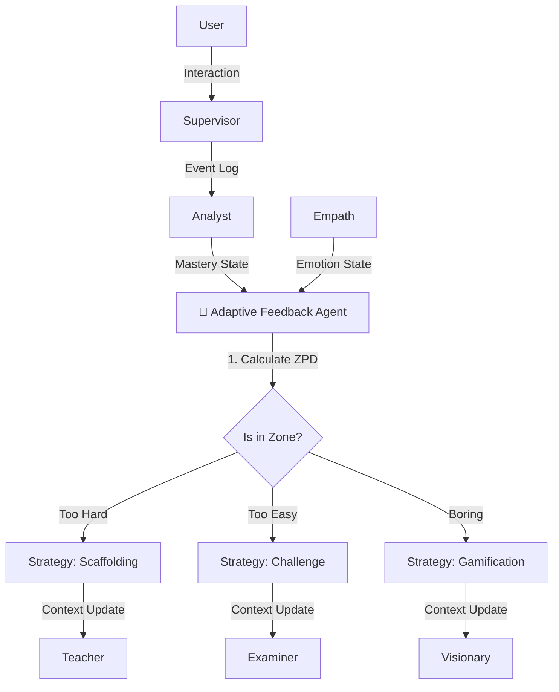

# Deep Analysis: Adaptive Feedback Loop Agent ("The Coach")

## 1. 🏛️ Agent Description
*   **Name**: Adaptive Feedback Agent (The Coach).
*   **Role**: The "Meta-Cognitive" engine. While the Supervisor directs traffic, the Coach decides **how** to drive. It actively adjusts the difficulty, tone, and pacing based on the student's real-time state.
*   **Philosophy**: Vygotsky's "Zone of Proximal Development" (ZPD). The agent ensures the user is challenged but not overwhelmed.

---

## 2. ⚙️ Technical Working Model

### Inputs (The Sensors)
1.  **From Analyst (Memory)**:
    *   `Topic Mastery Vector`: $[0.8, 0.4, 0.2]$ (High in Arrays, Low in Trees).
    *   `Learning Velocity`: Is the student learning fast or slow?
2.  **From Empath (Heart)**:
    *   `Current Arousal/Valence`: High Arousal + low Valence = Frustration.
3.  **From Interaction**:
    *   `Code Quality`: Did the code run on the first try?
    *   `Response Time`: Latency in student answer (Long pause = confusion).

### Core Logic (The Algorithms)
To host this "Adaptive Loop", we will use a hybrid of three strategies:

#### A. Deep Knowledge Tracing (DKT) - *The Predictor*
*   **Usage**: Predicts whether the student will get the *next* item correct.
*   **Algo**: LSTM or Transformer-based model (e.g., `Saint+`).
*   **Input**: Sequence of previous exercises ($ exercise_t, correct_t $).
*   **Output**: Probability of next success ($ P(correct | history) $).
*   **Action**: If $ P > 0.9 $, increase difficulty. If $ P < 0.4 $, remedial content.

#### B. Item Response Theory (IRT) - *The Matchmaker*
*   **Usage**: Matching "Student Ability" ($\theta$) with "Content Difficulty" ($\beta$).
*   **Formula**: $ P(\theta) = \frac{1}{1 + e^{-(\theta - \beta)}} $
*   **Action**: The Agent selects the next question such that $ P(\text{success}) \approx 0.65 $ (The ZPD sweet spot).

#### C. Multi-Armed Bandit (MAB) - *The Stylist*
*   **Usage**: Optimizing the "Teaching Style".
*   **Arms**: (1) Visual Analogy, (2) Code Example, (3) Mathematical Proof, (4) Socratic Question.
*   **Reward**: User engagement (length of session) or correctness.
*   **Action**: If "Visual Analogy" yields higher rewards for this user, exploit it more.

### Outputs (The Directives)
1.  **To Supervisor**: "Switch Agent". (e.g., "User is bored with theory. Force switch to Coder Agent").
2.  **To Teacher**: "Inject Prompt Modifier". (e.g., *`[CONSTRAINT: Explain using Minecraft analogies only. Keep readability < Grade 8.]`*).
3.  **To Examiner**: "Difficulty Setting". (e.g., "Generate Question: Difficulty=Hard").

---

## 3. 🔄 Workflow Diagram



---

## 4. 🛠️ Implementation Specs (Tech Stack)

*   **Library**: `scikit-learn` (for basic regression), `torch` (for DKT LSTM).
*   **Database**: PostgreSQL (Store vectors).
*   **Framework**: A simple Python Class in `backend/ai_engine/agents.py`.

```python
class AdaptiveAgent:
    def decide_strategy(self, mastery_score, emotion):
        # Implementation of the "Thermostat" Logic
        if emotion == "frustration" and mastery_score < 0.3:
            return "Strategy: ENCOURAGE_AND_SIMPLIFY"
        elif emotion == "boredom" and mastery_score > 0.8:
            return "Strategy: CHALLENGE_AND_COMPETE"
        else:
            return "Strategy: MAINTAIN_FLOW"
```
