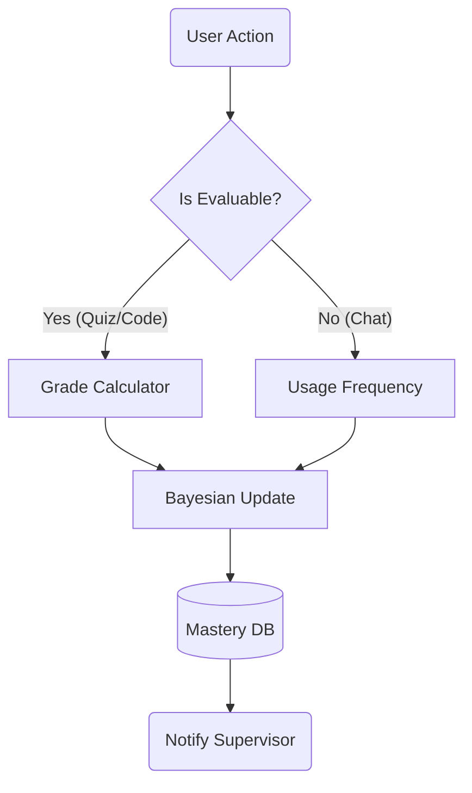

# Deep Analysis: Analyst Agent ("The Auditor")

## 1. 🏛️ Agent Description
*   **Name**: Analyst Agent.
*   **Role**: The background process that tracks "User Mastery". It never speaks directly to the user. It whispers to the Supervisor.
*   **Philosophy**: "Invisible Evaluation." Tests shouldn't feel like tests.

---

## 2. ⚙️ Technical Working Model

### Inputs
1.  **Interaction Log**: "User asked about BST -> Teacher explained -> User wrote code."
2.  **Code Execution Result**: "Syntax Error" or "Pass".

### Core Logic (The Algorithms)
#### A. Knowledge Tracing (DKT)
*   **Model**: Simple Bayesian Update (v1) -> LSTM (v2).
*   **Formula**: 
    $ P(Knows_T) = P(Knows_{T-1}) + \alpha \cdot Correct - \beta \cdot Incorrect $
*   **Decay**: Mastery score drops by 1% for every 24h of inactivity (Forgetting Curve).

#### B. Profile Management
*   **Database**: PostgreSQL / SQLite (Django ORM).
*   **Schema**:
    ```python
    class Mastery(models.Model):
        user = ForeignKey(User)
        topic = CharField() # e.g., "Recursion"
        score = FloatField() # 0.0 to 1.0
        confidence = FloatField()
    ```

### Outputs
*   **Mastery Vector**: `{'Recursion': 0.4, 'Loops': 0.9}`.
*   **Alerts**: "User is stuck on Recursion" (Triggers Remedial mode).

---

## 3. 🔄 Workflow Diagram



---

## 4. 🛠️ Implementation Specs

*   **Libraries**: `pandas` (Data manipulation), `scikit-learn` (Regression).
*   **Integration**: Asynchronous Task (Celery) or simple post-response hook.
