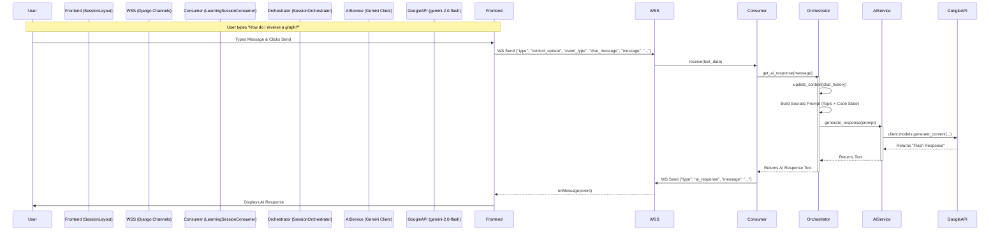

# System Architecture & Data Flow

This document visualizes how the **Frontend (Body)** and **Backend (Brain)** integrate to create the "Active Canvas" learning experience.

## High-Level Data Flow



## Detailed Component Interaction

### 1. The "Nervous System" (WebSocket Layer)
The connection is persistent. Unlike standard web requests, the "Active Canvas" stays connected to the server for the entire session.

*   **Frontend Trigger**: `SessionLayout.tsx` initializes the connection on mount.
*   **Protocol**: JSON over WebSocket.
*   **Events**:
    *   `context_update`: User changed language, added a node, or switched tools.
    *   `ai_response`: The AI wants to speak or show a hint.
    *   `sync_state`: (Planned) Save/Load the entire canvas state.

### 2. The "Brain" (Orchestrator)
The `SessionOrchestrator` class (`orchestrator.py`) is the decision maker.

*   It maintains a running **Context**:
    ```json
    {
      "topic": "Binary Search Trees",
      "proficiency": "Beginner",
      "current_task": "Implement Insert Method",
      "last_action": "User switched to Python"
    }
    ```
*   It decides **When** to trigger the AI. It filters noise (e.g., doesn't respond to every mouse move) but reacts to significant events (e.g., Code Run Error, Language Switch).

### 3. The Socratic Loop
1.  **Observe**: User performs an action (e.g., draws a node).
2.  **Interpret**: Orchestrator updates context.
3.  **Decide**: Does the user need help? (Sentiment Analysis/Timeout).
4.  **Act**: Generate a question (LLM) and send it back via WebSocket.
