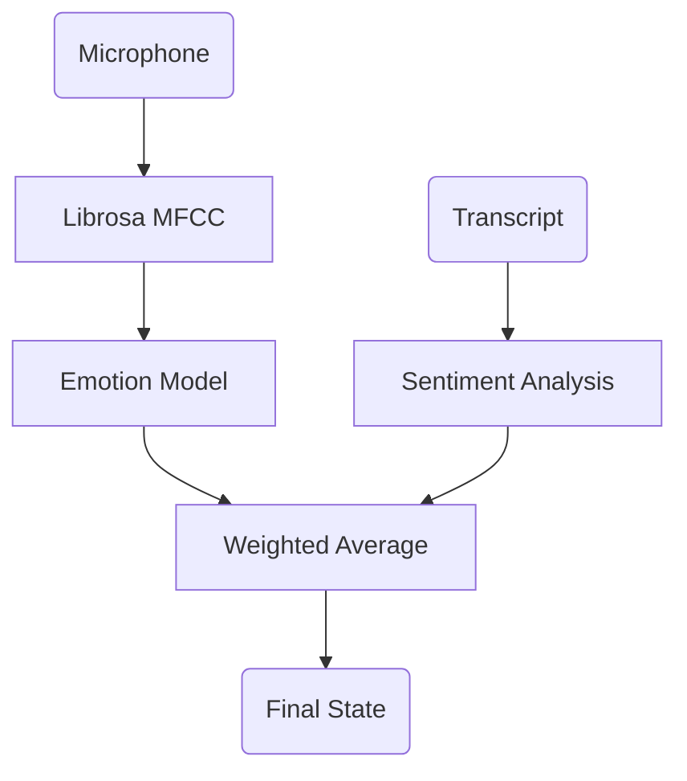

# Deep Analysis: Empath Agent ("The Counselor")

## 1. 🏛️ Agent Description
*   **Name**: Empath Agent.
*   **Role**: The emotion recognition subsystem. It ensures the AI doesn't sound robotic when the user is struggling.
*   **Philosophy**: "EQ > IQ." A tutor who knows the answer but ignores the frustration is a bad tutor.

---

## 2. ⚙️ Technical Working Model

### Inputs
1.  **Audio Stream**: Raw WAV bytes (via WebSocket).
2.  **Transcribed Text**: "I don't get it!"

### Core Logic (The Algorithms)
#### A. Acoustic Analysis (SER)
*   **Library**: `librosa`.
*   **Features**: MFCC (Mel-frequency cepstral coefficients), Pitch, Energy.
*   **Model**: TFLite / ONNX model trained on RAVDESS/TESS datasets.
*   **Classes**: `[Neutral, Calm, Happy, Sad, Angry, Fear, Disgust, Surprise]`.

#### B. Multi-Modal Fusion
*   **Logic**:
    *   Text Sentiment says "Negative" (-0.5).
    *   Audio Emotion says "Angry" (0.9 conf).
    *   **Result**: Weighted Average -> **HIGH FRUSTRATION**.

### Outputs
*   **Global State Update**: `AgentState['user_emotion'] = "frustrated"`.
*   **Action Directive**: "Lower Difficulty", "Change Topic".

---

## 3. 🔄 Workflow Diagram

---

## 4. 🛠️ Implementation Specs

*   **Inference**: `onnxruntime` (Fast CPU inference).
*   **Latency**: Must process < 200ms to be real-time.
*   **Fallback**: If Audio is silent, rely on Text.
