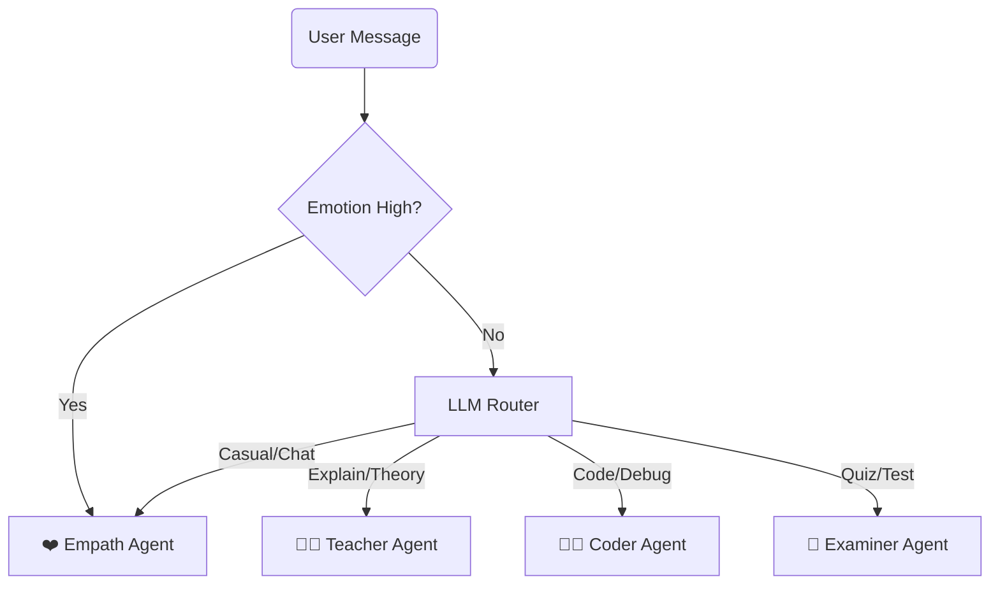

# Deep Analysis: Supervisor Agent ("The Principal")

## 1. 🏛️ Agent Description
*   **Name**: Supervisor Agent (The Router).
*   **Role**: The central orchestrator. It does not "think" about content; it "thinks" about delegation. It prevents the "One LLM does all" bottleneck by classifying intent and routing traffic.
*   **Philosophy**: "Delegation over Generalization."

---

## 2. ⚙️ Technical Working Model

### Inputs (The Sensors)
1.  **User Message**: "Can you debug this python code?"
2.  **Agent State**:
    *   `Emotion`: "Frustration" (High priority override).
    *   `Chat History`: Previous context.

### Core Logic (The Algorithms)
#### A. Emergency Override (Rule-Based)
*   **Logic**: If `Emotion == "Anger"` or `Emotion == "Fear"`.
*   **Action**: **IMMEDIATE ROUTE** to `Empath Agent`. Skip LLM.

#### B. Intent Classification via LLM
*   **Model**: Llama 3.2 (Local) or Gemini Flash (Cloud).
*   **Prompt Strategy**: Zero-Shot Classification.
    > "Classify the user intent into: [TEACHING, CODING, EXAM, CASUAL]. Return ONE word."
*   **Temperature**: `0.0` (Strict Determinism).

### Outputs (The Directives)
*   **Next Node**: `teacher`, `coder`, `examiner`, `empath`.

---

## 3. 🔄 Workflow Diagram

---

## 4. 🛠️ Implementation Specs

*   **Framework**: `langgraph` (StateGraph).
*   **State Access**: Read-Only access to `messages`, Write access to `next_step`.
*   **Latency Goal**: < 400ms (Using small local model or cached routing).
