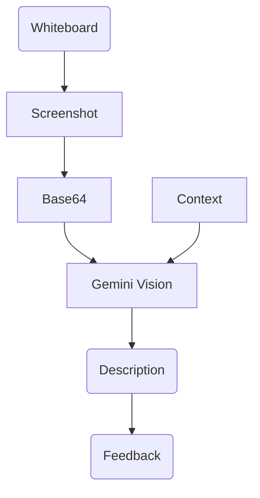

# Deep Analysis: Visionary Agent ("The Observer")

## 1. 🏛️ Agent Description
*   **Name**: Visionary Agent.
*   **Role**: The "Whiteboard" analyzer. It gives the AI the ability to "see" what the student is drawing.
*   **Philosophy**: "Visual Thinking." Computer Science is often diagrammatic (Trees, Graphs).

---

## 2. ⚙️ Technical Working Model

### Inputs
1.  **Canvas Image**: Base64 encoded PNG from `react-konva`.
2.  **Context**: "User is trying to draw a Max Heap."

### Core Logic (The Algorithms)
#### A. Visual Interpretation (V-LLM)
*   **Model**: Gemini 1.5 Flash / Gemini Pro Vision.
*   **Prompt**: "Analyze this sketch. The user is trying to draw {context}. Check for errors. Return JSON."

#### B. Geometric Heuristics (Fast Path)
*   **Library**: `OpenCV` (Optional).
*   **Logic**:
    *   Count distinct blobs (Nodes).
    *   Check connectivity (Edges).
    *   If `Nodes` != `Edges + 1`, it's not a Tree (it's a Graph or Disconnected).

### Outputs
*   **Feedback**: "You are missing a connection between Node 5 and 8."
*   **Validation**: `True/False`.

---

## 3. 🔄 Workflow Diagram

---

## 4. 🛠️ Implementation Specs

*   **API**: Google Generative AI (`gemini-1.5-flash`).
*   **Trigger**: Button press ("Check my Diagram") or Auto-Timer (every 30s of inactivity).
