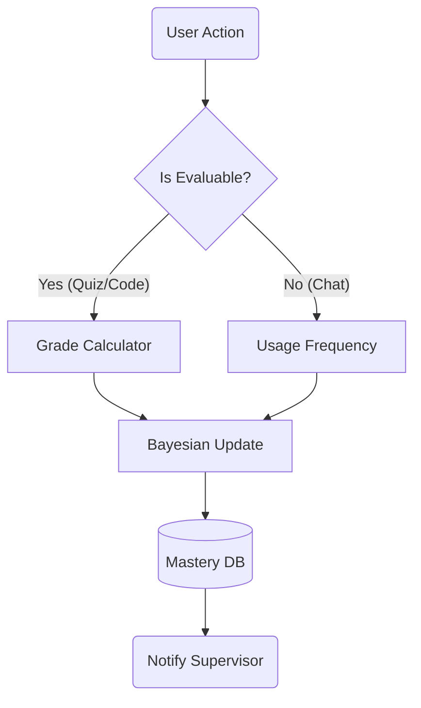

# Deep Analysis: Analyst Agent ("The Auditor")

## 1. 🏛️ Agent Description
*   **Name**: Analyst Agent.
*   **Role**: The background process that tracks "User Mastery". It never speaks directly to the user. It whispers to the Supervisor.
*   **Philosophy**: "Invisible Evaluation." Tests shouldn't feel like tests.

---

## 2. ⚙️ Technical Working Model

### Inputs
1.  **Interaction Log**: "User asked about BST -> Teacher explained -> User wrote code."
2.  **Code Execution Result**: "Syntax Error" or "Pass".

### Core Logic (The Algorithms)
#### A. Knowledge Tracing (Evolution)
*   **Level 1: Elo Rating (Fastest)**
    *   *Concept*: Treat "User vs Question" like a Chess Match.
    *   *Formula*: $ R_u = R_u + K(Actual - Expected) $
    *   *Pros*: Self-correcting. If you beat a "Hard" question, your mastery jumps up fast.
*   **Level 2: True BKT (Hidden Markov Model)**
    *   *Concept*: Models the probability of transitioning from "Unlearned" to "Learned".
    *   *Parameters*: $P(L_0)$ (Initial), $P(T)$ (Learn Rate), $P(G)$ (Guess), $P(S)$ (Slip).
    *   *Pros*: Distinguishes between "Guessing" and "Knowing". Very light on CPU.
*   **Level 3: LSTM/DKT (Deep Learning)**
    *   *Usage*: Only when dataset > 10k interactions.

#### B. Profile Management
*   **Database**: PostgreSQL / SQLite (Django ORM).
*   **Schema**:
    ```python
    class Mastery(models.Model):
        user = ForeignKey(User)
        topic = CharField() # e.g., "Recursion"
        score = FloatField() # 0.0 to 1.0
        confidence = FloatField()
    ```

### Outputs
*   **Mastery Vector**: `{'Recursion': 0.4, 'Loops': 0.9}`.
*   **Alerts**: "User is stuck on Recursion" (Triggers Remedial mode).

---

## 3. 🔄 Workflow Diagram



---

## 4. 🛠️ Implementation Specs

*   **Libraries**: `pandas` (Data manipulation), `scikit-learn` (Regression).
*   **Integration**: Asynchronous Task (Celery) or simple post-response hook.
