# Vaathiyar Adaptive AI Tutor
## New Architecture Project Report (Implementation-Based)

Date: March 14, 2026  
Project Type: Full-stack adaptive AI tutoring platform  
Scope Rule: This report documents only the implemented new architecture.

---

## 1. Executive Summary

Vaathiyar is an adaptive AI tutoring platform built with Django, DRF, Channels, and a multi-agent AI execution layer. The implemented architecture combines synchronous REST APIs and asynchronous WebSocket sessions to support guided learning, coding practice, assessment, emotional adaptation, and telemetry-based monitoring.

The runtime design centers on:

- A supervisor-driven agent routing model with fast keyword path, semantic cache, complexity scoring, and classifier-based intent selection.
- A stateful session orchestrator that injects student profile and phase context into the agent graph.
- Specialized subsystems for coding hints, emotion-aware intervention, and always-on telemetry forecasting.
- A persistent data layer for curriculum structure, mastery tracking, coding behavior, emotion events, and PBL sessions.

This report includes architecture, data flow, behavior flow, class design, and use-case diagrams in Mermaid form, directly aligned with implemented modules.

---

## 2. Problem and Solution Fit

### 2.1 Problem Addressed by the System

The implemented system targets practical tutoring needs in one platform:

- Personalized concept teaching and practice flow.
- Interactive coding support with progressive hints.
- Session-level adaptation based on student struggle and emotional signals.
- Continuous monitoring and feedback support for learning analytics.

### 2.2 Implemented Solution Strategy

The solution uses an integrated architecture with:

- API layer for account, content, AI, and session endpoints.
- Agent orchestration layer for intent routing and specialist handling.
- Session control layer for phase progression and context memory.
- Domain persistence layer for SIP mastery, coding/emotion logs, and PBL entities.

---

## 3. Technology Stack and Runtime Components

| Layer | Implemented Technology | Role |
|---|---|---|
| Web/API | Django + DRF | REST endpoints and auth-protected APIs |
| Realtime | Django Channels (ASGI) | WebSocket session interaction |
| Agent Workflow | LangGraph + custom agents | Supervisor and specialist execution graph |
| LLM Integration | LLM Factory abstraction | Provider-agnostic model access |
| Voice | STT/TTS services | Speech transcription and response audio |
| Persistence | Django ORM | Core, session, coding, emotion, PBL models |
| Caching | Semantic + multi-level cache manager | Latency and cost optimization |

---

## 4. System Context and Boundary

### Figure 1. System Context Diagram

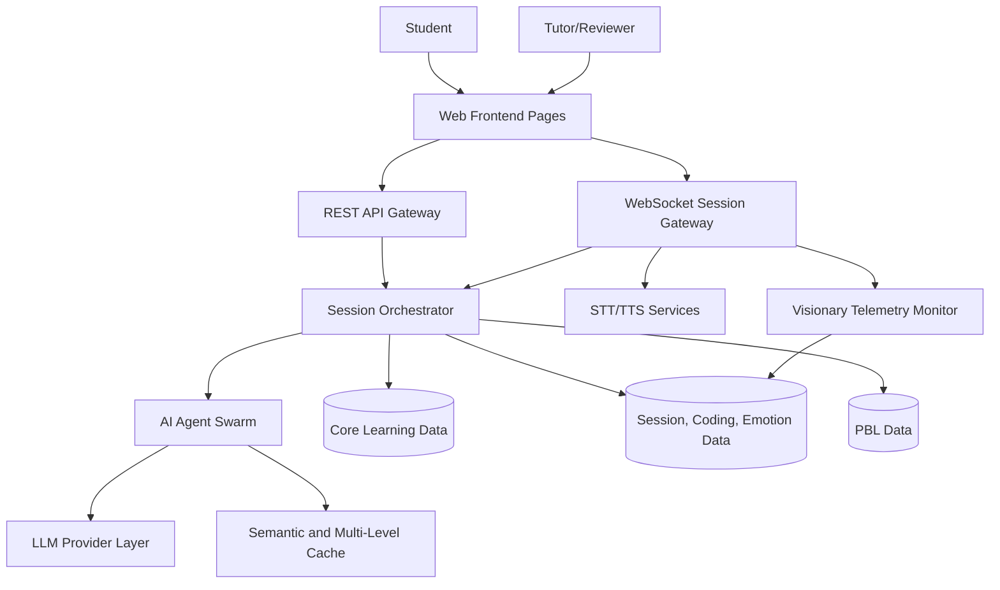

---

## 5. Layered Architecture

### Figure 2. Layered Architecture View

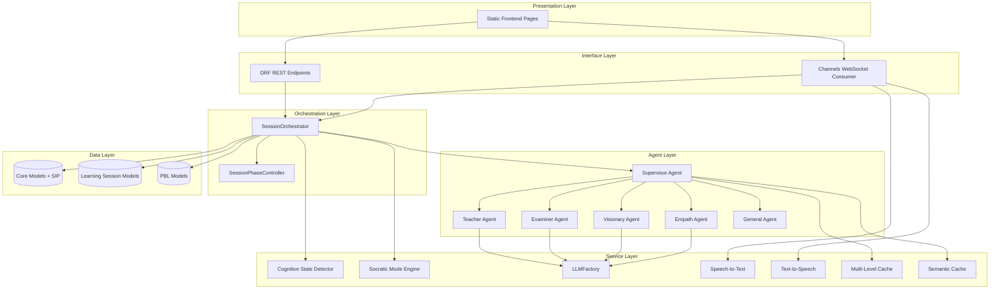

### Figure 3. Runtime Component Architecture

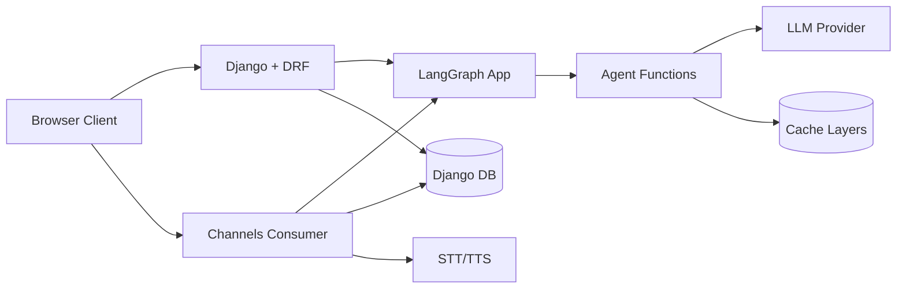

  ### Figure 3A. PBL Runtime Component Architecture

  ```mermaid
  flowchart LR
    Browser[Browser PBL Client]
    PBLAPI[PBL REST API]
    PBLWS[PBLConsumer WebSocket]
    PBLGraph[PBL LangGraph]
    Router[router_node]
    Hint[hint_node]
    Eval[evaluator_node]
    Guide[guide_node]
    Empath[empath_node]
    RunCode[run_code_node]
    TTS[tts_node]
    PBLDB[(PBLSession and PBLAttempt)]
    TELE[(TelemetryEvent)]
    LLM[LLM Provider]
    STT[STT Engine]

    Browser --> PBLAPI
    Browser --> PBLWS
    PBLAPI --> PBLDB
    PBLWS --> STT
    PBLWS --> PBLGraph
    PBLGraph --> Router
    Router --> Hint
    Router --> Eval
    Router --> Guide
    Router --> Empath
    Router --> RunCode
    Hint --> TTS
    Eval --> TTS
    Guide --> TTS
    Empath --> TTS
    Hint --> LLM
    Eval --> LLM
    Guide --> LLM
    Empath --> LLM
    PBLWS --> PBLDB
    PBLWS --> TELE
  ```

---

## 6. Implemented Agent Architecture

### 6.1 Supervisor Routing Strategy

Implemented in the supervisor pipeline:

- Phase override routing from session controller.
- Fast keyword routing for teach/code/test intents.
- Dialogue context resolution.
- Semantic cache lookup.
- Complexity analysis.
- SetFit classifier fallback for intent prediction.

### Figure 4. Supervisor Routing Decision Flow

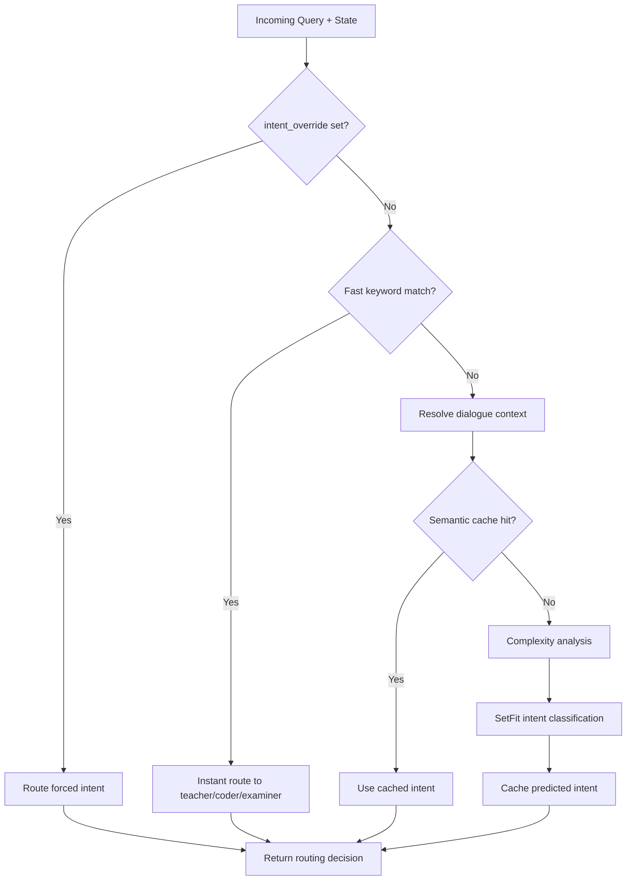

### 6.2 LangGraph Execution Topology

### Figure 5. Agent Graph Topology

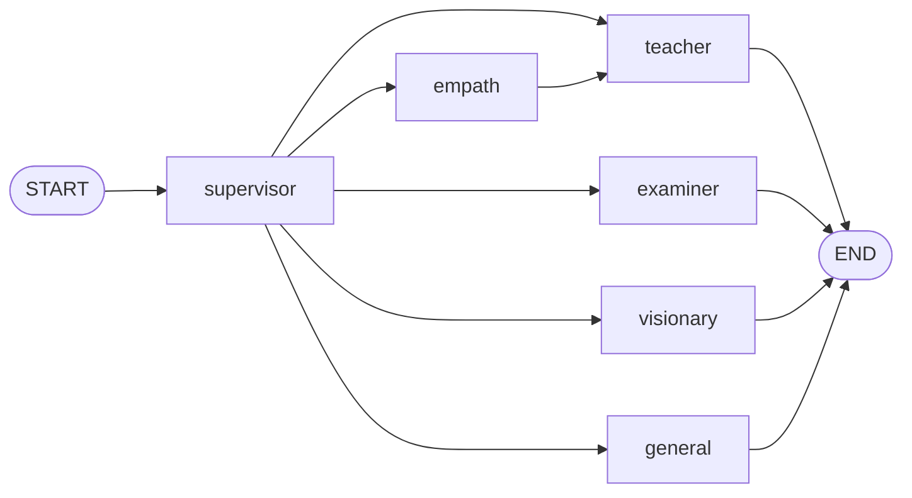

  ### 6.3 PBL Agent Graph Topology

  The PBL subsystem runs through a dedicated graph and is independent of the supervisor-first learning graph.

  ### Figure 5A. PBL Graph Topology

  ```mermaid
  flowchart LR
    START([START]) --> R[router]
    R --> H[hint]
    R --> E[evaluator]
    R --> RC[run_code]
    R --> G[guide]
    R --> EM[empath]

    H --> T[tts]
    E --> T
    G --> T
    EM --> T

    T --> END([END])
    RC --> END
  ```

---

## 7. Session and Interaction Flows

### Figure 6. Session Phase State Machine

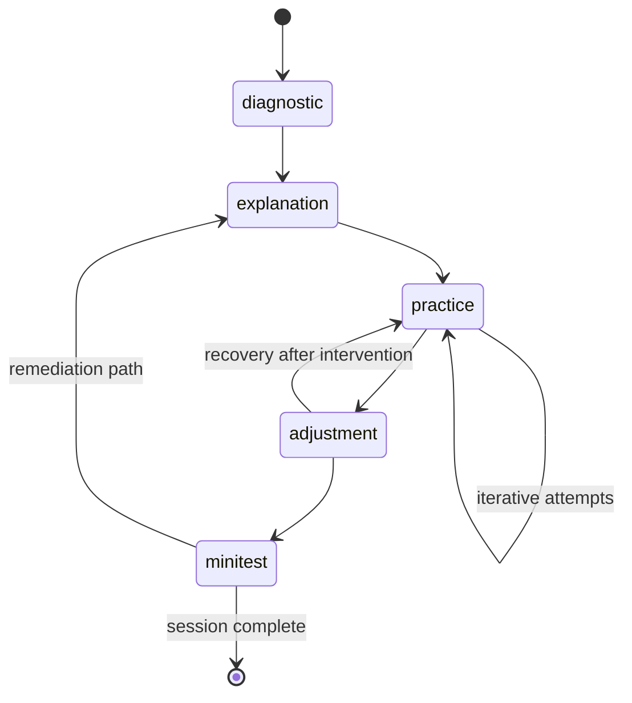

### Figure 7. Use Case Diagram (Primary)

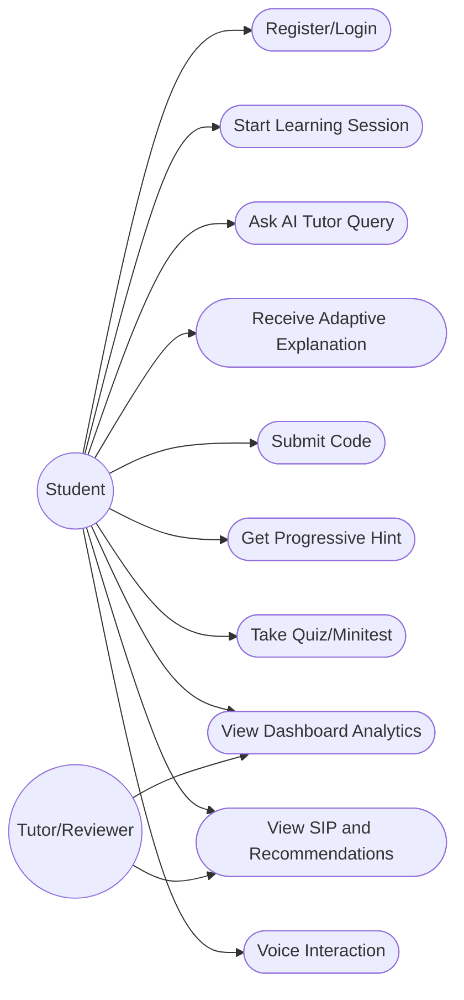

### Figure 8. Use Case Realization Map

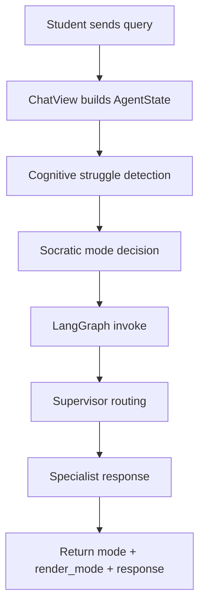

  ### Figure 8A. PBL Use Case Realization Map

  ```mermaid
  flowchart TB
    A[Student opens PBL session] --> B[POST /api/pbl/session/start]
    B --> C[PBLSession created with generated problem]
    C --> D[Connect ws/pbl session]
    D --> E[PBLConsumer builds PBLState]
    E --> F[PBL LangGraph router]
    F --> G[hint or evaluator or guide or empath or run_code]
    G --> H[Optional tts_node for spoken reply]
    H --> I[Return text and audio plus code_result or highlight]
  ```

---

## 8. Sequence Diagrams

### Figure 9. HTTP Chat Request Sequence

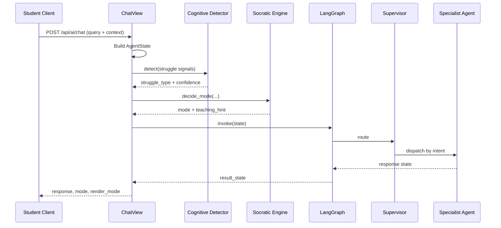

### Figure 10. WebSocket Learning Session Sequence

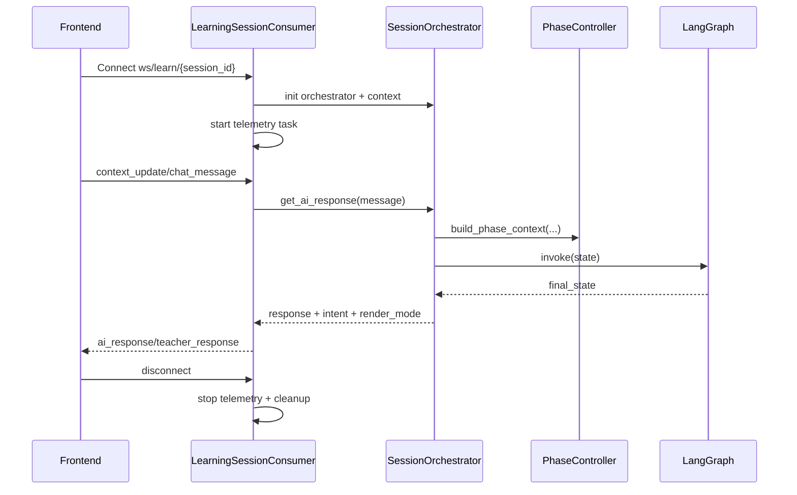

  ### Figure 10A. WebSocket PBL Session Sequence

  ```mermaid
  sequenceDiagram
    participant UI as PBL Frontend
    participant API as PBL REST API
    participant WS as PBLConsumer
    participant GR as PBLGraph
    participant DB as PBL Models

    UI->>API: POST /api/pbl/session/start/
    API->>DB: create PBLSession + problem context
    API-->>UI: session_id + problem

    UI->>WS: Connect ws/pbl/{session_id}
    WS->>DB: load session context
    WS-->>UI: state_sync

    UI->>WS: student_message or request_hint
    WS->>GR: invoke(PBLState)
    GR-->>WS: response_text and route outputs
    WS-->>UI: ai_response (and optional audio)

    UI->>WS: submit_solution
    WS->>GR: evaluator_node path
    GR-->>WS: code_result + feedback
    WS->>DB: save attempt and update mastery
    WS-->>UI: evaluation_result
  ```

### Figure 11. Voice Input/Output Sequence

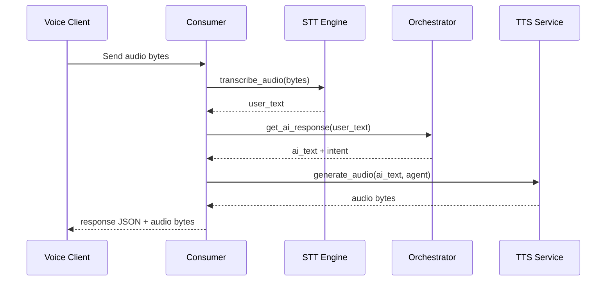

### Figure 12. Coding Submission Sequence

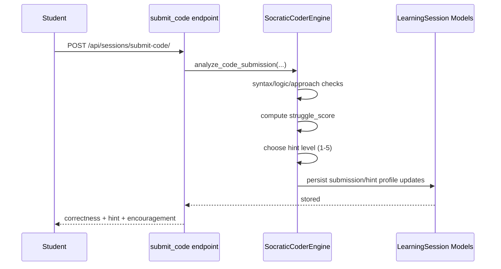

### Figure 13. Emotion Adaptation Sequence

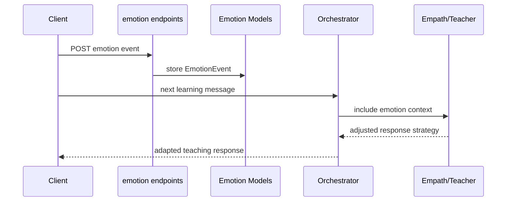

### Figure 14. Telemetry and Visionary Monitoring Sequence

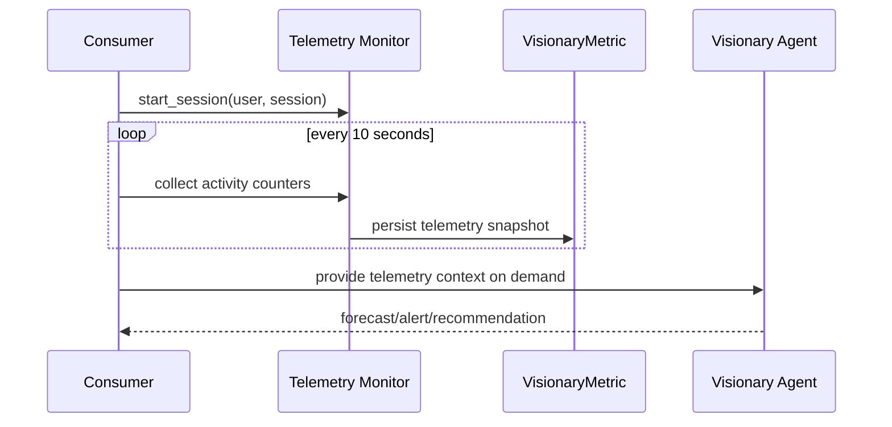

  ### Figure 14A. PBL Telemetry Sequence

  ```mermaid
  sequenceDiagram
    participant UI as PBL Frontend
    participant WS as PBLConsumer
    participant DB as TelemetryEvent

    UI->>WS: telemetry_event payload
    WS->>DB: store TelemetryEvent rows
    WS-->>UI: optional ack/state update

    UI->>WS: idle_status
    WS->>WS: update in-memory turn context
  ```

---

## 9. Data and Domain Modeling

### Figure 15. Core Learning Domain Class Diagram

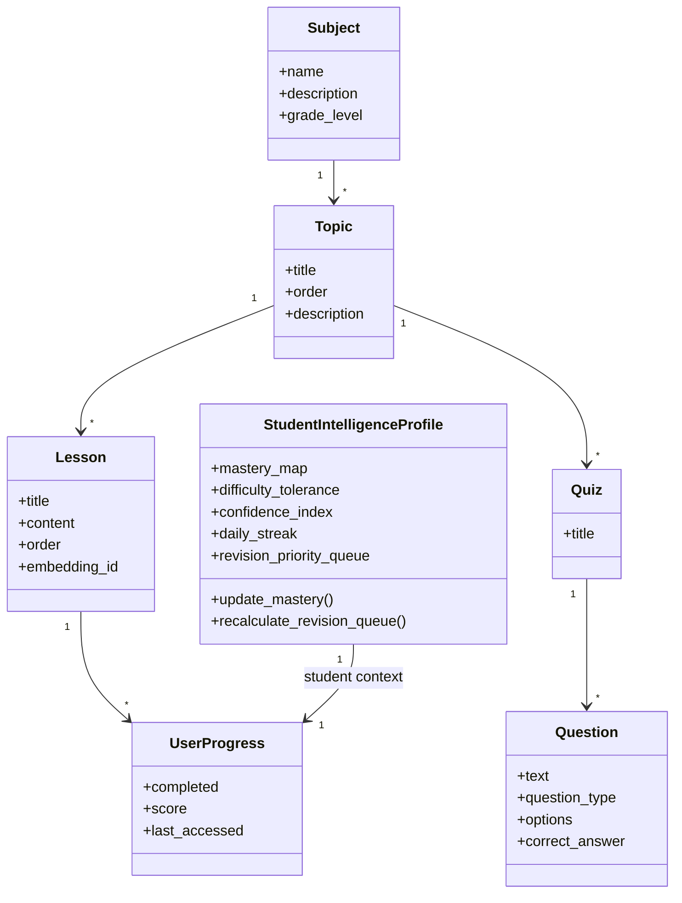

### Figure 16. AgentState Contract Diagram

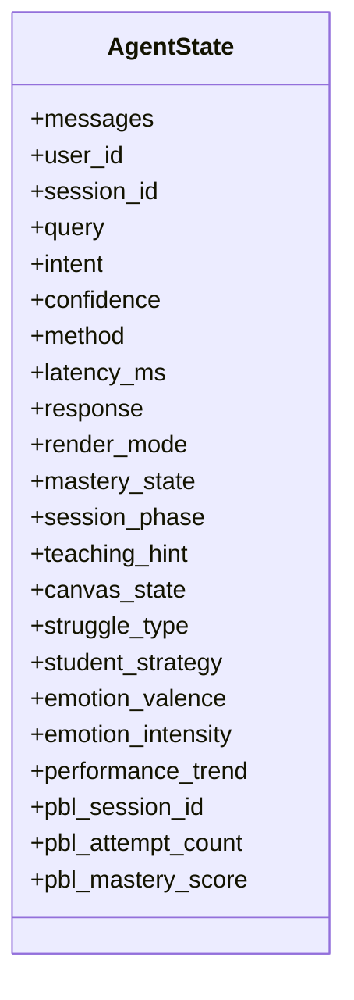

### Figure 17. Coding Domain Class Diagram

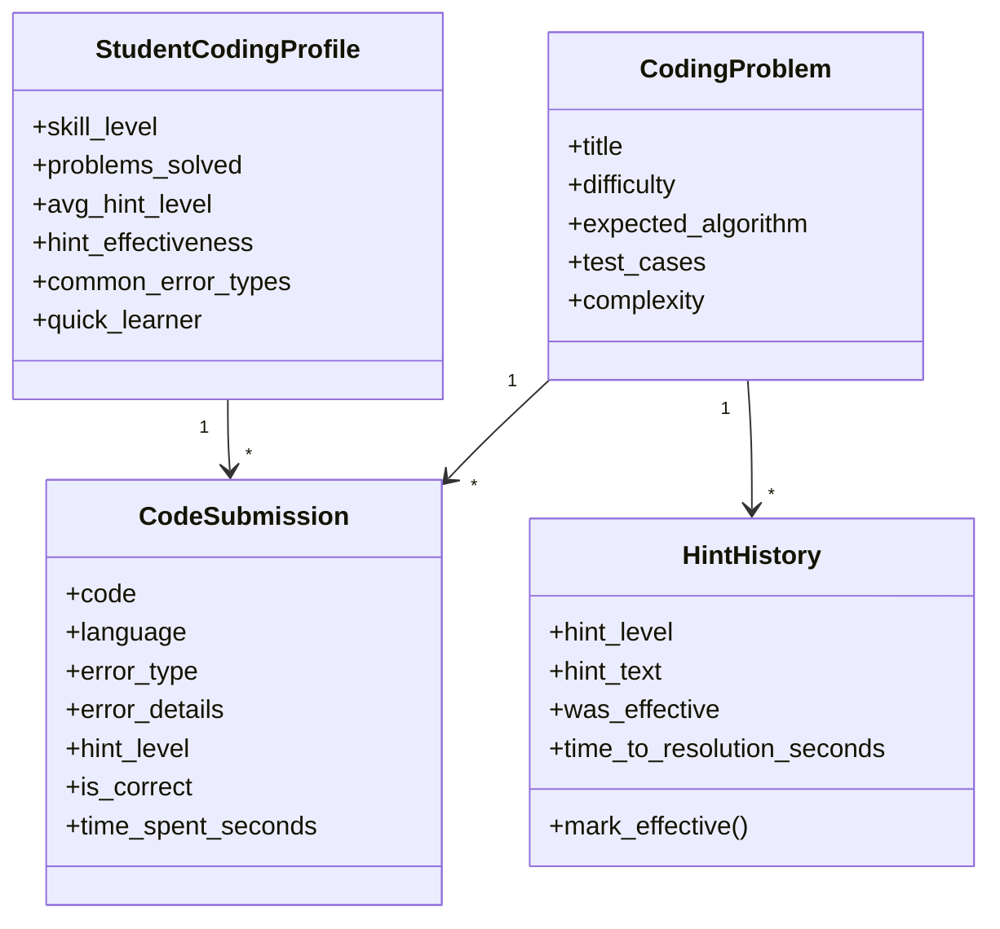

### Figure 18. Emotion Domain Class Diagram

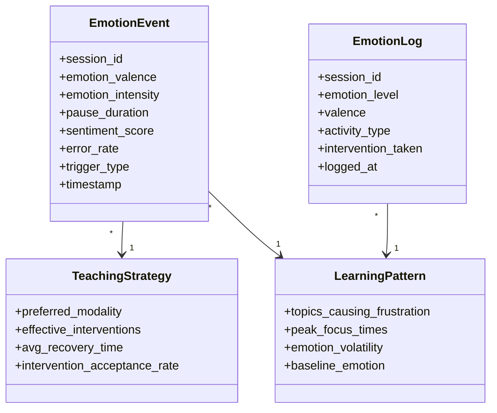

### Figure 19. PBL Domain Class Diagram

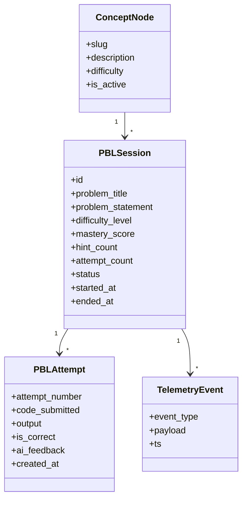

### Figure 20. ER-Style Data Relationship Diagram

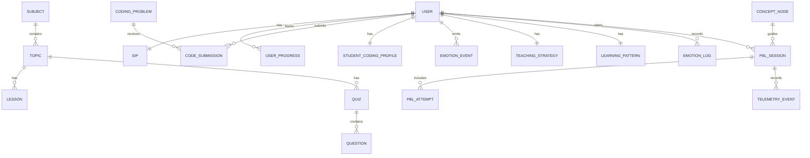

---

## 10. Data Flow Diagrams

### Figure 21. DFD Level 0 (Whole Platform)

```mermaid
flowchart LR
    Student[External Entity: Student]
    Tutor[External Entity: Tutor]

    P1((P1 Tutor Platform))

    D1[(D1 Core Learning Data)]
    D2[(D2 Session and Interaction Data)]
    D3[(D3 AI Runtime Context)]

    Student -->|queries, code, voice, telemetry| P1
    P1 -->|responses, hints, quizzes, audio| Student
    Tutor -->|analytics requests| P1
    P1 -->|dashboard insights| Tutor

    P1 --> D1
    P1 --> D2
    P1 --> D3
    D1 --> P1
    D2 --> P1
    D3 --> P1
```

### Figure 22. DFD Level 1 (Learning Session Subsystem)

```mermaid
flowchart TB
    U[Student]
    P1((1.1 Session Start/End))
    P2((1.2 Message Intake))
    P3((1.3 Orchestration + Phase Injection))
    P4((1.4 Agent Routing and Response))
    P5((1.5 Realtime Emit + TTS))

    D1[(Session Metadata)]
    D2[(SIP and Mastery)]
    D3[(Chat History/Context)]

    U --> P1
    U --> P2
    P1 --> D1
    P2 --> P3
    P3 --> D2
    P3 --> D3
    P3 --> P4
    P4 --> P5
    P5 --> U
```

### Figure 23. DFD Level 1 (Coding Tutor Subsystem)

```mermaid
flowchart TB
    S[Student]
    P1((2.1 Code Submission))
    P2((2.2 Code Analysis))
    P3((2.3 Hint Decision))
    P4((2.4 Profile Update))
    P5((2.5 Result Response))

    D1[(Coding Problems)]
    D2[(CodeSubmission History)]
    D3[(Hint History)]
    D4[(StudentCodingProfile)]

    S --> P1
    P1 --> P2
    D1 --> P2
    P2 --> P3
    P3 --> D3
    P3 --> P4
    P2 --> D2
    P4 --> D4
    P5 --> S
    P3 --> P5
```

  ### Figure 23A. DFD Level 1 (PBL Subsystem)

  ```mermaid
  flowchart TB
    S[Student]
    P1((3.1 PBL Session Start))
    P2((3.2 Problem Delivery))
    P3((3.3 Realtime Message Intake))
    P4((3.4 PBL Graph Routing))
    P5((3.5 Hint or Evaluation or Guide Response))
    P6((3.6 Attempt and Telemetry Persistence))

    D1[(ConceptNode)]
    D2[(PBLSession)]
    D3[(PBLAttempt)]
    D4[(TelemetryEvent)]

    S --> P1
    P1 --> D1
    P1 --> D2
    D2 --> P2
    P2 --> S
    S --> P3
    P3 --> P4
    P4 --> P5
    P5 --> S
    P5 --> P6
    P6 --> D3
    P6 --> D4
  ```

---

## 11. Supporting Architecture Diagrams

### Figure 24. Multi-Level Cache Strategy

```mermaid
flowchart LR
    Q[Query] --> L1[L1 Hot Query Cache]
    L1 -->|hit| R1[Return]
    L1 -->|miss| L2[L2 Semantic Cache]
    L2 -->|hit| R2[Return]
    L2 -->|miss| L3[L3 Generation Cache]
    L3 -->|hit| R3[Return]
    L3 -->|miss| L4[L4 Chunk/Memory Cache]
    L4 -->|miss| GEN[LLM Generation]
    GEN --> STORE[Store in cache layers]
    STORE --> OUT[Response]
```

### Figure 25. RAG-Enhanced Teaching Pipeline

```mermaid
flowchart TD
    Q[Student Query] --> C1[Topic and context resolution]
    C1 --> C2[Retrieve relevant chunks]
    C2 --> C3[Assemble grounded prompt]
    C3 --> C4[Generate teaching response]
    C4 --> C5[Extract concept for visuals]
    C5 --> C6[Return response + teaching script]
```

### Figure 26. Render Mode Selection Logic

```mermaid
flowchart TD
    A[Agent result] --> B{render_mode}
    B -->|default| D1[Standard text response]
    B -->|canvas| D2[Canvas drawing/explanation mode]
    B -->|tree| D3[Tree structure visualization mode]
    B -->|voice| D4[Voice-first response mode]
```

### Figure 27. Deployment View (Logical)

```mermaid
flowchart LR
    Client[Browser Client]
    ASGI[ASGI App: Django + Channels]
    API[REST Controllers]
    WS[WebSocket Consumer]
    SWARM[Agent Swarm + LangGraph]
    SERVICES[LLM/STT/TTS/Cache Services]
    DB[(Relational Database)]

    Client --> ASGI
    ASGI --> API
    ASGI --> WS
    API --> SWARM
    WS --> SWARM
    SWARM --> SERVICES
    API --> DB
    WS --> DB
```

  ### Figure 27A. Deployment View (PBL Path)

  ```mermaid
  flowchart LR
    Client[Browser PBL Page]
    ASGI[ASGI App]
    PBLREST[PBL REST Controllers]
    PBLWS[PBLConsumer]
    PBLGraph[PBL LangGraph]
    Providers[LLM and STT and TTS]
    PBLDB[(PBL Tables)]

    Client --> ASGI
    ASGI --> PBLREST
    ASGI --> PBLWS
    PBLWS --> PBLGraph
    PBLGraph --> Providers
    PBLREST --> PBLDB
    PBLWS --> PBLDB
  ```

---

## 12. Implemented Techniques and Strategies

| Technique | What it does | Architectural location |
|---|---|---|
| Fast-path intent routing | Immediate route for explicit teach/code/test queries | supervisor logic |
| Classifier-based fallback routing | Predicts intent when no fast-path hit | supervisor classifier |
| Semantic and multi-level caching | Reduces repeated compute and latency | supervisor + cache manager |
| Session phase control | Injects phase-aware guidance into agent state | phase controller + orchestrator |
| Cognitive struggle detection | Detects student difficulty patterns from context | chat endpoint pre-processing |
| Socratic mode policy | Selects mode such as nudge/deep guidance/reflection | socratic engine before graph invoke |
| Elo-style mastery tracking | Updates per-topic mastery and revision queue | SIP model methods |
| Progressive coding hints | Escalating hint levels 1 to 5 based on struggle | coder subsystem |
| Emotion-aware adaptation | Logs and uses affective signals for intervention | emotion models + empath behavior |
| Continuous telemetry monitoring | Periodic activity snapshots for insight and alerts | WebSocket telemetry loop |
| PBL graph routing | Routes each turn to hint/evaluator/guide/empath/run_code paths | ai_engine.pbl.pbl_graph |
| PBL code execution and evaluation | Runs learner code safely and returns Socratic correctness feedback | evaluator_node + run_code_node |
| PBL multimodal guidance | Uses canvas context and optional vision inference for guided support | guide_node + PBLConsumer |

---

## 13. API Surface (Functional Grouping)

### 13.1 Top-Level Route Groups

- /api/users/
- /api/core/
- /api/ai/
- /api/sessions/
- /api/pbl/

### 13.2 AI Routes

- POST /api/ai/chat/
- GET /api/ai/stats/pbl-runtime/
- POST /api/ai/tts/generate/
- GET /api/ai/tts/speakers/
- POST /api/ai/stt/transcribe/
- GET /api/ai/recommendations/
- GET /api/ai/sip/

### 13.3 Session Routes

- POST /api/sessions/start/
- POST /api/sessions/{session_id}/end/
- POST /api/sessions/coding/execute/
- POST /api/sessions/coding/hint/
- POST /api/sessions/submit-code/
- GET /api/sessions/coding-profile/
- POST /api/sessions/emotion-log/
- GET /api/sessions/teaching-strategy/
- GET /api/sessions/emotion-analytics/
- GET /api/sessions/stats/today/
- GET /api/sessions/stats/weekly/
- GET /api/sessions/stats/overall/
- GET /api/sessions/recent/
- GET /api/sessions/active/
- GET /api/sessions/topics/

### 13.4 Realtime Route

- ws/learn/{session_id}/
- ws/pbl/{session_id}/

### 13.5 PBL Routes

- POST /api/pbl/session/start/
- GET /api/pbl/session/{session_id}/
- GET /api/pbl/graph/{subject_id}/

---

## 14. Architecture Reality Notes (Implementation-Constrained)

This report intentionally tracks real implemented behavior and known runtime wiring:

- The graph currently routes coder intent to teacher node in the compiled workflow mapping.
- Empath behavior routes into teacher response path rather than direct student response path.
- Session telemetry is maintained in-memory for active monitors in current implementation.
- PBL routing is handled by a separate graph with router/hint/evaluator/guide/empath/run_code/tts nodes.
- In PBL flow, run_code returns execution output directly and bypasses tts_node.

These points are architecture facts in the present codebase and are included to avoid overclaiming.

---

## 15. Quality, Maintainability, and Reviewer Perspective

### 15.1 Strengths

- Clear modular split: endpoint layer, orchestrator layer, agent layer, data layer.
- Typed shared state contract for cross-agent communication.
- Separation of synchronous API and asynchronous realtime channels.
- Comprehensive domain persistence for adaptive behavior and analytics.

### 15.2 Risks / Constraints

- Some cross-module field naming inconsistencies can affect endpoint-model compatibility if not normalized.
- In-memory registries for active sessions/telemetry may need distributed backing for horizontal scaling.
- Complex adaptive behavior depends on careful state validity across many optional fields.

---

## 16. Conclusion

The implemented new architecture delivers a multi-layer adaptive tutoring system with strong integration between AI routing, session orchestration, coding assistance, emotional adaptation, and telemetry-aware monitoring. The design is technically rich while remaining modular enough for staged hardening and scaling.

From an academic review perspective, the project demonstrates:

- Applied software architecture using layered and agentic patterns.
- Real-time system design through WebSocket orchestration.
- Data-informed adaptation using mastery, struggle, emotion, and telemetry signals.
- End-to-end engineering coherence from APIs to persistent learning intelligence.

---

## 17. Evidence Anchor Map (Files)

- backend/config/urls.py
- backend/ai_engine/urls.py
- backend/learning_session/urls.py
- backend/learning_session/routing.py
- backend/ai_engine/views.py
- backend/learning_session/views.py
- backend/learning_session/consumers.py
- backend/learning_session/orchestrator.py
- backend/ai_engine/graph.py
- backend/ai_engine/agents.py
- backend/ai_engine/state.py
- backend/core/models.py
- backend/learning_session/models.py
- backend/ai_engine/pbl/models.py
- backend/ai_engine/pbl/urls.py
- backend/ai_engine/pbl/routing.py
- backend/ai_engine/pbl/consumers.py
- backend/ai_engine/pbl/pbl_graph.py
- backend/ai_engine/pbl/problem_generator.py
- backend/ai_engine/pbl/concept_graph.py

