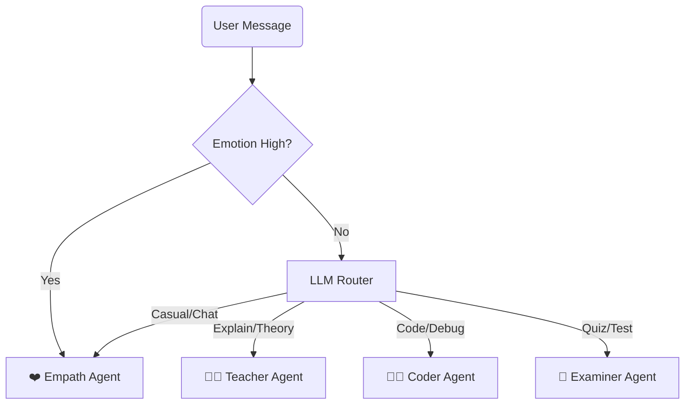

# Deep Analysis: Supervisor Agent ("The Principal")

## 1. 🏛️ Agent Description
*   **Name**: Supervisor Agent (The Router).
*   **Role**: The central orchestrator. It does not "think" about content; it "thinks" about delegation. It prevents the "One LLM does all" bottleneck by classifying intent and routing traffic.
*   **Philosophy**: "Delegation over Generalization."

---

## 2. ⚙️ Technical Working Model

### Inputs (The Sensors)
1.  **User Message**: "Can you debug this python code?"
2.  **Agent State**:
    *   `Emotion`: "Frustration" (High priority override).
    *   `Chat History`: Previous context.

### Core Logic (The Algorithms)
#### A. Emergency Override (Rule-Based)
*   **Logic**: If `Emotion == "Anger"` or `Emotion == "Fear"`.
*   **Action**: **IMMEDIATE ROUTE** to `Empath Agent`. Skip LLM.
*   **Design Rationale**: "EQ First". If a student is frustrated, they are cognitively blocked. Continuing to teach (Logic) will fail. We must de-escalate (Emotion) before we can educate.

#### B. Intent Classification via LLM
*   **Model**: Llama 3.2 (Local) or Gemini Flash (Cloud).
*   **Prompt Strategy**: Zero-Shot Classification.
    > "Classify the user intent into: [TEACHING, CODING, EXAM, CASUAL]. Return ONE word."
*   **Temperature**: `0.0` (Strict Determinism).

### Outputs (The Directives)
*   **Next Node**: `teacher`, `coder`, `examiner`, `empath`.

### 5. Handling Mid-Session Frustration (The Interruption Logic)
*   **The Loop**: The Supervisor is the **Entry Point** for *every single message*, not just the first one.
*   **Stickiness**: Normally, if the user is Coding, the Supervisor routes back to `Coder`.
*   **The Interrupt**: 
    > IF `Emotion == Frustration` AND `Current_Agent == Coder`:
    > **ACTION**: Break Stickiness -> Route to `Empath`.
    > **Goal**: Pause the coding task, calm the user, then resume.

---

## 3. 🔄 Workflow Diagram

---

## 4. 🛠️ Implementation Specs

*   **Framework**: `langgraph` (StateGraph).
*   **Latency Goal**: < 400ms (Using small local model or cached routing).

### 5. StateGraph Mechanics (The "Game Board")
*   **The State**: `AgentState` acts as the shared memory.
*   **The Node**: The `SupervisorAgent.invoke()` method is a **Node** in the graph.
*   **The Edge**:
    *   The Supervisor returns `{"next_step": "coder"}`.
    *   The `StateGraph` uses a **Conditional Edge** to read this key.
    *   Logic: `IF next_step == 'coder' THEN GOTO CoderNode`.
*   **The Flow**: Start -> Supervisor -> (Edge) -> Agent -> End.
